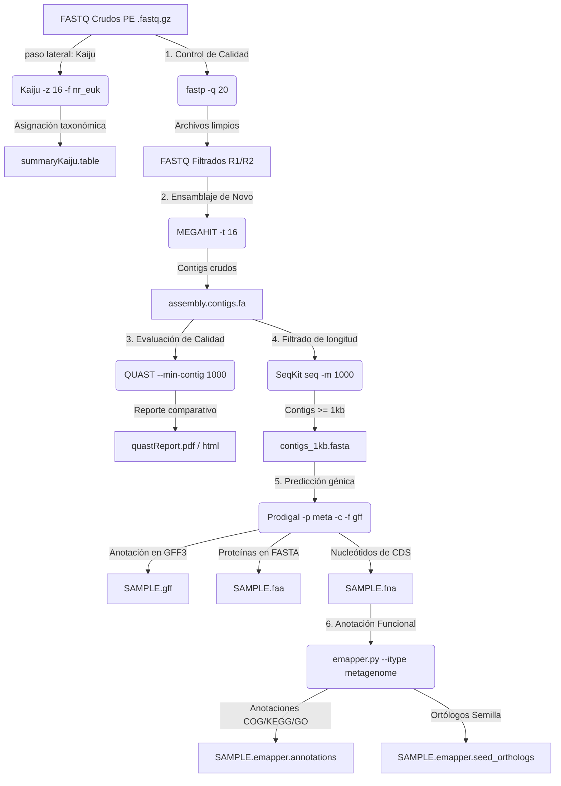

# 🧬 Bitácora de procesamiento de datos metagenómicos antárticos

> **Proyecto:** Análisis metagenómico de muestras antárticas (2019)  
> **Etapa 1:** Asignación taxonómica directa (`Kaiju`) *[paso lateral]*  
> **Etapa 2:** Control de calidad, limpieza y recortado de adaptadores (`fastp`)  
> **Etapa 3:** Ensamblaje metagenómico *de novo* (`MEGAHIT`)  
> **Etapa 4:** Evaluación de calidad de ensamblajes (`QUAST`)  
> **Etapa 5:** Filtrado de contigs (`SeqKit`) y predicción génica (`Prodigal`)  
> **Etapa 6:** Anotación funcional genómica (`EggNOG-mapper`)  
> **Fecha de actualización:** Octubre de 2026  

---

## 📋 Tabla de contenidos

- [0. Herramientas auxiliares para procesos en segundo plano (`screen` y `nohup`)](#0-herramientas-auxiliares-para-procesos-en-segundo-plano-screen-y-nohup)
- [1. Descripción del dataset crudo](#1-descripción-del-dataset-crudo)
- [2. Asignación taxonómica directa desde lecturas crudas (`Kaiju`) [paso lateral]](#2-asignación-taxonómica-directa-desde-lecturas-crudas-kaiju-paso-lateral)
  - [2.1. Comando de muestra y fundamentación parámetro por parámetro](#21-comando-de-muestra-y-fundamentación-parámetro-por-parámetro)
  - [2.2. Mapeo general de muestras pareadas](#22-mapeo-general-de-muestras-pareadas)
  - [2.3. Resumen de abundancias taxonómicas (`kaiju2table`)](#23-resumen-de-abundancias-taxonómicas-kaiju2table)
  - [2.4. Tiempo medio de procesamiento](#24-tiempo-medio-de-procesamiento)
- [3. Control de calidad y preprocesamiento (`fastp`)](#3-control-de-calidad-y-preprocesamiento-fastp)
  - [3.1. Comando de muestra y fundamentación parámetro por parámetro](#31-comando-de-muestra-y-fundamentación-parámetro-por-parámetro)
  - [3.2. Mapeo general de muestras pareadas](#32-mapeo-general-de-muestras-pareadas)
  - [3.3. Archivos de salida obtenidos tras `fastp`](#33-archivos-salida-obtenidos-tras-fastp)
  - [3.4. Guía de interpretación del informe HTML](#34-guía-de-interpretación-del-informe-html)
  - [3.5. Tiempo medio de procesamiento](#35-tiempo-medio-de-procesamiento)
- [4. Ensamblaje metagenómico *de novo* (`MEGAHIT`)](#4-ensamblaje-metagenómico-de-novo-megahit)
  - [4.1. Comando ejecutado y desglose de parámetros](#41-comando-ejecutado-y-desglose-de-parámetros)
  - [4.2. Mapeo general del lote de muestras para MEGAHIT](#42-mapeo-general-del-lote-de-muestras-para-megahit)
  - [4.3. Estructura de salida y resultados de MEGAHIT](#43-estructura-de-salida-y-resultados-de-megahit)
  - [4.4. Tiempo medio de procesamiento](#44-tiempo-medio-de-procesamiento)
- [5. Evaluación de calidad del ensamblaje (`QUAST`)](#5-evaluación-de-calidad-del-ensamblaje-quast)
  - [5.1. Comando ejecutado y desglose de parámetros](#51-comando-ejecutado-y-desglose-de-parámetros)
  - [5.2. Mapeo general del lote de muestras para QUAST](#52-mapeo-general-del-lote-de-muestras-para-quast)
  - [5.3. Estructura de resultados y archivos de salida de QUAST](#53-estructura-de-resultados-y-archivos-de-salida-de-quast)
  - [5.4. Resultados reales del reporte de QUAST (contigs ≥ 1000 bp)](#54-resultados-reales-del-reporte-quast-contigs--1000-bp)
  - [5.5. Guía de interpretación de métricas bioinformáticas](#55-guía-de-interpretación-de-métricas-bioinformáticas)
  - [5.6. Tiempo medio de procesamiento](#56-tiempo-medio-de-procesamiento)
- [6. Filtrado de contigs (`SeqKit`) y predicción génica (`Prodigal`)](#6-filtrado-de-contigs-seqkit-y-predicción-génica-prodigal)
  - [6.1. Filtrado por longitud mínima con `SeqKit`](#61-filtrado-por-longitud-mínima-con-seqkit)
  - [6.2. Predicción de CDS y proteínas con `Prodigal`](#62-predicción-de-cds-y-proteínas-con-prodigal)
  - [6.3. Mapeo general del lote y estructura de salida](#63-mapeo-general-del-lote-y-estructura-de-salida)
  - [6.4. Tiempo medio de procesamiento](#64-tiempo-medio-de-procesamiento)
- [7. Anotación funcional genómica (`EggNOG-mapper`)](#7-anotación-funcional-genómica-eggnog-mapper)
  - [7.1. Comando ejecutado y desglose de parámetros](#71-comando-ejecutado-y-desglose-de-parámetros)
  - [7.2. Mapeo general del lote de muestras para EggNOG-mapper](#72-mapeo-general-del-lote-de-muestras-para-eggnog-mapper)
  - [7.3. Estructura de resultados y archivos de salida de EggNOG](#73-estructura-de-resultados-y-archivos-de-salida-de-eggnog)
  - [7.4. Tiempo medio de procesamiento](#74-tiempo-medio-de-procesamiento)
- [8. Automatización del pipeline completo en lote (Bash)](#8-automatización-del-pipeline-completo-en-lote-bash)
- [9. Diagrama de flujo integrado del pipeline](#9-diagrama-de-flujo-integrado-del-pipeline)
- [10. Referencias](#10-referencias)

---

## 0. 🛠️ Herramientas auxiliares para procesos en segundo plano (`screen` y `nohup`)

En entornos de computación de alto rendimiento (HPC) o servidores remotos vía SSH, los procesos bioinformáticos de larga duración (como el ensamblaje o la clasificación taxonómica) requieren mecanismos de persistencia para evitar interrupciones por caídas de red o cierre de terminales. Aunque hay más herramientas disponibles, se emplearon estas dos:

### 0.1. GNU Screen (`screen`)

`screen` es un multiplexor de terminales que crea sesiones independientes del proceso de shell activo.

#### Desglose de comandos y opciones principales:
* **`screen -S <nombre_sesion>`**: Crea una nueva sesión de terminal con un identificador personalizado (ej. `screen -S megahit_run`).
* **`screen -ls`**: Lista todas las sesiones activas en el servidor con su estado (`Attached` o `Detached`).
* **`screen -r <nombre_o_id>`**: Reanuda (*reattach*) una sesión que se encuentra en segundo plano.
* **`screen -d <nombre_o_id>`**: Desconecta (*detach*) una sesión activa desde otra terminal.

#### Combinaciones de teclas clave (dentro de una sesión Screen):
* **`Ctrl + A` seguido de `D`**: Desconecta la sesión actual y regresa a la shell principal manteniendo los comandos ejecutándose en segundo plano.
* **`Ctrl + A` seguido de `K`**: Cierra (*kill*) la sesión actual.
* **`exit`**: Finaliza la sesión limpiamente tras completar las tareas.

---

### 0.2. Comando `nohup` (*No Hang Up*)

`nohup` redirige la señal `SIGHUP` (emitida al cerrar la sesión SSH) para que los procesos continúen ejecutándose en el servidor.

#### Uso y parámetros:
```bash
nohup <COMANDO_BIOINFORMÁTICO> > salida.log 2>&1 &
```
* **`nohup`**: Evita la cancelación del proceso si se pierde la conexión SSH.
* **`> salida.log 2>&1`**: Redirige la salida estándar (`STDOUT`) y los errores (`STDERR`) a un archivo de registro (por defecto `./nohup.out`).
* **`&`**: Envía el comando al segundo plano (*background*), devolviendo el control de la terminal inmediatamente.

---

## 1. 📂 Descripción del dataset crudo

El dataset de entrada consiste en 5 parejas de archivos FASTQ comprimidos (`.fastq.gz`) obtenidos mediante secuenciación de lecturas pareadas (*paired-end*, PE) de metagenomas ambientales antárticos (2019).

```text
metagenomas_antarida_2019/
├── C4_230_347_S89_L002_R1_001.fastq.gz   (17,020,773 KB ~ 17.02 GB)
├── C4_230_347_S89_L002_R2_001.fastq.gz   (17,922,220 KB ~ 17.92 GB)
├── D_242_335_S88_L002_R1_001.fastq.gz    ( 3,663,943 KB ~  3.66 GB)
├── D_242_335_S88_L002_R2_001.fastq.gz    ( 3,842,488 KB ~  3.84 GB)
├── E4_254_323_S87_L002_R1_001.fastq.gz   ( 7,921,805 KB ~  7.92 GB)
├── E4_254_323_S87_L002_R2_001.fastq.gz   ( 8,249,762 KB ~  8.25 GB)
├── EC_266_311_S86_L002_R1_001.fastq.gz  ( 7,876,211 KB ~  7.88 GB)
├── EC_266_311_S86_L002_R2_001.fastq.gz  ( 8,246,128 KB ~  8.25 GB)
├── H_278_299_S85_L002_R1_001.fastq.gz   ( 6,824,312 KB ~  6.82 GB)
└── H_278_299_S85_L002_R2_001.fastq.gz   ( 7,149,960 KB ~  7.15 GB)
```
* **Volumen Total Crudo:** **88,717,602 KB (~88.72 GB)**.

---

## 2. 🔀 Asignación taxonómica directa desde lecturas crudas (`Kaiju`) [paso lateral]

Como análisis complementario e independiente del ensamblaje, se realizó la clasificación taxonómica de las lecturas crudas utilizando **Kaiju**. Al traducir las secuencias de ADN a sus 6 marcos de lectura y alinearlas contra una base de datos proteica de referencia (`nr_euk`), Kaiju identifica miembros de la comunidad microbiana (incluyendo organismos de baja abundancia o divergentes).

### 2.1. Comando de muestra y fundamentación parámetro por parámetro

```bash
./kaiju/bin/kaiju   -t /media/hdd1/kaijudb/nodes.dmp   -f /media/hdd1/kaijudb/kaiju_db_nr_euk.fmi   -i ./metagenomas_antarida_2019/D_242_335_S88_L002_R1_001.fastq.gz   -j ./metagenomas_antarida_2019/D_242_335_S88_L002_R2_001.fastq.gz   -o ./taxMetagenomes/D_242-kaiju.out   -z 16
```

#### 🛠️ Desglose de parámetros:

| Parámetro | Nombre largo | Descripción / fundamentación bioinformática |
| :--- | :--- | :--- |
| `-t` | `--taxonomy` | Ruta al archivo jerárquico de nodos de la taxonomía NCBI (`nodes.dmp`). |
| `-f` | `--fmi` | Ruta al índice FM de la base de datos proteica de referencia (`kaiju_db_nr_euk.fmi`). Incluye referencias de bacterias, arqueas, virus, hongos y microeucariotas. |
| `-i` | `--in1` | Ruta al archivo FASTQ de entrada para **Read 1 (R1)**. |
| `-j` | `--in2` | Ruta al archivo FASTQ de entrada para **Read 2 (R2)**. |
| `-o` | `--output` | Archivo de salida con la clasificación por lectura (`.out`). |
| `-z 16` | `--threads` | Asigna **16 hilos CPU** para acelerar el alineamiento multihilo. |

---

### 2.2. Mapeo general de muestras pareadas

| ID de muestra | Archivo de entrada R1 (`-i`) | Archivo de entrada R2 (`-j`) | Archivo de salida (`-o`) |
| :---: | :--- | :--- | :--- |
| **C4_230** | `.../C4_230_..._R1_001.fastq.gz` | `.../C4_230_..._R2_001.fastq.gz` | `./taxMetagenomes/C4_230-kaiju.out` |
| **D_242** | `.../D_242_..._R1_001.fastq.gz` | `.../D_242_..._R2_001.fastq.gz` | `./taxMetagenomes/D_242-kaiju.out` |
| **E4_254** | `.../E4_254_..._R1_001.fastq.gz` | `.../E4_254_..._R2_001.fastq.gz` | `./taxMetagenomes/E4_254-kaiju.out` |
| **EC_266** | `.../EC_266_..._R1_001.fastq.gz` | `.../EC_266_..._R2_001.fastq.gz` | `./taxMetagenomes/EC_266-kaiju.out` |
| **H_278** | `.../H_278_..._R1_001.fastq.gz` | `.../H_278_..._R2_001.fastq.gz` | `./taxMetagenomes/H_278-kaiju.out` |

---

### 2.3. Resumen de abundancias taxonómicas (`kaiju2table`)

Para resumir la clasificación individual de cada lectura en una matriz de abundancias tabulada:

```bash
../kaiju/bin/kaiju2table   -t /media/hdd1/kaijudb/nodes.dmp   -n /media/hdd1/kaijudb/names.dmp   -o summaryKaiju.table   -r genus   -l superkingdom,phylum,class,order,family,genus   *.out
```

* **`-n names.dmp`**: Mapeo de TaxIDs de NCBI a nombres científicos.
* **`-r genus`**: Resume el conteo a nivel de **Género**.
* **`-l ...`**: Exporta la jerarquía taxonómica completa.
* **`summaryKaiju.table`**: Matriz de abundancia relativa y conteos lista para análisis downstream en R/Python.

---

### 2.4. Tiempo medio de procesamiento (Kaiju)

* **Rendimiento por muestra:** ~20 a 60 minutos por muestra según el tamaño de la librería.
* **Tiempo total estimado (lote de 5 muestras):** **~3.5 a 5.5 horas** con 16 hilos en la base `nr_euk`. `kaiju2table` toma **1 a 2 minutos**.

---

## 3. ⚙️ Control de calidad y preprocesamiento (`fastp`)

Se empleó **`fastp`** (v1.0 / v0.23+) para realizar control de calidad, remoción de adaptadores y filtrado por calidad Phred en una sola pasada.

### 3.1. Comando de muestra y fundamentación parámetro por parámetro

```bash
../fastp   -i ../metagenomas_antarida_2019/C4_230_347_S89_L002_R1_001.fastq.gz   -I ../metagenomas_antarida_2019/C4_230_347_S89_L002_R2_001.fastq.gz   -o C_230_R1.fastq.gz   -O C_230_R2.fastq.gz   -q 20   -j C_230.json   -h C_230.html
```

#### 🛠️ Desglose de parámetros:

| Parámetro | Nombre largo | Descripción / fundamentación bioinformática |
| :--- | :--- | :--- |
| `-i` / `-I` | `--in1` / `--in2` | Archivos FASTQ de entrada pareados comprimidos (`.fastq.gz`). |
| `-o` / `-O` | `--out1` / `--out2` | Archivos FASTQ de salida limpios (comprimidos en `.gz`). |
| `-q 20` | `--qualified_quality_phred` | Calidad Phred mínima para base cualificada (**Q20 = 99% precisión**). |
| `-j` / `-h` | `--json` / `--html` | Reportes de métricas cuantitativas (JSON) y gráficos interactivos (HTML). |

---

### 3.2. Mapeo general de muestras pareadas

| ID de muestra | Entrada R1 (`-i`) | Entrada R2 (`-I`) | Salida R1 (`-o`) | Salida R2 (`-O`) | Reporte JSON (`-j`) | Reporte HTML (`-h`) |
| :---: | :--- | :--- | :--- | :--- | :---: | :---: |
| **C4_230** | `.../C4_230_..._R1_001.fastq.gz` | `.../C4_230_..._R2_001.fastq.gz` | `C_230_R1.fastq.gz` | `C_230_R2.fastq.gz` | `C_230.json` | `C_230.html` |
| **D_242** | `.../D_242_..._R1_001.fastq.gz` | `.../D_242_..._R2_001.fastq.gz` | `D_242_R1.fastq.gz` | `D_242_R2.fastq.gz` | `D_242.json` | `D_242.html` |
| **E4_254** | `.../E4_254_..._R1_001.fastq.gz` | `.../E4_254_..._R2_001.fastq.gz` | `E4_254_R1.fastq.gz` | `E4_254_R2.fastq.gz` | `E4_254.json` | `E4_254.html` |
| **EC_266** | `.../EC_266_..._R1_001.fastq.gz` | `.../EC_266_..._R2_001.fastq.gz` | `EC_266_R1.fastq.gz` | `EC_266_R2.fastq.gz` | `EC_266.json` | `EC_266.html` |
| **H_278** | `.../H_278_..._R1_001.fastq.gz` | `.../H_278_..._R2_001.fastq.gz` | `H_278_R1.fastq.gz` | `H_278_R2.fastq.gz` | `H_278.json` | `H_278.html` |

---

### 3.3. Archivos de salida obtenidos tras `fastp`

```text
clean_fastq/
├── C_230_R1.fastq.gz   ├── C_230.json   ├── C_230.html
├── C_230_R2.fastq.gz
├── D_242_R1.fastq.gz   ├── D_242.json   ├── D_242.html
├── D_242_R2.fastq.gz
├── E4_254_R1.fastq.gz  ├── E4_254.json  ├── E4_254.html
├── E4_254_R2.fastq.gz
├── EC_266_R1.fastq.gz  ├── EC_266.json  ├── EC_266.html
├── EC_266_R2.fastq.gz
├── H_278_R1.fastq.gz   ├── H_278.json   ├── H_278.html
└── H_278_R2.fastq.gz
```

---

### 3.4. Guía de interpretación del informe HTML

<details>
<summary><b>🔍 Haga clic para desplegar los detalles del informe de control de calidad</b></summary>

1. **Resumen (*Summary*):** Lecturas totales, porcentaje Q20/Q30 y GC pre y postfiltrado.
2. **Curvas de calidad (*Quality Curves*):** Curvas de calidad Phred por ciclo para R1 y R2.
3. **Composición de bases (*Base Contents*):** Proporción de A, T, C y G por posición para detectar sesgos.
4. **Contenido de adaptadores (*Adapter Contents*):** Porcentaje de adaptadores identificados y eliminados.
5. **Tasa de duplicación (*Duplication Rate*):** Nivel de lecturas duplicadas por PCR.

</details>

---

### 3.5. Tiempo medio de procesamiento (fastp)

* **Por muestra:** ~2 min (`D_242`) a ~15 min (`C4_230`).
* **Lote Completo (88.72 GB):** **~25 a 45 minutos** con 16 hilos.

---

## 4. 🧩 Ensamblaje metagenómico *de novo* (`MEGAHIT`)

Reconstrucción de contigs genómicos mediante **MEGAHIT** (v1.2.9) basado en grafos de de Bruijn concisos (SDBG).

### 4.1. Comando ejecutado y desglose de parámetros

```bash
../MEGAHIT-1.2.9-Linux-x86_64-static/bin/megahit   -1 ../fastq/H_278_R1.fastq.gz   -2 ../fastq/H_278_R2.fastq.gz   -o ./H_278/   -t 16
```

#### 🛠️ Desglose de parámetros:
* **`-1` / `-2`**: Lecturas pareadas limpias.
* **`-o ./H_278/`**: Directorio de salida específico por muestra.
* **`-t 16`**: 16 hilos CPU asignados.

---

### 4.2. Mapeo general del lote de muestras para MEGAHIT

| Muestra | Entrada de lecturas R1 (`-1`) | Entrada de lecturas R2 (`-2`) | Directorio de salida (`-o`) |
| :---: | :--- | :--- | :---: |
| **C4_230** | `../fastq/C_230_R1.fastq.gz` | `../fastq/C_230_R2.fastq.gz` | `./MegahitOutputs/C4_230/` |
| **D_242** | `../fastq/D_242_R1.fastq.gz` | `../fastq/D_242_R2.fastq.gz` | `./MegahitOutputs/D_242/` |
| **E4_254** | `../fastq/E4_254_R1.fastq.gz` | `../fastq/E4_254_R2.fastq.gz` | `./MegahitOutputs/E4_254/` |
| **EC_266** | `../fastq/EC_266_R1.fastq.gz` | `../fastq/EC_266_R2.fastq.gz` | `./MegahitOutputs/EC_266/` |
| **H_278** | `../fastq/H_278_R1.fastq.gz` | `../fastq/H_278_R2.fastq.gz` | `./MegahitOutputs/H_278/` |

---

### 4.3. Estructura de salida y resultados de MEGAHIT

```text
MegahitOutputs/H_278/
├── assembly_H_278.contigs.fa  <-- 🌟 ARCHIVO PRINCIPAL: Contigs ensamblados finales (FASTA)
├── checkpoints.txt
├── log
├── options.json
└── intermediate_contigs/     <-- Contigs intermedios (k21 a k119)
```

---

### 4.4. Tiempo medio de procesamiento (MEGAHIT)

* **Por Muestra:** Desde ~6-10 horas (`D_242`) hasta **~48 horas reales** (`C4_230`).
* **Lote Completo (88.72 GB):** **~105 a 132 horas (~4.3 a 5.5 días continuos)** con 16 hilos CPU.

---

## 5. 📊 Evaluación de calidad del ensamblaje (`QUAST`)

Evaluación de métricas estadísticas de continuidad y fragmentación con **QUAST**.

### 5.1. Comando ejecutado y desglose de parámetros

```bash
quast.py   ../MegahitOutputs/C4_230/assembly_C4_230.contigs.fa   ../MegahitOutputs/D_242/assembly_D_242.contigs.fa   ../MegahitOutputs/E4_254/assembly_E4_254.contigs.fa   ../MegahitOutputs/EC_266/assembly_EC_266.contigs.fa   ../MegahitOutputs/H_278/assembly_H_278.contigs.fa   -o ./quast_results/   -t 16   --min-contig 1000   --labels C4_230,D_242,E4_254,EC_266,H_278
```

#### 🛠️ Desglose de parámetros:
* **`--min-contig 1000`**: Filtra contigs con longitud < 1,000 bp para el cálculo estadístico.
* **`--labels`**: Etiquetas asignadas a cada ensamblaje en los informes comparativos.

---

### 5.2. Mapeo general del lote de muestras para QUAST

| Muestra | Archivo de entrada (`.fa`) | Directorio de salida de QUAST |
| :---: | :--- | :---: |
| **C4_230** | `../MegahitOutputs/C4_230/assembly_C4_230.contigs.fa` | `./quast_results/` |
| **D_242** | `../MegahitOutputs/D_242/assembly_D_242.contigs.fa` | `./quast_results/` |
| **E4_254** | `../MegahitOutputs/E4_254/assembly_E4_254.contigs.fa` | `./quast_results/` |
| **EC_266** | `../MegahitOutputs/EC_266/assembly_EC_266.contigs.fa` | `./quast_results/` |
| **H_278** | `../MegahitOutputs/H_278/assembly_H_278.contigs.fa` | `./quast_results/` |

---

### 5.3. Estructura de resultados y archivos de salida de QUAST

```text
quast_results/
├── report.html            <-- Informe gráfico interactivo
├── report.txt / .tsv      <-- Tablas de resumen
├── icarus.html            <-- Visualizador interactivo de contigs
└── basic_stats/           <-- Histogramas de N50, GC y tamaños
```

---

### 5.4. Resultados reales del reporte de QUAST (contigs ≥ 1000 bp)

Valores consolidados extraídos directamente de `quastReport.pdf`:

| Métrica bioinformática | `C4_230` | `D_242` | `E4_254` | `EC_266` | `H_278` |
| :--- | :---: | :---: | :---: | :---: | :---: |
| **# contigs (>= 0 bp)** | 2,752,185 | 393,296 | 1,029,881 | 1,024,561 | 823,283 |
| **# contigs (>= 1000 bp)** | **464,888** | **78,924** | **180,683** | **172,551** | **150,056** |
| **# contigs (>= 50000 bp)** | **1,124** | **44** | **318** | **327** | **364** |
| **Largest contig (bp)** | 358,072 | 196,446 | 280,183 | 316,972 | **451,911** |
| **Total length (>= 1000 bp)** | **1,770,052,994** | **198,397,871** | **527,105,744** | **523,243,306** | **464,159,380** |
| **N50 (bp)** | 2,686 | 2,216 | 2,729 | 2,836 | **3,509** |
| **L50** | 171,960 | 25,662 | 51,916 | 49,977 | **33,962** |
| **auN** | 8,245.9 | 3,923.3 | 7,639.8 | 8,367.6 | **15,148.1** |
| **GC (%)** | 56.40 | 59.72 | 53.07 | 49.72 | 55.45 |
| **# N's per 100 kbp** | **0.00** | **0.00** | **0.00** | **0.00** | **0.00** |

---

### 5.5. Guía de interpretación de métricas bioinformáticas

<details>
<summary><b>🔍 Haga clic para desplegar la interpretación diagnóstica</b></summary>

* **N50 y auN (continuidad):** La muestra **`H_278`** exhibe la mayor continuidad del estudio (N50: 3,509 bp; auN: 15,148.1) y el contig de mayor extensión (~452 kb).
* **Rendimiento de ensamblaje (`C4_230`):** Reconstruyó **1.77 Gb** de datos genómicos en contigs ≥ 1 kb, reflejando la alta profundidad de secuenciación de esta librería.
* **Precisión:** Ausencia total de Ns (`0.00 N's per 100 kbp`).

</details>

---

### 5.6. Tiempo medio de procesamiento (QUAST)

* **Lote de 5 muestras:** **~15 a 25 minutos** en total con 16 hilos.

---

## 6. 🧬 Filtrado de contigs (`SeqKit`) y predicción génica (`Prodigal`)

### 6.1. Filtrado por longitud mínima con `SeqKit`

Antes de proceder a la anotación y predicción génica, se aplica un filtro de longitud mínima de **1,000 bp (1 kb)** sobre los contigs ensamblados por MEGAHIT para conservar únicamente secuencias con suficiente contexto genómico.

```bash
seqkit seq -m 1000 assembly_EC_266.contigs.fa > EC_266contigs_1kb.fasta
```

#### 🛠️ Desglose de parámetros de SeqKit:
* **`seqkit seq`**: Subcomando de SeqKit para manipulación y transformación de secuencias FASTA/Q.
* **`-m 1000`** (`--min-len 1000`): Filtra y conserva únicamente los contigs con longitud mayor o igual a **1,000 pares de bases**.
* **`> EC_266contigs_1kb.fasta`**: Redirección hacia el nuevo archivo FASTA filtrado.

---

### 6.2. Predicción de CDS y proteínas con `Prodigal`

Para predecir regiones codificantes de proteínas (*Coding Sequences*, CDS) en los contigs filtrados, se empleó **Prodigal** (*Prokaryotic Dynamic Programming Genefinding Algorithm*) en modo metagenómico.

```bash
prodigal   -i EC_266contigs_1kb.fasta   -a ./prodEC_266/EC_266.faa   -d ./prodEC_266/EC_266.fna   -o ./prodEC_266/EC_266.gff   -f gff   -c   -p meta
```

#### 🛠️ Desglose de parámetros de Prodigal:

| Parámetro | Nombre largo | Descripción / fundamentación bioinformática |
| :--- | :--- | :--- |
| `-i` | `--input` | Archivo FASTA de entrada con los contigs filtrados (`EC_266contigs_1kb.fasta`). |
| `-a` | `--amino` | Archivo FASTA de salida con las **traducciones a aminoácidos / proteínas** (`EC_266.faa`). |
| `-d` | `--nucleotide` | Archivo FASTA de salida con las **secuencias de nucleótidos de las CDS** (`EC_266.fna`). |
| `-o` | `--output` | Archivo de salida estructurado con las coordenadas y anotaciones de los genes (`EC_266.gff`). |
| `-f gff` | `--format gff` | Especifica el formato estándar **GFF3** (*General Feature Format*). |
| `-c` | `--closed_ends` | Fuerza la predicción únicamente de **genes completos** (evita genes truncados en los bordes del contig). |
| `-p meta` | `--procedure meta` | **Modo metagenómico**. Utiliza modelos pre-entrenados para organismos no aislados en comunidades microbianas con contenido GC variable. |

---

### 6.3. Mapeo general del lote y estructura de salida

| Muestra | Contigs de entrada (`-i`) | Anotación en GFF3 (`-o`) | Proteínas en FASTA (`-a`) | Nucleótidos de CDS (`-d`) |
| :---: | :--- | :--- | :--- | :--- |
| **C4_230** | `C4_230contigs_1kb.fasta` | `./prodC4_230/C4_230.gff` | `./prodC4_230/C4_230.faa` | `./prodC4_230/C4_230.fna` |
| **D_242** | `D_242contigs_1kb.fasta` | `./prodD_242/D_242.gff` | `./prodD_242/D_242.faa` | `./prodD_242/D_242.fna` |
| **E4_254** | `E4_254contigs_1kb.fasta` | `./prodE4_254/E4_254.gff` | `./prodE4_254/E4_254.faa` | `./prodE4_254/E4_254.fna` |
| **EC_266** | `EC_266contigs_1kb.fasta` | `./prodEC_266/EC_266.gff` | `./prodEC_266/EC_266.faa` | `./prodEC_266/EC_266.fna` |
| **H_278** | `H_278contigs_1kb.fasta` | `./prodH_278/H_278.gff` | `./prodH_278/H_278.faa` | `./prodH_278/H_278.fna` |

```text
prodEC_266/
├── EC_266.gff       <-- Anotación estructural en formato GFF3
├── EC_266.faa       <-- Secuencias de aminoácidos (proteínas en formato FASTA)
└── EC_266.fna       <-- Secuencias codificantes de nucleótidos (CDS en formato FASTA)
```

---

### 6.4. Tiempo medio de procesamiento (SeqKit + Prodigal)

* **`SeqKit seq -m 1000`**: **~5 a 15 segundos** por muestra FASTA.
* **`Prodigal -p meta`**: **~1 a 3 minutos** por muestra.
* **Tiempo Total Lote (5 muestras):** **~8 a 15 minutos**.

---

## 7. 🔬 Anotación funcional genómica (`EggNOG-mapper`)

Una vez predichas las secuencias codificantes de nucleótidos (`.fna`) con Prodigal, se procedió a la **anotación funcional masiva basada en ortología** empleando **EggNOG-mapper** (`emapper.py`). Esta herramienta transfiere funcionalmente nombres de genes, categorías COG, términos de Gene Ontology (GO), rutas metabólicas KEGG, familias de enzimas CAZy y dominios InterProScan mediante búsquedas ultrarrápidas contra la base de datos EggNOG.

### 7.1. Comando ejecutado y desglose de parámetros

```bash
emapper.py   -i ../croppedSamplesEggNog/prodC4_230/C4_230.fna   --itype metagenome   -o C4_230   --output_dir ../croppedSamplesEggNog/eggYESprodC4_230   --data_dir /media/hdd2/eggnog_data_v7   --cpu 16
```

#### 🛠️ Desglose de parámetros de EggNOG-mapper:

| Parámetro | Nombre largo | Descripción / fundamentación bioinformática |
| :--- | :--- | :--- |
| `-i` | `--input` | Archivo de entrada con las secuencias nucleotídicas codificantes predichas por Prodigal (`C4_230.fna`). |
| `--itype metagenome` | `--input_type` | Especifica que el tipo de datos de entrada corresponde a secuencias nucleotídicas de un metagenoma (`metagenome`). |
| `-o` | `--output` | Prefijo para nombrar todos los archivos de salida de la muestra (`C4_230`). |
| `--output_dir` | `--output_dir` | Directorio de destino para almacenar los archivos de anotación de EggNOG. |
| `--data_dir` | `--data_dir` | Ruta del directorio local donde reside la base de datos de referencia EggNOG (versión 7 / `eggnog_data_v7`). |
| `--cpu 16` | `--cpu` | Número de hilos de procesamiento en paralelo asignados (**16 hilos CPU**). |

---

### 7.2. Mapeo general del lote de muestras para EggNOG-mapper

| Muestra | CDS de entrada (`-i`) | Prefijo de salida (`-o`) | Directorio de salida (`--output_dir`) |
| :---: | :--- | :---: | :--- |
| **C4_230** | `.../prodC4_230/C4_230.fna` | `C4_230` | `.../eggYESprodC4_230` |
| **D_242** | `.../prodD_242/D_242.fna` | `D_242` | `.../eggYESprodD_242` |
| **E4_254** | `.../prodE4_254/E4_254.fna` | `E4_254` | `.../eggYESprodE4_254` |
| **EC_266** | `.../prodEC_266/EC_266.fna` | `EC_266` | `.../eggYESprodEC_266` |
| **H_278** | `.../prodH_278/H_278.fna` | `H_278` | `.../eggYESprodH_278` |

---

### 7.3. Estructura de resultados y archivos de salida de EggNOG

Dentro de cada directorio de salida (ej. `eggYESprodH_278/`), EggNOG-mapper genera la siguiente suite de resultados:

```text
eggYESprodH_278/
├── H_278.emapper.annotations      <-- 🌟 TABLA PRINCIPAL: Anotaciones funcionales completas (COG, KEGG, GO, EC, CAZy)
├── H_278.emapper.seed_orthologs   <-- Mejores alineamientos ortólogos iniciales e índices BitScore / E-value
├── H_278.emapper.hits             <-- Alineamientos crudos de búsqueda proteica (DIAMOND/MMseqs2)
├── H_278.emapper.genepred.fasta   <-- Secuencias de genes predichas por el flujo interno de emapper
└── H_278.emapper.genepred.gff     <-- Coordenadas GFF3 de la predicción interna
```

#### 📄 Descripción del archivo clave (`*.emapper.annotations`):
Es una tabla delimitada por tabuladores (TSV) que contiene las siguientes columnas fundamentales para el análisis metagenómico:
1. **query**: ID de la secuencia/gen predicho de Prodigal.
2. **seed_ortholog**: Proteína u ortólogo de referencia con el mejor alineamiento.
3. **evalue & score**: Métricas de significancia estadística del alineamiento.
4. **eggNOG_OGs**: Grupos Ortólogos (OGs) asignados en distintos niveles taxonómicos.
5. **max_annot_lvl**: Nivel taxonómico más específico de la asignación.
6. **COG_category**: Categoría funcional de Grupos Ortólogos de Cúmulos (ej. *Metabolismo de carbohidratos*, *Reparación de ADN*).
7. **Description**: Descripción textual de la función proteica predicha.
8. **Preferred_name**: Nombre común o símbolo del gen (ej. *recA*, *dnaK*).
9. **GOs**: Términos de Gene Ontology (proceso biológico, función molecular, componente celular).
10. **EC & KEGG_ko**: Números de Clasificación Enzimática (EC) y KOs de KEGG para reconstrucción de rutas metabólicas.

---

### 7.4. Tiempo medio de procesamiento (EggNOG-mapper)

* **Rendimiento por muestra:** ~15 a 45 minutos por muestra según la cantidad de CDS contenidas en el `.fna`.
* **Tiempo total estimado (lote de 5 muestras):** **~1.5 a 3.5 horas** con 16 hilos en la base de datos `v7`.

---

## 8. 🤖 Automatización del pipeline completo en lote (Bash)

```bash
#!/usr/bin/env bash
# Pipeline Metagenomico Completo: fastp -> MEGAHIT -> QUAST -> SeqKit -> Prodigal -> EggNOG-mapper

THREADS=16
RAW_DIR="../metagenomas_antarida_2019"
CLEAN_DIR="./clean_fastq"
ASSEMBLY_DIR="./MegahitOutputs"
QUAST_DIR="./quast_results"
PROD_DIR="./prodigal_outputs"
EGGNOG_DIR="../croppedSamplesEggNog"
EGGNOG_DB="/media/hdd2/eggnog_data_v7"

mkdir -p "$CLEAN_DIR" "$ASSEMBLY_DIR" "$QUAST_DIR" "$PROD_DIR" "$EGGNOG_DIR"

for R1 in "${RAW_DIR}"/*_R1_001.fastq.gz; do
    R2="${R1/_R1_001.fastq.gz/_R2_001.fastq.gz}"
    SAMPLE=$(basename "$R1" | cut -d'_' -f1,2)

    echo "=== 1. QC con fastp: ${SAMPLE} ==="
    ../fastp -i "$R1" -I "$R2"       -o "${CLEAN_DIR}/${SAMPLE}_R1.fastq.gz"       -O "${CLEAN_DIR}/${SAMPLE}_R2.fastq.gz"       -q 20 -j "${CLEAN_DIR}/${SAMPLE}.json" -h "${CLEAN_DIR}/${SAMPLE}.html" -w 4

    echo "=== 2. Ensamblaje con MEGAHIT: ${SAMPLE} ==="
    ../MEGAHIT-1.2.9-Linux-x86_64-static/bin/megahit       -1 "${CLEAN_DIR}/${SAMPLE}_R1.fastq.gz"       -2 "${CLEAN_DIR}/${SAMPLE}_R2.fastq.gz"       -o "${ASSEMBLY_DIR}/${SAMPLE}" -t "$THREADS"

    CONTIG_RAW="${ASSEMBLY_DIR}/${SAMPLE}/assembly_${SAMPLE}.contigs.fa"
    CONTIG_1KB="${ASSEMBLY_DIR}/${SAMPLE}/${SAMPLE}_contigs_1kb.fasta"

    echo "=== 3. Filtrado >=1kb con SeqKit: ${SAMPLE} ==="
    seqkit seq -m 1000 "$CONTIG_RAW" > "$CONTIG_1KB"

    echo "=== 4. Prediccion Genica con Prodigal: ${SAMPLE} ==="
    SAMPLE_PROD_DIR="${PROD_DIR}/prod_${SAMPLE}"
    mkdir -p "$SAMPLE_PROD_DIR"

    prodigal -i "$CONTIG_1KB"       -a "${SAMPLE_PROD_DIR}/${SAMPLE}.faa"       -d "${SAMPLE_PROD_DIR}/${SAMPLE}.fna"       -o "${SAMPLE_PROD_DIR}/${SAMPLE}.gff"       -f gff -c -p meta

    echo "=== 5. Anotacion Funcional con EggNOG-mapper: ${SAMPLE} ==="
    SAMPLE_EGG_DIR="${EGGNOG_DIR}/eggYESprod_${SAMPLE}"
    mkdir -p "$SAMPLE_EGG_DIR"

    emapper.py -i "${SAMPLE_PROD_DIR}/${SAMPLE}.fna"       --itype metagenome       -o "${SAMPLE}"       --output_dir "$SAMPLE_EGG_DIR"       --data_dir "$EGGNOG_DB"       --cpu "$THREADS"

    CONTIG_FILES+=("$CONTIG_RAW")
    LABELS+=("$SAMPLE")
done

echo "=== 6. Evaluacion Diagnostica con QUAST ==="
JOINED_LABELS=$(IFS=,; echo "${LABELS[*]}")
quast.py "${CONTIG_FILES[@]}" -o "$QUAST_DIR" -t "$THREADS" --min-contig 1000 --labels "$JOINED_LABELS"

echo "🎉 Pipeline completado con éxito."
```

---

## 9. 🔄 Diagrama de flujo integrado del pipeline



---

## 10. 📚 Referencias

- **fastp:** Chen, S. (2025). *fastp 1.0: An ultra-fast all-round tool for FASTQ data quality control and preprocessing*. **iMeta**, 4.5, e70078.
- **MEGAHIT:** Li, D., et al. (2015). *MEGAHIT: An ultra-fast single-node solution for large and complex metagenomics assembly via succinct de Bruijn graph*. **Bioinformatics**, 31(10), 1674–1676.
- **QUAST:** Gurevich, A., et al. (2013). *QUAST: quality assessment tool for genome assemblies*. **Bioinformatics**, 29(8), 1072–1075.
- **Kaiju:** Menzel, P., et al. (2016). *Fast and sensitive taxonomic classification for metagenomics with Kaiju*. **Nature Communications**, 7, 11257.
- **SeqKit:** Shen, W., et al. (2016). *SeqKit: A Cross-Platform and Ultrafast Toolkit for FASTA/Q File Manipulation*. **PLoS ONE**, 11(10), e0163962.
- **Prodigal:** Hyatt, D., et al. (2010). *Prodigal: prokaryotic gene prediction and genome annotation*. **BMC Bioinformatics**, 11, 199.
- **EggNOG-mapper:** Cantalapiedra, C. P., et al. (2021). *eggnog-mapper v2: functional annotation, orthology assignment, and domain prediction at the metagenomic scale*. **Molecular Biology and Evolution**, 38(12), 5825–5829.
