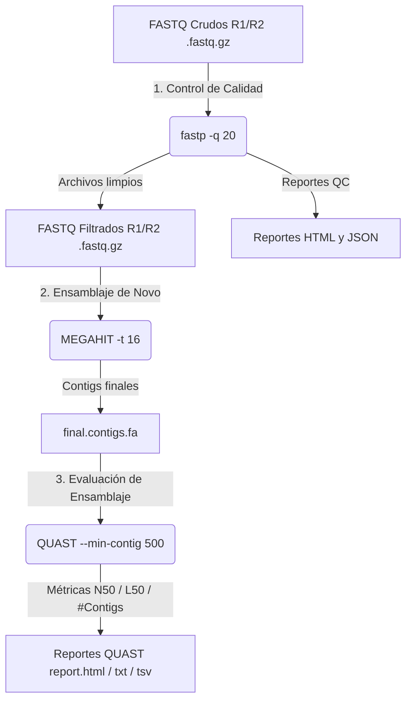

# 🧬 Bitácora de Procesamiento de Datos Metagenómicos

> **Proyecto:** Análisis Metagenómico de Muestras Antárticas (2019)  
> **Etapa 1:** Control de Calidad, Limpieza y Trimado de Adaptadores (`fastp`)  
> **Etapa 2:** Ensamblaje Metagenómico *De Novo* (`MEGAHIT`)  
> **Etapa 3:** Evaluación de Calidad de Ensamblajes (`QUAST`)  
> **Fecha de actualización:** Octubre 2026  

---

## 📋 Tabla de Contenidos

- [1. Descripción del Dataset Crudo](#1-descripción-del-dataset-crudo)
- [2. Control de Calidad y Preprocesamiento (`fastp`)](#2-control-de-calidad-y-preprocesamiento-fastp)
  - [2.1. Comando de Muestra y Fundamentación Parámetro por Parámetro](#21-comando-de-muestra-y-fundamentación-parámetro-por-parámetro)
  - [2.2. Mapeo General de Muestras Pareadas](#22-mapeo-general-de-muestras-pareadas)
  - [2.3. Archivos Salida Obtenidos tras `fastp`](#23-archivos-salida-obtenidos-tras-fastp)
  - [2.4. Guía de Interpretación del Informe HTML](#24-guía-de-interpretación-del-informe-html)
- [3. Ensamblaje Metagenómico *De Novo* (`MEGAHIT`)](#3-ensamblaje-metagenómico-de-novo-megahit)
  - [3.1. Comando Ejecutado y Desglose de Parámetros](#31-comando-ejecutado-y-desglose-de-parámetros)
  - [3.2. Mapeo General del Lote de Muestras para MEGAHIT](#32-mapeo-general-del-lote-de-muestras-para-megahit)
  - [3.3. Estructura de Salida y Resultados de MEGAHIT](#33-estructura-de-salida-y-resultados-de-megahit)
- [4. Evaluación de Calidad del Ensamblaje (`QUAST`)](#4-evaluación-de-calidad-del-ensamblaje-quast)
  - [4.1. Comando Ejecutado y Desglose de Parámetros](#41-comando-ejecutado-y-desglose-de-parámetros)
  - [4.2. Mapeo General del Lote de Muestras para QUAST](#42-mapeo-general-del-lote-de-muestras-para-quast)
  - [4.3. Estructura de Resultados y Archivos de Salida de QUAST](#43-estructura-de-resultados-y-archivos-de-salida-de-quast)
  - [4.4. Guía de Interpretación de Métricas Bioinformáticas](#44-guía-de-interpretación-de-métricas-bioinformáticas)
- [5. Automatización del Pipeline Completo en Lote (Bash)](#5-automatización-del-pipeline-completo-en-lote-bash)
- [6. Diagrama de Flujo Integrado del Pipeline](#6-diagrama-de-flujo-integrado-del-pipeline)
- [7. Referencias](#7-referencias)

---

## 1. 📂 Descripción del Dataset Crudo

El dataset de entrada consiste en 5 parejas de archivos FASTQ comprimidos (`.fastq.gz`) obtenidos mediante secuenciación de lecturas pareadas (*paired-end*, PE) de metagenomas ambientales antárticos.

```text
metagenomas_antarida_2019/
├── C4_230_347_S89_L002_R1_001.fastq.gz
├── C4_230_347_S89_L002_R2_001.fastq.gz
├── D_242_335_S88_L002_R1_001.fastq.gz
├── D_242_335_S88_L002_R2_001.fastq.gz
├── E4_254_323_S87_L002_R1_001.fastq.gz
├── E4_254_323_S87_L002_R2_001.fastq.gz
├── EC_266_311_S86_L002_R1_001.fastq.gz
├── EC_266_311_S86_L002_R2_001.fastq.gz
├── H_278_299_S85_L002_R1_001.fastq.gz
└── H_278_299_S85_L002_R2_001.fastq.gz
```

---

## 2. ⚙️ Control de Calidad y Preprocesamiento (`fastp`)

Se empleó la herramienta **`fastp`** (v1.0 / v0.23+), un preprocesador ultrafácil y todo-en-uno para archivos FASTQ, para realizar control de calidad, remoción de adaptadores y filtrado por calidad Phred en una sola pasada.

### 2.1. Comando de Muestra y Fundamentación Parámetro por Parámetro

```bash
../fastp \
  -i ../metagenomas_antarida_2019/C4_230_347_S89_L002_R1_001.fastq.gz \
  -I ../metagenomas_antarida_2019/C4_230_347_S89_L002_R2_001.fastq.gz \
  -o C_230_R1.fastq.gz \
  -O C_230_R2.fastq.gz \
  -q 20 \
  -j C_230.json \
  -h C_230.html
```

#### 🛠️ Desglose de Parámetros

| Parámetro | Nombre Largo | Descripción / Fundamentación Bioinformática |
| :--- | :--- | :--- |
| `-i` | `--in1` | Ruta al archivo de entrada FASTQ comprimido para **Read 1 (R1)**. |
| `-I` | `--in2` | Ruta al archivo de entrada FASTQ comprimido para **Read 2 (R2)**. |
| `-o` | `--out1` | Nombre del archivo de salida limpio para **Read 1**. La extensión `.gz` habilita compresión automática `gzip`. |
| `-O` | `--out2` | Nombre del archivo de salida limpio para **Read 2**. |
| `-q 20` | `--qualified_quality_phred` | Define la calidad Phred mínima para considerar una base como cualificada (**Q20 = 99% de precisión**). El valor predeterminado es Q15. |
| `-j` | `--json` | Genera un archivo de reporte en formato **JSON** con métricas cuantitativas estructuradas. |
| `-h` | `--html` | Genera un informe visual interactivo en formato **HTML** para la inspección gráfica de curvas de calidad y adaptadores. |

---

### 2.2. Mapeo General de Muestras Pareadas

Configuración del comando para cada una de las 5 muestras metagenómicas:

| ID Muestra | Entrada R1 (`-i`) | Entrada R2 (`-I`) | Salida R1 (`-o`) | Salida R2 (`-O`) | Reporte JSON (`-j`) | Reporte HTML (`-h`) |
| :---: | :--- | :--- | :--- | :--- | :---: | :---: |
| **C4_230** | `.../C4_230_..._R1_001.fastq.gz` | `.../C4_230_..._R2_001.fastq.gz` | `C_230_R1.fastq.gz` | `C_230_R2.fastq.gz` | `C_230.json` | `C_230.html` |
| **D_242** | `.../D_242_..._R1_001.fastq.gz` | `.../D_242_..._R2_001.fastq.gz` | `D_242_R1.fastq.gz` | `D_242_R2.fastq.gz` | `D_242.json` | `D_242.html` |
| **E4_254** | `.../E4_254_..._R1_001.fastq.gz` | `.../E4_254_..._R2_001.fastq.gz` | `E4_254_R1.fastq.gz` | `E4_254_R2.fastq.gz` | `E4_254.json` | `E4_254.html` |
| **EC_266** | `.../EC_266_..._R1_001.fastq.gz` | `.../EC_266_..._R2_001.fastq.gz` | `EC_266_R1.fastq.gz` | `EC_266_R2.fastq.gz` | `EC_266.json` | `EC_266.html` |
| **H_278** | `.../H_278_..._R1_001.fastq.gz` | `.../H_278_..._R2_001.fastq.gz` | `H_278_R1.fastq.gz` | `H_278_R2.fastq.gz` | `H_278.json` | `H_278.html` |

---

### 2.3. Archivos Salida Obtenidos tras `fastp`

Como resultado de ejecutar `fastp` para las 5 muestras, el directorio de lecturas filtradas contiene los siguientes archivos listos para el ensamblaje:

```text
clean_fastq/
├── C_230_R1.fastq.gz   ├── C_230.json   ├── C_230.html
├── C_230_R2.fastq.gz
├── D_242_R1.fastq.gz   ├── D_242.json   ├── D_242.html
├── D_242_R2.fastq.gz
├── E4_254_R1.fastq.gz  ├── E4_254.json  ├── E4_254.html
├── E4_254_R2.fastq.gz
├── EC_266_R1.fastq.gz  ├── EC_266.json  ├── EC_266.html
├── EC_266_R2.fastq.gz
├── H_278_R1.fastq.gz   ├── H_278.json   ├── H_278.html
└── H_278_R2.fastq.gz
```

---

### 2.4. Guía de Interpretación del Informe HTML

<details>
<summary><b>🔍 Haga clic para desplegar los detalles del informe de control de calidad</b></summary>

1. **Summary (Resumen General):**
   - Muestra el total de lecturas y bases antes y después del filtrado.
   - Proporción de bases **Q20** (≥99% precisión) y **Q30** (≥99.9% precisión).
   - Porcentaje de contenido **GC**.
   - Conteo de lecturas aprobadas (*Passed filters*) y causas de lecturas descartadas (baja calidad, Ns, o longitud corta <15 bp).

2. **Quality Curves (Curvas de Calidad Phred):**
   - Gráficos por posición (R1 y R2). Muestran la ganancia de calidad Phred tras el filtrado.

3. **Base Contents (Composición de Nucleótidos):**
   - Estabilidad de las proporciones A, T, C, G a lo largo de los ciclos de secuenciación.

4. **Adapter Contents (Contenido de Adaptadores):**
   - Porcentaje de adaptadores recortados automáticamente por análisis de solapamiento.

5. **Duplication Rate (Tasa de Duplicación):**
   - Porcentaje de secuencias duplicadas para evaluar sesgos de PCR.

</details>

---

## 3. 🧩 Ensamblaje Metagenómico *De Novo* (`MEGAHIT`)

Para la reconstrucción de genomas no cultivados a partir de los datos metagenómicos limpios, se utilizó **MEGAHIT** (v1.2.9), un ensamblador *de novo* ultra rápido y altamente eficiente en uso de memoria RAM basado en grafos de de Bruijn concisos (*Succinct de Bruijn Graph*, SDBG).

### 3.1. Comando Ejecutado y Desglose de Parámetros

Ejemplo del comando ejecutado para la muestra **H_278**:

```bash
../MEGAHIT-1.2.9-Linux-x86_64-static/bin/megahit \
  -1 ../fastq/H_278_R1.fastq.gz \
  -2 ../fastq/H_278_R2.fastq.gz \
  -o ./H_278/ \
  -t 16
```

#### 🛠️ Desglose de Parámetros

| Parámetro | Nombre Largo | Descripción / Fundamentación Bioinformática |
| :--- | :--- | :--- |
| `../megahit` | — | Binario ejecutable estático de MEGAHIT (v1.2.9). |
| `-1` | `--read1` | Ruta al archivo FASTQ filtrado con las lecturas pareadas **Read 1 (R1)**. |
| `-2` | `--read2` | Ruta al archivo FASTQ filtrado con las lecturas pareadas **Read 2 (R2)**. |
| `-o` | `--out-dir` | Directorio de salida específico para la muestra (`./H_278/`). MEGAHIT creará la carpeta y almacenará contigs y archivos auxiliares. |
| `-t 16` | `--num-cpu-threads` | Número de hilos CPU para acelerar el procesamiento en paralelo (**16 hilos** asignados). |

---

### 3.2. Mapeo General del Lote de Muestras para MEGAHIT

A continuación se presenta la matriz de ejecución del ensamblaje individual para cada una de las 5 muestras del estudio:

| Muestra | Entrada Lecturas R1 (`-1`) | Entrada Lecturas R2 (`-2`) | Directorio Salida (`-o`) | Hilos (`-t`) |
| :---: | :--- | :--- | :---: | :---: |
| **C4_230** | `../fastq/C_230_R1.fastq.gz` | `../fastq/C_230_R2.fastq.gz` | `./C_230/` | `16` |
| **D_242** | `../fastq/D_242_R1.fastq.gz` | `../fastq/D_242_R2.fastq.gz` | `./D_242/` | `16` |
| **E4_254** | `../fastq/E4_254_R1.fastq.gz` | `../fastq/E4_254_R2.fastq.gz` | `./E4_254/` | `16` |
| **EC_266** | `../fastq/EC_266_R1.fastq.gz` | `../fastq/EC_266_R2.fastq.gz` | `./EC_266/` | `16` |
| **H_278** | `../fastq/H_278_R1.fastq.gz` | `../fastq/H_278_R2.fastq.gz` | `./H_278/` | `16` |

---

### 3.3. Estructura de Salida y Resultados de MEGAHIT

Dentro de cada carpeta de salida (ej. `./H_278/`), MEGAHIT genera los siguientes archivos clave:

```text
H_278/
├── final.contigs.fa          <-- 🌟 ARCHIVO PRINCIPAL: Contigs ensamblados finales (FASTA)
├── checkpoints.txt           <-- Registro de control para reanudar la ejecución si se interrumpe
├── log                       <-- Registro detallado del proceso (k-meros evaluados, tiempo, uso de memoria)
├── options.json              <-- Configuración y parámetros utilizados
└── intermediate_contigs/     <-- Contigs intermedios por cada tamaño de k-mero (k21, k31, k41, ..., k119)
    ├── k21.contig.fa
    ├── k31.contig.fa
    └── ...
```

* **`final.contigs.fa`**: Es el resultado primario que contiene los contigs ensamblados finales en formato FASTA. Este archivo es el insumo clave para la siguiente fase: **evaluación de ensamblaje (QUAST), mapeo de lecturas (Bowtie2/BWA) y Binning (MetaBAT2/CheckM)**.

---


---

## 4. 📊 Evaluación de Calidad del Ensamblaje (`QUAST`)

Para evaluar la continuidad, fragmentación y calidad estructural de los contigs ensamblados por MEGAHIT, se emplea **QUAST** (*Genome Assembly Evaluation Tool*). QUAST calcula métricas estadísticas estándar fundamentales para diagnosticar la calidad de ensamblajes genómicos y metagenómicos *de novo*.

### 4.1. Comando Ejecutado y Desglose de Parámetros

Ejemplo de ejecución comparativa para evaluar los 5 ensamblajes metagenómicos de forma simultánea:

```bash
quast.py \
  ./assemblies/C4_230/final.contigs.fa \
  ./assemblies/D_242/final.contigs.fa \
  ./assemblies/E4_254/final.contigs.fa \
  ./assemblies/EC_266/final.contigs.fa \
  ./assemblies/H_278/final.contigs.fa \
  -o ./quast_results/ \
  -t 16 \
  --min-contig 500 \
  --labels C4_230,D_242,E4_254,EC_266,H_278
```

#### 🛠️ Desglose de Parámetros de QUAST

| Parámetro | Nombre Largo | Descripción / Fundamentación Bioinformática |
| :--- | :--- | :--- |
| `quast.py` | — | Script ejecutable principal de QUAST. |
| `*.contigs.fa` | — | Archivos FASTA con los contigs a evaluar generados por MEGAHIT. |
| `-o` | `--output-dir` | Directorio de salida donde se guardarán los informes, gráficos e interfaz interactiva Icarus (`./quast_results/`). |
| `-t 16` | `--threads` | Asigna **16 hilos CPU** para cálculo en paralelo. |
| `--min-contig 500` | `--min-contig` | Umbral mínimo de longitud de contig (**500 bp**) para descartar fragmentos cortos. |
| `--labels` | `--labels` | Nombres personalizados para identificar cada muestra en el reporte comparativo. |

---

### 4.2. Mapeo General del Lote de Muestras para QUAST

| Muestra Metagenómica | Archivo Entrante (`.fa`) | Directorio Salida QUAST | Etiqueta en Reporte |
| :---: | :--- | :---: | :---: |
| **C4_230** | `./assemblies/C4_230/final.contigs.fa` | `./quast_results/` | `C4_230` |
| **D_242** | `./assemblies/D_242/final.contigs.fa` | `./quast_results/` | `D_242` |
| **E4_254** | `./assemblies/E4_254/final.contigs.fa` | `./quast_results/` | `E4_254` |
| **EC_266** | `./assemblies/EC_266/final.contigs.fa` | `./quast_results/` | `EC_266` |
| **H_278** | `./assemblies/H_278/final.contigs.fa` | `./quast_results/` | `H_278` |

---

### 4.3. Estructura de Resultados y Archivos de Salida de QUAST

Dentro del directorio de salida `./quast_results/`, QUAST genera una suite completa de archivos diagnósticos:

```text
quast_results/
├── report.html            <-- 🌟 ARCHIVO CLAVE: Informe gráfico interactivo con curvas N50 y tamaño acumulado
├── report.txt             <-- Tabla de resumen en texto plano
├── report.tsv             <-- Tabla en formato TSV (ideal para scripts o R/Python)
├── report.tex             <-- Código fuente LaTeX para informes formales
├── icarus.html            <-- Visualizador interactivo de contigs (Icarus browser)
└── basic_stats/           <-- Histogramas de distribución de longitudes, contenido GC y N50
```

---

### 4.4. Guía de Interpretación de Métricas Bioinformáticas

<details>
<summary><b>🔍 Haga clic para desplegar los detalles de las métricas de QUAST</b></summary>

1. **Contigs Count (# contigs):**
   - Número total de contigs con longitud mayor o igual al umbral fijado (≥500 bp). Un menor número de contigs largos suele indicar mayor continuidad.

2. **Largest Contig (Contig más largo):**
   - Longitud en pares de bases (bp) del contig más largo. Refleja la capacidad del ensamblador para resolver regiones complejas.

3. **Total Length (Longitud total ensamblada):**
   - Suma total de pares de bases de todos los contigs ensamblados. Representa la cantidad total de información genómica reconstruida en la comunidad microbiana.

4. **N50 & L50:**
   - **N50:** Longitud del contig para el cual todos los contigs de igual o mayor tamaño representan al menos el 50% de la longitud total ensamblada. *Un valor N50 mayor indica mayor continuidad en el ensamblaje.*
   - **L50:** Número mínimo de contigs necesarios para acumular el 50% del tamaño total del ensamblaje.

5. **N75 & L75:**
   - Métricas análogas al N50/L50 pero evaluadas al umbral del 75% del tamaño total del ensamblaje.

6. **GC Content (% GC):**
   - Porcentaje total de bases Guanina y Citosina en el conjunto de contigs. Permite monitorear la composición general de la comunidad microbiana.

7. **# Ns per 100 kbp:**
   - Número de bases no determinadas (N) por cada 100.000 bases.

</details>

---

## 5. 🤖 Automatización del Pipeline Completo en Lote (Bash)

Script de Bash para ejecutar la cadena completa desde el control de calidad con `fastp` hasta el ensamblaje con `MEGAHIT`:

```bash
#!/usr/bin/env bash
# Pipeline Metagenomico: fastp (QC) -> MEGAHIT (Assembly)

THREADS=16
FASTP_BIN="../fastp"
MEGAHIT_BIN="../MEGAHIT-1.2.9-Linux-x86_64-static/bin/megahit"

RAW_DIR="../metagenomas_antarida_2019"
CLEAN_DIR="./clean_fastq"
REPORT_DIR="./fastp_reports"
ASSEMBLY_DIR="./assemblies"

mkdir -p "$CLEAN_DIR" "$REPORT_DIR" "$ASSEMBLY_DIR"

for R1 in "${RAW_DIR}"/*_R1_001.fastq.gz; do
    R2="${R1/_R1_001.fastq.gz/_R2_001.fastq.gz}"
    SAMPLE=$(basename "$R1" | cut -d'_' -f1,2) # Extrae el ID de muestra (ej. C4_230)

    echo "=================================================="
    echo "1. Control de Calidad con fastp: ${SAMPLE}"
    echo "=================================================="

    CLEAN_R1="${CLEAN_DIR}/${SAMPLE}_R1.fastq.gz"
    CLEAN_R2="${CLEAN_DIR}/${SAMPLE}_R2.fastq.gz"

    "$FASTP_BIN" \
      -i "$R1" -I "$R2" \
      -o "$CLEAN_R1" -O "$CLEAN_R2" \
      -q 20 \
      -j "${REPORT_DIR}/${SAMPLE}.json" \
      -h "${REPORT_DIR}/${SAMPLE}.html" \
      -w 4

    echo "=================================================="
    echo "2. Ensamblaje de Novo con MEGAHIT: ${SAMPLE}"
    echo "=================================================="

    "$MEGAHIT_BIN" \
      -1 "$CLEAN_R1" \
      -2 "$CLEAN_R2" \
      -o "${ASSEMBLY_DIR}/${SAMPLE}" \
      -t "$THREADS"

    CONTIG_PATH="${ASSEMBLY_DIR}/${SAMPLE}/final.contigs.fa"
    if [ -f "$CONTIG_PATH" ]; then
        CONTIG_FILES+=("$CONTIG_PATH")
        LABELS+=("$SAMPLE")
    fi

    echo "✅ Muestra ${SAMPLE} procesada y ensamblada."
    echo ""
done

echo "=================================================="
echo "3. Evaluación de Calidad de Ensamblajes con QUAST"
echo "=================================================="

JOINED_LABELS=$(IFS=,; echo "${LABELS[*]}")

quast.py \
  "${CONTIG_FILES[@]}" \
  -o "./quast_results" \
  -t "$THREADS" \
  --min-contig 500 \
  --labels "$JOINED_LABELS"

echo "🎉 Pipeline completado con éxito para todas las muestras."
echo "📊 Informe comparativo de QUAST guardado en: ./quast_results/report.html"
```

---

## 6. 🔄 Diagrama de Flujo Integrado del Pipeline



---

## 7. 📚 Referencias

- **fastp GitHub Repository:** https://github.com/OpenGene/fastp
- **Chen, S. (2025).** *fastp 1.0: An ultra-fast all-round tool for FASTQ data quality control and preprocessing*. **iMeta**, 4.5, e70078. DOI: 10.1002/imt2.70078
- **MEGAHIT GitHub Repository:** https://github.com/voutcn/megahit
- **Li, D., et al. (2015).** *MEGAHIT: An ultra-fast single-node solution for large and complex metagenomics assembly via succinct de Bruijn graph*. **Bioinformatics**, 31(10), 1674–1676. DOI: 10.1093/bioinformatics/btv033
- **QUAST (Genome Assembly Evaluation Tool):** Gurevich, A., Saveliev, V., Vyahhi, N., & Tesler, G. (2013). *QUAST: quality assessment tool for genome assemblies*. **Bioinformatics**, 29(8), 1072–1075.
- **SeqKit GitHub Repository:** https://github.com/shenwei356/seqkit
