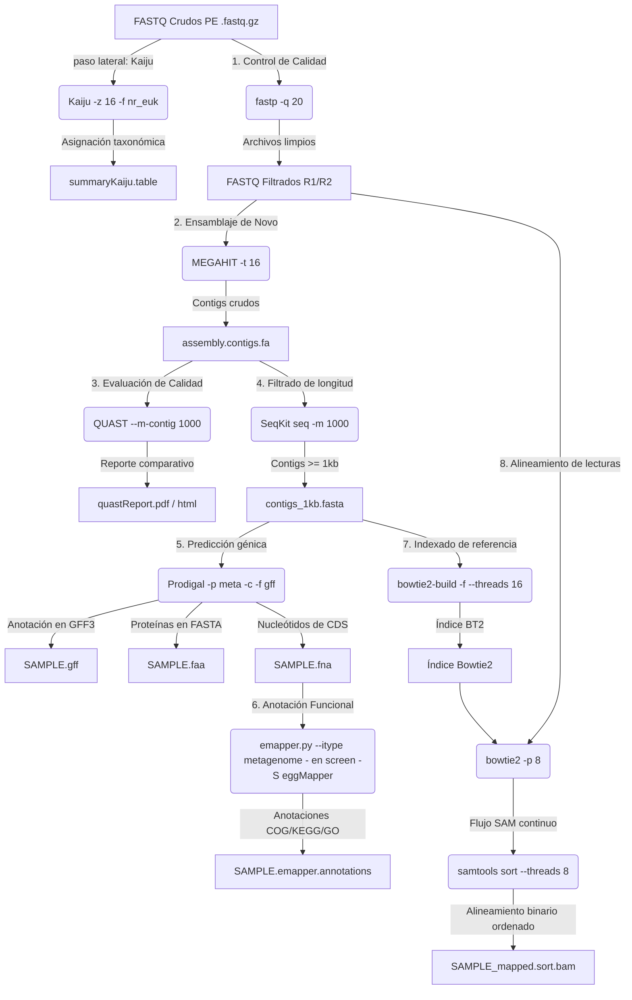

# 🧬 Bitácora de procesamiento de datos metagenómicos antárticos

> 🌐 **Idioma / Language:** [English Version](bitacora_qc_metagenomas_en.md)
PENDIENTE DE CORRECCIÓN  
> **Proyecto:** Análisis metagenómico de muestras antárticas (2019)  
> **Etapa 1:** Asignación taxonómica directa (`Kaiju`) *[paso lateral]*  
> **Etapa 2:** Control de calidad, limpieza y recortado de adaptadores (`fastp`)  
> **Etapa 3:** Ensamblaje metagenómico *de novo* (`MEGAHIT`)  
> **Etapa 4:** Evaluación de calidad de ensamblajes (`QUAST`)  
> **Etapa 5:** Filtrado de contigs (`SeqKit`) y predicción génica (`Prodigal`)  
> **Etapa 6:** Anotación funcional genómica (`EggNOG-mapper`)  
> **Etapa 7:** Construcción del índice de referencia, alineamiento y ordenamiento de lecturas (`Bowtie2` y `Samtools`)  
> **Fecha de actualización:** 20 de octubre de 2026  

---

## 📋 Tabla de contenidos PENDIENTE DE EDICIÓN

- [0. Herramientas auxiliares para procesos en segundo plano y monitoreo de recursos (`screen`, `nohup` y `/usr/bin/time`)](#0-herramientas-auxiliares-para-procesos-en-segundo-plano-y-monitoreo-de-recursos-screen-nohup-y-usrbintime)
- [1. Descripción del dataset crudo](#1-descripción-del-dataset-crudo)
- [2. Asignación taxonómica directa desde lecturas crudas (`Kaiju`) [paso lateral]](#2-asignación-taxonómica-directa-desde-lecturas-crudas-kaiju-paso-lateral)
  - [2.1. Comando de muestra y fundamentación parámetro por parámetro](#21-comando-de-muestra-y-fundamentación-parámetro-por-parámetro)
  - [2.2. Mapeo general de muestras pareadas](#22-mapeo-general-de-muestras-pareadas)
  - [2.3. Resumen de abundancias taxonómicas (`kaiju2table`)](#23-resumen-de-abundancias-taxonómicas-kaiju2table)
  - [2.4. Tiempo medio de procesamiento](#24-tiempo-medio-de-procesamiento)
- [3. Control de calidad y preprocesamiento (`fastp`)](#3-control-de-calidad-y-preprocesamiento-fastp)
  - [3.1. Comando de muestra y fundamentación parámetro por parámetro](#31-comando-de-muestra-y-fundamentación-parámetro-por-parámetro)
  - [3.2. Mapeo general de muestras pareadas](#32-mapeo-general-de-muestras-pareadas)
  - [3.3. Archivos de salida obtenidos tras `fastp`](#33-archivos-de-salida-obtenidos-tras-fastp)
  - [3.4. Guía de interpretación del informe HTML](#34-guía-de-interpretación-del-informe-html)
  - [3.5. Tiempo medio de procesamiento](#35-tiempo-medio-de-procesamiento)
- [4. Ensamblaje metagenómico *de novo* (`MEGAHIT`)](#4-ensamblaje-metagenómico-de-novo-megahit)
  - [4.1. Comando ejecutado y desglose de parámetros](#41-comando-ejecutado-y-desglose-de-parámetros)
  - [4.2. Mapeo general del lote de muestras para MEGAHIT](#42-mapeo-general-del-lote-de-muestras-para-megahit)
  - [4.3. Estructura de salida y resultados de MEGAHIT](#43-estructura-de-salida-y-resultados-de-megahit)
  - [4.4. Tiempo medio de procesamiento](#44-tiempo-medio-de-procesamiento)
- [5. Evaluación de calidad del ensamblaje (`QUAST`)](#5-evaluación-de-calidad-del-ensamblaje-quast)
  - [5.1. Comando ejecutado y desglose de parámetros](#51-comando-ejecutado-y-desglose-de-parámetros)
  - [5.2. Mapeo general del lote de muestras para QUAST](#52-mapeo-general-del-lote-de-muestras-para-quast)
  - [5.3. Estructura de resultados y archivos de salida de QUAST](#53-estructura-de-resultados-y-archivos-de-salida-de-quast)
  - [5.4. Resultados reales del reporte de QUAST (contigs ≥ 1000 pb)](#54-resultados-reales-del-reporte-de-quast-contigs--1000-pb)
  - [5.5. Guía de interpretación de métricas bioinformáticas](#55-guía-de-interpretación-de-métricas-bioinformáticas)
  - [5.6. Tiempo medio de procesamiento](#56-tiempo-medio-de-procesamiento)
- [6. Filtrado de contigs (`SeqKit`) y predicción génica (`Prodigal`)](#6-filtrado-de-contigs-seqkit-y-predicción-génica-prodigal)
  - [6.1. Filtrado por longitud mínima con `SeqKit`](#61-filtrado-por-longitud-mínima-con-seqkit)
  - [6.2. Predicción de CDS y proteínas con `Prodigal`](#62-predicción-de-cds-y-proteínas-con-prodigal)
  - [6.3. Mapeo general del lote y estructura de salida](#63-mapeo-general-del-lote-y-estructura-de-salida)
  - [6.4. Tiempo medio de procesamiento](#64-tiempo-medio-de-procesamiento)
- [7. Anotación funcional genómica (`EggNOG-mapper`)](#7-anotación-funcional-genómica-eggnog-mapper)
  - [7.1. Comando ejecutado y desglose de parámetros](#71-comando-ejecutado-y-desglose-de-parámetros)
  - [7.2. Mapeo general del lote de muestras para EggNOG-mapper](#72-mapeo-general-del-lote-de-muestras-para-eggnog-mapper)
  - [7.3. Estructura de resultados y archivos de salida de EggNOG](#73-estructura-de-resultados-y-archivos-de-salida-de-eggnog)
  - [7.4. Tiempo medio de procesamiento](#74-tiempo-medio-de-procesamiento)
- [8. Construcción del índice de referencia, alineamiento y ordenamiento de lecturas (`Bowtie2` y `Samtools`)](#8-construcción-del-índice-de-referencia-alineamiento-y-ordenamiento-de-lecturas-bowtie2-y-samtools)
  - [8.1. Comandos ejecutados y desglose de parámetros](#81-comandos-ejecutados-y-desglose-de-parámetros)
  - [8.2. Mapeo general del lote de muestras para indexado y alineamiento](#82-mapeo-general-del-lote-de-muestras-para-indexado-y-alineamiento)
  - [8.3. Estructura de resultados y archivos de salida](#83-estructura-de-resultados-y-archivos-de-salida)
  - [8.4. Tiempos de procesamiento (construcción de índice + alineamiento)](#84-tiempos-de-procesamiento-construcción-de-índice--alineamiento)
- [9. Diagrama de flujo integrado del pipeline](#9-diagrama-de-flujo-integrado-del-pipeline)
- [10. Referencias](#10-referencias)

---

***TODOS LOS COMANDOS EMPLEADOS EN ESTA BITACORA TIENEN EN CUENTA QUE DEBEN SER EJECUTADOS DESDE UNA CARPETA RAÍZ QUE CONTENGA LAS SUBCARPETAS DE SALIDA Y DE DONDE SE LLAMARÁ A LOS PROGRAMAS***

# 0. 🛠️ Herramientas auxiliares para procesos en segundo plano y monitoreo de recursos

En entornos de computación de alto rendimiento (HPC) o servidores remotos vía SSH, los procesos bioinformáticos de larga duración requieren mecanismos de persistencia y monitoreo para registrar los tiempos de procesamiento exactos sin interrupciones.

## 0.1. GNU Screen (`screen`)

`screen` es un multiplexor de termales que crea sesiones independientes del proceso de shell activo.

####  Parámetros empleados para `screen`:

* **`screen -S <nombre_sesion>`**: Crea una nueva sesión de termal con un identificador personalizado (ej. `screen -S megahit_run`).
* **`screen -ls`**: Lista todas las sesiones activas en el servidor con su estado (`Attached` o `Detached`).
* **`screen -r <nombre_o_id>`**: Reanuda (*reattach*) una sesión que se encuentra en segundo plano.
* **`screen -d <nombre_o_id>`**: Desconecta (*detach*) una sesión activa desde otra termal.

#### Combinaciones de teclas importantes (dentro de una sesión):
* **`Ctrl + A` seguido de `D`**: Desconecta la sesión actual y regresa a la shell principal manteniendo los comandos ejecutándose en segundo plano.
* **`Ctrl + A` seguido de `K`**: Cierra (*kill*) la sesión actual.
* **`exit`**: Finaliza la sesión limpiamente tras completar las tareas.

## 0.2. Comando *No Hang Up* (`nohup`)

El comando `nohup` (abreviación de *No Hang Up*) es una utilidad de sistemas UNIX/Linux diseñada para ignorar la señal `SIGHUP` (*Signal Hang Up*). Esta señal es enviada automáticamente por el sistema operativo a todos los procesos secundarios (*child processes*) cuando la termal o la sesión SSH que los originó se cierra o pierde conexión.
Para cada etapa del flujo de trabajo, `nohup` se combinó con una subshell de Bash (`bash -c`), la captura de marcas de tiempo, redirección de flujos E/S y el operador de segundo plano (`&`)

## 0.3. Monitoreo de tiempo y recursos con GNU `time` (`/usr/bin/time`)

Para auditar con precisión el tiempo de ejecución real (*elapsed wall clock time*) de cada comando bioinformático en el pipeline, se emplea el binario del sistema GNU `time` (`/usr/bin/time`) junto con marcas de tiempo en un bloque envolvente de `nohup`.

####  Parámetros empleados para `/usr/bin/time`:
* **`-v`** (`--verbose`): Genera un reporte detallado con las métricas completas de tiempo de ejecución.
* **`-a`** (`--append`): Anexa la salida al archivo de registro en lugar de sobrescribirlo.
* **`-o <archivo>`** (`--output`): Especifica la ruta del archivo de texto donde se guardará el reporte.

#### Estructura del bloque envolvente de monitoreo:
```bash
nohup bash -c '
echo "Muestra: NOMBRE_MUESTRA" > reporte_tiempo.txt
echo "Hora de inicio: $(date)" >> reporte_tiempo.txt
/usr/bin/time -v -a -o reporte_tiempo.txt \
  COMANDO_BIOINFORMÁTICO \
echo "Hora de finalización: $(date)" >> reporte_tiempo.txt
' &
```


# 1. 📂 Descripción del dataset crudo

El dataset de entrada consiste en 5 parejas de archivos "FASTQ" comprimidos (`.fastq.gz`) obtenidos mediante secuenciación de lecturas pareadas (*paired-end*, PE) de metagenomas ambientales antárticos (2019).

```text
metagenomas_antarida_2019/
├── C4_230_347_S89_L002_R1_001.fastq.gz   (17,020,773 KB ~ 17.02 GB)
├── C4_230_347_S89_L002_R2_001.fastq.gz   (17,922,220 KB ~ 17.92 GB)
├── D_242_335_S88_L002_R1_001.fastq.gz    ( 3,663,943 KB ~  3.66 GB)
├── D_242_335_S88_L002_R2_001.fastq.gz    ( 3,842,488 KB ~  3.84 GB)
├── E4_254_323_S87_L002_R1_001.fastq.gz   ( 7,921,805 KB ~  7.92 GB)
├── E4_254_323_S87_L002_R2_001.fastq.gz   ( 8,249,762 KB ~  8.25 GB)
├── EC_266_311_S86_L002_R1_001.fastq.gz  ( 7,876,211 KB ~  7.88 GB)
├── EC_266_311_S86_L002_R2_001.fastq.gz  ( 8,246,128 KB ~  8.25 GB)
├── H_278_299_S85_L002_R1_001.fastq.gz   ( 6,824,312 KB ~  6.82 GB)
└── H_278_299_S85_L002_R2_001.fastq.gz   ( 7,149,960 KB ~  7.15 GB)
```
* **Volumen total crudo:** **88,717,602 KB (~88.72 GB)**.


# 2. 🔀 Asignación taxonómica desde lecturas crudas (`Kaiju`)

Como análisis complementario e independiente del ensamblaje, se realizó la clasificación taxonómica de las lecturas crudas utilizando **Kaiju 1.10.1**. Al traducir las secuencias de ADN a sus 6 marcos de lectura y alinearlas contra una base de datos proteica de referencia (`nr_euk 2023-05-10`), Kaiju identifica miembros de la comunidad microbiana.

El comando empleado para el procesamiento de las muestras (**Importante:** se ejemplifica con el nombre de una muestra, pero se procesaron todas) fue el siguiente:

```bash
nohup bash -c '
echo "Muestra: D_242" > ./taxMetagenomes/D_242_reporte_kaiju.txt
echo "Hora de inicio: $(date)" >> ./taxMetagenomes/D_242_reporte_kaiju.txt
/usr/bin/time -v -a -o ./taxMetagenomes/D_242_reporte_kaiju.txt \
  ./kaiju/bin/kaiju \
  -t /media/hdd1/kaijudb/nodes.dmp \
  -f /media/hdd1/kaijudb/kaiju_db_nr_euk.fmi \
  -i ./metagenomas_antarida_2019/D_242_335_S88_L002_R1_001.fastq.gz \
  -j ./metagenomas_antarida_2019/D_242_335_S88_L002_R2_001.fastq.gz \
  -o ./taxMetagenomes/D_242-kaiju.out \
  -z 16
echo "Hora de finalización: $(date)" >> ./taxMetagenomes/D_242_reporte_kaiju.txt
' &
```

### Desglose de parámetros

| Parámetro | Nombre largo | Descripción bioinformática |
| :--- | :--- | :--- |
| `-t` | `--taxonomy` | Ruta al archivo jerárquico de nodos de la taxonomía NCBI (`nodes.dmp`). |
| `-f` | `--fmi` | Ruta al Índice FM de la base de datos proteica de referencia (`kaiju_db_nr_euk.fmi`). |
| `-i` | `--in1` | Ruta al archivo FASTQ de entrada para **Read 1 o Forward (R1)**. |
| `-j` | `--in2` | Ruta al archivo FASTQ de entrada para **Read 2 o Reverse (R2)**. |
| `-o` | `--output` | Archivo de salida con la clasificación por lectura (`.out`). |
| `-z 16` | `--threads` | Asigna **16 hilos CPU** para acelerar el alineamiento multihilo. |

---

### Mapeo general de muestras pareadas

| ID de muestra | Archivo de entrada R1 (`-i`) | Archivo de entrada R2 (`-j`) | Archivo de salida (`-o`) | Reporte de tiempos |
| :---: | :--- | :--- | :--- | :--- |
| **C4_230** | `C4_230_..._R1_001.fastq.gz` | `C4_230_..._R2_001.fastq.gz` | `./taxMetagenomes/C4_230-kaiju.out` | `C4_230_reporte_kaiju.txt` |
| **D_242** | `D_242_..._R1_001.fastq.gz` | `D_242_..._R2_001.fastq.gz` | `./taxMetagenomes/D_242-kaiju.out` | `D_242_reporte_kaiju.txt` |
| **E4_254** | `E4_254_..._R1_001.fastq.gz` | `E4_254_..._R2_001.fastq.gz` | `./taxMetagenomes/E4_254-kaiju.out` | `E4_254_reporte_kaiju.txt` |
| **EC_266** | `EC_266_..._R1_001.fastq.gz` | `EC_266_..._R2_001.fastq.gz` | `./taxMetagenomes/EC_266-kaiju.out` | `EC_266_reporte_kaiju.txt` |
| **H_278** | `H_278_..._R1_001.fastq.gz` | `H_278_..._R2_001.fastq.gz` | `./taxMetagenomes/H_278-kaiju.out` | `H_278_reporte_kaiju.txt` |


## 2.1. Resumen de abundancias taxonómicas (`kaiju2table`)
Para poder visualizar todas las asignaciones taxonómicas de las muestras se empleó el programa `kaiju2table` para obtener una tabla que continene todas las coincidencias de todas la muestras.

```bash
../kaiju/bin/kaiju2table \
  -t /media/hdd1/kaijudb/nodes.dmp \
  -n /media/hdd1/kaijudb/names.dmp \
  -o summaryKaiju.table \
  -r genus \
  -l superkingdom,phylum,class,order,family,genus \
  *.out
```

### Desglose de parámetros

| Parámetro | Nombre largo | Descripción bioinformática |
| :--- | :--- | :--- |
| `-t` | `--taxonomy` | Ruta al archivo jerárquico de nodos de la taxonomía del NCBI (`nodes.dmp`) que define la estructura del árbol taxonómico. |
| `-n` | `--names` | Ruta al archivo de mapeo de nombres del NCBI (`names.dmp`) para asociar los identificadores numéricos (TaxIDs) con sus nombres científicos. |
| `-o` | `--output` | Nombre y ruta del archivo de salida que contendrá la matriz resumida de abundancias taxonómicas (`summaryKaiju.table`). |
| `-r genus` | `--rank` | Nivel o rango taxonómico objetivo al cual se consolidarán y resumirán los conteos de lecturas clasificadas (**Género**). |
| `-l ...` | `--levels` | Lista delimitada por comas de la jerarquía taxonómica completa que se desplegará en las columnas del reporte (`superkingdom,phylum,class,order,family,genus`). |
| `*.out` | — | Archivos de entrada que contienen los resultados individuales de clasificación por lectura generados previamente por `kaiju` para cada muestra. |


### Archivos de salida obtenidos tras `kaiju` y `kaiju2table`

```text
kaijuOut/
├── C4_230-kaiju.out  │
├── D_242-kaiju.out   │
├── E4_254-kaiju.out  ├── summaryKaiju.table
├── EC_266-kaiju.out  │
└── H_278-kaiju.out   │
```

## 2.2. Tiempo medio de procesamiento 

* **Rendimiento por muestra:**
  * **`D_242` (7.51 GB):** 3h 56m
  * **`H_278` (13.97 GB):** 7h 20m
  * **`EC_266` (16.12 GB):** 8h 27m
  * **`E4_254` (16.17 GB):** 8h 29m
  * **`C4_230` (34.94 GB):** 18h 19m
* **Lote completo (88.72 GB):** 46h 32m en total.

---

# 3. ⚙️ Control de calidad y preprocesamiento (`fastp`)

Se empleó **fastp 1.3.6** para realizar control de calidad, remoción de adaptadores y filtrado por calidad Phred en una sola pasada sobre las secuencias crudas (*raw reads*).

```bash
nohup bash -c '
echo "Muestra: C4_230" > ./fastpOut/C4_230_reporte_fastp.txt
echo "Hora de inicio: $(date)" >> ./fastpOut/C4_230_reporte_fastp.txt
/usr/bin/time -v -a -o ./fastpOut/C4_230_reporte_fastp.txt \
  ./fastp \
  -i ./metagenomas_antarida_2019/C4_230_347_S89_L002_R1_001.fastq.gz \
  -I ./metagenomas_antarida_2019/C4_230_347_S89_L002_R2_001.fastq.gz \
  -o ./fastpOut/C4_230_R1.fastq.gz \
  -O ./fastpOut/C4_230_R2.fastq.gz \
  -q 20 \
  -j ./fastpOut/C4_230.json \
  -h ./fastpOut/C4_230.html
echo "Hora de finalización: $(date)" >> ./fastpOut/C4_230_reporte_fastp.txt
' &
```

### Desglose de parámetros

| Parámetro | Nombre largo | Descripción bioinformática |
| :--- | :--- | :--- |
| `-i` / `-I` | `--in1` / `--in2` | Archivos FASTQ de entrada pareados comprimidos (`.fastq.gz`). |
| `-o` / `-O` | `--out1` / `--out2` | Archivos FASTQ de salida limpios (comprimidos en `.gz`). |
| `-q 20` | `--qualified_quality_phred` | Calidad Phred mínima para base cualificada (**Q20 = 99% precisión**). |
| `-j` / `-h` | `--json` / `--html` | Reportes de métricas cuantitativas (JSON) y gráficos interactivos (HTML). |


### Mapeo general de muestras pareadas

| ID de muestra | Entrada R1 (`-i`) | Entrada R2 (`-I`) | Salida R1 (`-o`) | Salida R2 (`-O`) | Reporte JSON (`-j`) | Reporte HTML (`-h`) |
| :---: | :--- | :--- | :--- | :--- | :---: | :---: |
| **C4_230** | `C4_230_..._R1_001.fastq.gz` | `C4_230_..._R2_001.fastq.gz` | `C4_230_R1.fastq.gz` | `C4_230_R2.fastq.gz` | `C4_230.json` | `C4_230.html` |
| **D_242** | `D_242_..._R1_001.fastq.gz` | `D_242_..._R2_001.fastq.gz` | `D_242_R1.fastq.gz` | `D_242_R2.fastq.gz` | `D_242.json` | `D_242.html` |
| **E4_254** | `E4_254_..._R1_001.fastq.gz` | `E4_254_..._R2_001.fastq.gz` | `E4_254_R1.fastq.gz` | `E4_254_R2.fastq.gz` | `E4_254.json` | `E4_254.html` |
| **EC_266** | `EC_266_..._R1_001.fastq.gz` | `EC_266_..._R2_001.fastq.gz` | `EC_266_R1.fastq.gz` | `EC_266_R2.fastq.gz` | `EC_266.json` | `EC_266.html` |
| **H_278** | `H_278_..._R1_001.fastq.gz` | `H_278_..._R2_001.fastq.gz` | `H_278_R1.fastq.gz` | `H_278_R2.fastq.gz` | `H_278.json` | `H_278.html` |


### Archivos de salida obtenidos tras `fastp`

```text
fastpOut/
├── <Muestra>_R1.fastq.gz   ├── <Muestra>.json   ├── <Muestra>.html
├── <Muestra>_R2.fastq.gz
├── <Muestra>_reporte_fastp.txt
└── ...
```


## 3.1. Guía general de interpretación del informes de `fastp`

<details>
<summary><b>🔍 Haga clic para desplegar la guia</b></summary>

Esta guía detalla el significado de cada una de las métricas principales entregadas por `fastp`, una herramienta automatizada de control de calidad y procesamiento de datos de secuenciación masiva (archivos FASTQ).


### 3.1.1. Resumen general (*Summary*)

* **Total de lecturas (*Read count*):** Representa la cantidad total de fragmentos secuenciados. Comparar este valor antes (*before filtering*) y después del filtrado (*after filtering*) permite evaluar cuánta información se conservó.
* **Bases totales (*Total bases*):** Es el volumen bruto de nucleótidos secuenciados ($A, T, C, G$).
* **Contenido GC (*%GC content*):** Indica el porcentaje de Guanina y Citosina en la muestra. Sirve para verificar si la composición nucleotídica coincide con el organismo objetivo o el tipo de librería analizada.
* **Tasa de duplicación (*Duplication rate*):** Porcentaje de lecturas idénticas. Un valor alto suele indicar sesgos durante la amplificación o una baja diversidad inicial en la librería.


### 3.1.2. Criterios de filtrado (*Filtering Result*)

* **Lecturas aprobadas (*Passed filter*):** Cantidad y porcentaje de lecturas que superaron los controles de calidad y son aptas para análisis posteriores (alineamiento, ensamblado, etc.).
* **Descarte por baja calidad (*Low quality reads*):** Lecturas elimadas por contener un número excesivo de bases con bajo puntaje de calidad Phred.
* **Descarte por exceso de Ns (*Too many N reads*):** Lecturas descartadas debido a una cantidad elevada de nucleótidos no identificados o ambiguos (representados por "$N$").
* **Descarte por longitud corta (*Too short reads*):** Lecturas que, tras recortar adaptadores o bases de baja calidad, quedaron por debajo del límite mínimo de longitud configurado.
* **Recorte de adaptadores (*Adapter trimmg*):** Identificación y elimación de secuencias sintéticas de adaptadores que se leen cuando el fragmento insertado es más corto que la cantidad de ciclos de secuenciación.


### 3.1.3 Puntajes de calidad (*Phred Quality Scores*)

Los puntajes de calidad Phred ($Q$) miden la probabilidad ($P$) de que una base haya sido asignada incorrectamente por el secuenciador:

$$Q = -10 \log_{10}(P)$$

| Puntaje | Precisión de la Base | Probabilidad de Error |
| :--- | :--- | :--- |
| **Q20** | **99%** | $1 \text{ de cada } 100 \text{ bases}$ |
| **Q30** | **99.9%** | $1 \text{ de cada } 1,000 \text{ bases}$ |

> **Regla general:** En secuenciación NGS de alta calidad, se busca que más del $80\% - 85\%$ de las bases se encuentren por encima del umbral **Q30**.

### 3.1.4. Tamaño de inserción (*Insert Size*)

* **Pico de tamaño de inserción (*Insert size peak*):** Estimación de la longitud del fragmento real de ADN/ARN situado entre los dos adaptadores. Ayuda a confirmar si el proceso de fragmentación en laboratorio fue homogéneo y adecuado para la longitud de lectura elegida.

### 3.1.5. Gráficas de control de calidad

* **Calidad por posición (*Quality curves*):** Muestra cómo varía la calidad Phred promedio a lo largo de cada ciclo de secuenciación (de la base $1$ a la base final). Un perfil óptimo mantiene la curva dentro del rango de alta calidad ($>Q30$) durante todo el recorrido.
* **Contenido de bases por posición (*Base content*):** Representa la proporción relativa de cada nucleótido ($A, T, C, G$) en cada posición. En librerías bien balanceadas y sin sesgos, las líneas deben mantenerse rectas y paralelas.

</details>

---

### 3.2. Tiempo medio de procesamiento

* **Rendimiento por muestra:**
  * **`D_242` (7.51 GB):** 07m 41s
  * **`H_278` (13.97 GB):** 14m 15s
  * **`EC_266` (16.12 GB):** 16m 07s
  * **`E4_254` (16.17 GB):** 16m 29s
  * **`C4_230` (34.94 GB):** 35m 30s
* **Lote completo (88.72 GB):** 1h 30m 2s en total.

---

# 4. 🧩 Ensamblaje metagenómico *de novo* (`MEGAHIT`)

Reconstrucción de contigs genómicos de novo mediante MEGAHIT (v1.2.9), un ensamblador de alto rendimiento optimizado para metagenómica que utiliza grafos de de Bruijn concisos (*succinct de Bruijn graphs*, SDBG). Este método permite procesar grandes conjuntos de datos de secuenciación (NGS) de manera eficiente, optimizando la reconstrucción de secuencias en comunidades microbianas complejas.

```bash

nohup bash -c '
echo "Muestra: H_278" > ./megahitOut/H_278/H_278_reporte_megahit.txt
echo "Hora de inicio: $(date)" >> ./megahitOut/H_278/H_278_reporte_megahit.txt
/usr/bin/time -v -a -o ./megahitOut/H_278/H_278_reporte_megahit.txt \
  ./MEGAHIT-1.2.9-Linux-x86_64-static/bin/megahit \
  -1 ./fastqOut/H_278_R1.fastq.gz \
  -2 ./fastqOut/H_278_R2.fastq.gz \
  -o ./megahitOut/H_278/ \
  -t 16
echo "Hora de finalización: $(date)" >> ./megahitOut/H_278/H_278_reporte_megahit.txt
' &
```

### Desglose de parámetros
| Parámetro | Valor | Descripción bioinformática |
| :--- | :--- | :--- |
| `-1` / `-2` | Archivos FastQ (`R1` / `R2`) | Lecturas pareadas limpias (paired-end reads)|
| `-o` | `./megahitOut/<muestra>/` | Archivos FASTQ de salida limpios (comprimidos en `.gz`)|
| `-t` | `16` | Asignación de 16 hilos (threads) de CPU para acelerar el procesamiento en paralelo|

### Mapeo general del lote de muestras para `MEGAHIT`

| Muestra | Entrada de lecturas R1 (`-1`) | Entrada de lecturas R2 (`-2`) | Directorio de salida (`-o`) | Reporte de tiempos |
| :---: | :--- | :--- | :---: | :--- |
| **C4_230** | `../fastq/C4_230_R1.fastq.gz` | `../fastq/C4_230_R2.fastq.gz` | `./megahitOut/C4_230/` | `reporte_megahit.txt` |
| **D_242** | `../fastq/D_242_R1.fastq.gz` | `../fastq/D_242_R2.fastq.gz` | `./megahitOut/D_242/` | `reporte_megahit.txt` |
| **E4_254** | `../fastq/E4_254_R1.fastq.gz` | `../fastq/E4_254_R2.fastq.gz` | `./megahitOut/E4_254/` | `reporte_megahit.txt` |
| **EC_266** | `../fastq/EC_266_R1.fastq.gz` | `../fastq/EC_266_R2.fastq.gz` | `./megahitOut/EC_266/` | `reporte_megahit.txt` |
| **H_278** | `../fastq/H_278_R1.fastq.gz` | `../fastq/H_278_R2.fastq.gz` | `./megahitOut/H_278/` | `reporte_megahit.txt` |

### Estructura de salida y resultados de `MEGAHIT`

```text
megahitOut/H_278/
├── assembly_H_278.contigs.fa.gz  <-- 🌟 ARCHIVO PRINCIPAL: Contigs ensamblados finales (FASTA)
├── reporte_megahit.txt        <-- Reporte de tiempos (/usr/bin/time -v)
├── checkpoints.txt
├── options.json        <-- Lista de parámetros empleados en el proceso
├── log        <-- Reporte del proceso
└── intermediate_contigs/     <-- Contigs intermedios (k21 a k119)
```


## 4.1. Tiempo medio de procesamiento

* **Rendimiento por muestra:**
  * **`D_242` (7.51 GB):** 7h 10m 31s
  * **`H_278` (13.97 GB):** 14h 10m 36s
  * **`EC_266` (16.12 GB):** 9h 1m 37s
  * **`E4_254` (16.17 GB):** 18h 22m 14s
  * **`C4_230` (34.94 GB):** 23h 8m 43s
* **Lote completo (88.72 GB):** 71h 53m 41s en total.

## 4.2. Estadísticos brutos de ensamblaje *de novo* con `MEGAHIT` (contigs ≥ 200 pb)

Valores extraídos directamente de los registros oficiales de ejecución (`log*.txt`) producidos por MEGAHIT para cada muestra:

| Muestra | Contigs totales (≥ 200 pb) | Longitud total (pb) | N50 (pb) | Contig mayor (pb) | Longitud media (pb) |
| :---: | :---: | :---: | :---: | :---: | :---: |
| **`C4_230`** | 4,350,356 | 3,483,909,817| 1,023 | 421,916 | 800 |
| **`D_242`** | 1,317,483 | 1,158,328,128| 1,214 | 226,212 | 879 |
| **`E4_254`** | 3,572,499 | 2,475,797,541| 787 | 434,884 | 693 |
| **`EC_266`** | 1,533,500 | 1,118,929,119| 902 | 225,584 | 729 |
| **`H_278`** | 2,494,409 | 2,168,322,057| 1,146 | 451,911 | 869 |

---

# 5. 📊 Evaluación de calidad del ensamblaje (`QUAST`)

La calidad, continuidad y grado de fragmentación de los ensamblajes metagenómicos obtenidos se evaluaron utilizando la herramienta bioinformática **QUAST 5.3.0**. El análisis se ejecutó sobre contigs con una longitud mínima de 500 pb (`--min-contig 1000`) utilizando 16 hilos de procesamiento (`-t 16`). Se evaluaron métricas clave de continuidad y ensamblaje, incluyendo la longitud total del ensamblaje, número de contigs por rangos de longitud ($\ge 1000$ pb, $\ge 5000$ pb, $\ge 10000$ pb), la longitud del contig más largo, los estadísticos N50, N90 y la métrica auN. Asimismo, se determinó el contenido de GC (%) y la presencia de bases ambiguas (N’s) para la caracterización global de las secuencias.

```bash
nohup bash -c '
echo "Evaluación comparativa QUAST" > ./quastOut/reporte_quast.txt
echo "Hora de inicio: $(date)" >> ./quastOut/reporte_quast.txt
/usr/bin/time -v -a -o ./quastOut/reporte_quast.txt \
  ./quast/quast.py \
  ./megahitOut/C4_230/assembly_C4_230.contigs.fa \
  ./megahitOut/D_242/assembly_D_242.contigs.fa \
  ./megahitOut/E4_254/assembly_E4_254.contigs.fa \
  ./megahitOut/EC_266/assembly_EC_266.contigs.fa \
  ./megahitOut/H_278/assembly_H_278.contigs.fa \
  -o ./quastOut/ \
  -t 16 \
  --min-contig 1000 \
  --labels C4_230,D_242,E4_254,EC_266,H_278
echo "Hora de finalización: $(date)" >> ./quastOut/reporte_quast.txt
' > ./quastOut/quast_execution.log 2>&1 &
```

### Desglose de parámetros
* **`--min-contig 1000`**: Filtra contigs con longitud < 1,000 pb para el cálculo estadístico.
* **`--labels`**: Etiquetas asignadas a cada ensamblaje en los informes comparativos.

### Estructura de resultados y archivos de salida de `QUAST`

```text
quastOut/
├── report.html            <-- Informe gráfico interactivo
├── report.txt / .tsv      <-- Tablas de resumen
├── reporte_quast.txt      <-- Reporte de tiempos (/usr/bin/time -v)
└── basic_stats/           <-- Histogramas de N50, GC y tamaños
```

## 5.1. Estadísticos del reporte de QUAST (contigs ≥ 1000 pb)

Valores consolidados extraídos directamente de `quastReport.pdf`:
| Estadístico | `C4_230` | `D_242` | `E4_254` | `EC_266` | `H_278` |
| :--- | :---: | :---: | :---: | :---: | :---: |
| **# contigs (≥ 0 pb)** | 4,350,356 | 1,317,483 | 3,572,499 | 1,533,500 | 2,494,409 |
| **# contigs (≥ 1,000 pb)** | **672,142** | **233,420** | **438,529** | **215,581** | **418,430** |
| **# contigs (≥ 50,000 pb)** | **1,124** | **407** | **396** | **75** | **879** |
| **Contig mayor (pb)** | 421,916 | 226,212 | 434,884 | 225,584 | **451,911** |
| **Longitud total (≥ 1,000 pb)** | **1,766,567,241** | **641,681,108** | **1,030,586,967** | **523,112,992** | **1,167,876,196** |
| **N50 (pb)** | 3,108 | 3,376 | 2,580 | 2,758 | **3,509** |
| **L50** | 110,935 | 37,595 | 86,456 | 42,986 | **62,948** |
| **auN** | 11,468.8 | 11,444.2 | 8,246.1 | 6,547.7 | **15,148.1** |
| **GC (%)** | 50.31 | 59.72 | 51.70 | 49.72 | 56.41 |
| **# N's por 100 kpb** | **0.00** | **0.00** | **0.00** | **0.00** | **0.00** |


## 5.2 Glosario de estadísticos bioinformáticos
### Conteo y distribución de tamaños
* **# contigs ($\ge 0\text{ bp}$)**  
  Número total absoluto de fragmentos de ADN ensamblados (*contigs*), sin aplicar ningún filtro por tamaño mínimo. Incluye secuencias desde $1\text{ bp}$ hasta el fragmento más largo.

* **# contigs ($\ge 1{,}000\text{ bp}$)**  
  Cantidad de contigs con una longitud mayor o igual a $1{,}000\text{ pares de bases (pb)}$. Permite analizar la fragmentación descartando el ruido y los contigs ultra cortos generados durante el ensamblaje.

* **# contigs ($\ge 50{,}000\text{ bp}$)**  
  Número de contigs de gran tamaño ($\ge 50\text{ kb}$). Es un indicador directo de la capacidad del ensamblador para reconstruir regiones genómicas extensas.

* **Contig mayor (bp)**  
  Longitud en pares de bases del contig individual más largo obtenido en el ensamblaje.

* **Longitud total ($\ge 1{,}000\text{ bp}$)**  
  Suma acumulada de la longitud de todos los contigs de al menos $1{,}000\text{ pb}$. Representa la cantidad total de información genómica retenida tras el filtrado inicial.

### Métricas de Continuidad

* **N50 (bp)**  
  Longitud del contig $k$ tal que, al ordenar todos los contigs de mayor a menor, la suma acumulada de sus longitudes alcanza al menos el $50\%$ de la longitud total del ensamblaje. Un valor de $N50$ más alto indica una mayor continuidad en el ensamblaje.

* **L50**  
  Número mínimo de contigs necesarios para sumar el $50\%$ de la longitud total del ensamblaje (corresponde al conteo asociado al valor de $N50$). A menor valor de $L50$ para una misma cantidad total de pares de bases, mayor es la calidad y continuidad del ensamblaje.

* **auN (Area under $N$-Curve)**  
  Área bajo la curva $N_x$. Es un promedio ponderado de los valores de $N_x$ evaluados a lo largo de todo el rango (desde $x = 0\%$ hasta $x = 100\%$). A diferencia del $N50$, esta métrica evalúa el perfil completo de continuidad del ensamblaje y no se ve tan afectada por decisiones arbitrarias de filtrado de contigs pequeños.

### Composición y Calidad de Secuencia

* **GC (%)**  
  Porcentaje molar de guaninas ($G$) y citosinas ($C$) respecto al total de nucleótidos analizados ($A + T + G + C$). Sirve para verificar la firma composicional de un organismo en análisis genómicos o la diversidad de la comunidad en análisis metagenómicos.

* **# N's por $100\text{ kbp}$**  
  Promedio de bases no determinadas o ambiguas ($\text{N}$) por cada $100{,}000\text{ pb}$. Mide la cantidad de brechas o huecos (*gaps*) introducidos durante la fase de andamiaje (*scaffolding*).

## 5.3. Tiempo medio de procesamiento (QUAST)

* **Lote de 5 muestras:** **~15 a 25 minutos** en total con 16 hilos.

---
# 6. 🔄 Análisis comparativo directo de filtrado


| ID de muestra | Fuente / Filtro | Contigs totales | Longitud total (pb) | N50 (pb) | Contig mayor (pb) | Métrica secundaria |
| :---: | :--- | :---: | :---: | :---: | :---: | :---: |
| **`C4_230`** | **MEGAHIT** (≥ 200 pb)<br>**QUAST** (≥ 1,000 pb) | 4,350,356<br>**672,142** | 3,483,909,817 (~3.48 Gb)<br>**1,766,567,241 (~1.77 Gb)** | 1,023 pb<br>**3,108 pb** | 421,916 pb<br>**421,916 pb** | 800 pb (Media)<br>**11,468.8 (auN)** |
| **`D_242`** | **MEGAHIT** (≥ 200 pb)<br>**QUAST** (≥ 1,000 pb) | 1,317,483<br>**233,420** | 1,158,328,128 (~1.16 Gb)<br>**641,681,108 (~0.64 Gb)** | 1,214 pb<br>**3,376 pb** | 226,212 pb<br>**226,212 pb** | 879 pb (Media)<br>**11,444.2 (auN)** |
| **`E4_254`** | **MEGAHIT** (≥ 200 pb)<br>**QUAST** (≥ 1,000 pb) | 3,572,499<br>**438,529** | 2,475,797,541 (~2.48 Gb)<br>**1,030,586,967 (~1.03 Gb)** | 787 pb<br>**2,580 pb** | 434,884 pb<br>**434,884 pb** | 693 pb (Media)<br>**8,246.1 (auN)** |
| **`EC_266`** | **MEGAHIT** (≥ 200 pb)<br>**QUAST** (≥ 1,000 pb) | 1,533,500<br>**215,581** | 1,118,929,119 (~1.12 Gb)<br>**523,112,992 (~0.52 Gb)** | 902 pb<br>**2,758 pb** | 225,584 pb<br>**225,584 pb** | 729 pb (Media)<br>**6,547.7 (auN)** |
| **`H_278`** | **MEGAHIT** (≥ 200 pb)<br>**QUAST** (≥ 1,000 pb) | 2,494,409<br>**418,430** | 2,168,322,057 (~2.17 Gb)<br>**1,167,876,196 (~1.17 Gb)** | 1,146 pb<br>**3,509 pb** | 451,911 pb<br>**451,911 pb** | 869 pb (Media)<br>**15,148.1 (auN)** |

Podemos hacer las siguientes observaciones al comparar los estadísticos prefiltrados y los filtrados.
   * El filtrado remueve el **85.09% de los contigs totales** (reduciendo de 13.27 millones a 1.98 millones de contigs), eliminando la fracción de fragmentos pequeños (200-999 pb). Los contigs cortos, típicamente de menos de 1,000 pb, producen señales de composición ruidosas que pueden dar lugar a clasificaciones erróneas.
   * A pesar de reducir sustancialmente el número de secuencias, se retiene el **49.30% de la masa total de nucleótidos** (~5.13 Gb de los ~10.41 Gb ensamblados originalmente).
   * El N50 de todas las muestras aumenta al **triple (x3.04)** en los contigs filtrados.
   * La muestra **`H_278`** mantiene la mayor calidad del estudio con un N50 de **3,509 pb**, un auN de **15,148.1** y el contig contiguo más largo con **451,911 pb (~452 kb)**.

---

# 7. 🧬 Filtrado de contigs (`SeqKit`) y predicción génica (`Prodigal`)
Antes de la anotación, se filtran los contigs a **≥ 1,000 pb (1 kb)** porque la mayoría de las herramientas de agrupamiento (binning) aplican filtros o requieren que la longitud mínima de contig sea comúnmente de entre 1,000 y 2,500 pares de bases, para excluir estimaciones de composición poco confiables. El corte se realizó con **SeqKit 2.14.0** y se procesan con **Prodigal v2.6.3** en modo metagenómico para la predicción de genes codificadores de proteínas.

```bash
#Recorte de secuencias con SeqKit
nohup bash -c '
echo "Muestra: EC_266 (SeqKit)" > ./seqkitOut/EC_266_reporte_seqkit.txt
echo "Hora de inicio: $(date)" >> ./seqkitOut/EC_266_reporte_seqkit.txt
/usr/bin/time -v -a -o ./seqkitOut/EC_266_reporte_seqkit.txt \
  seqkit seq -m 1000 ./megahitOut/EC_266/assembly_EC_266.contigs.fa > ./seqkitOut/EC_266contigs_1kb.fasta
echo "Hora de finalización: $(date)" >> ./seqkitOut/EC_266_reporte_seqkit.txt
' > ./seqkitOut/EC_266_seqkit_execution.log 2>&1 &
```
```bash
#Predicción de genes con Prodigal
nohup bash -c '
echo "Muestra: EC_266 (Prodigal)" > ./prodigalOut/prodEC_266/EC_266_reporte_prodigal.txt
echo "Hora de inicio: $(date)" >> ./prodigalOut/prodEC_266/EC_266_reporte_prodigal.txt
/usr/bin/time -v -a -o ./prodigalOut/prodEC_266/EC_266_reporte_prodigal.txt \
  prodigal \
  -i ./seqkitOut/EC_266contigs_1kb.fasta \
  -a ./prodigalOut/prodEC_266/EC_266.faa \
  -d ./prodigalOut/prodEC_266/EC_266.fna \
  -o ./prodigalOut/prodEC_266/EC_266.gff \
  -f gff \
  -c \
  -p meta
echo "Hora de finalización: $(date)" >> ./prodigalOut/prodEC_266/EC_266_reporte_prodigal.txt
' > ./prodigalOut/prodEC_266/EC_266prodigal_execution.log 2>&1 &
```

### Desglose de parámetros de Prodigal

| Parámetro | Nombre largo | Descripción / fundamentación bioinformática |
| :--- | :--- | :--- |
| `-i` | `--input` | Archivo FASTA de entrada con los contigs filtrados (`EC_266contigs_1kb.fasta`). |
| `-a` | `--amo` | Archivo FASTA de salida con las **traducciones a amoácidos / proteínas** (`EC_266.faa`). |
| `-d` | `--nucleotide` | Archivo FASTA de salida con las **secuencias de nucleótidos de las CDS** (`EC_266.fna`). |
| `-o` | `--output` | Archivo de salida estructurado con las coordenadas y anotaciones de los genes (`EC_266.gff`). |
| `-f gff` | `--format gff` | Especifica el formato estándar **GFF3** (*General Feature Format*). |
| `-c` | `--closed_ends` | Fuerza la predicción únicamente de **genes completos** (evita genes truncados). |
| `-p meta` | `--procedure meta` | **Modo metagenómico**. Utiliza modelos pre-entrenados para comunidades microbianas. |


### Mapeo general del lote y estructura de salida

| Muestra | Contigs de entrada (`-i`) | Anotación en GFF3 (`-o`) | Proteínas en FASTA (`-a`) | Nucleótidos de CDS (`-d`) | Reporte de tiempos |
| :---: | :--- | :--- | :--- | :--- | :--- |
| **C4_230** | `C4_230contigs_1kb.fasta` | `./prodC4_230/C4_230.gff` | `./prodC4_230/C4_230.faa` | `./prodC4_230/C4_230.fna` | `C4_230_reporte_seqkit_prodigal.txt` |
| **D_242** | `D_242contigs_1kb.fasta` | `./prodD_242/D_242.gff` | `./prodD_242/D_242.faa` | `./prodD_242/D_242.fna` | `D_242_reporte_seqkit_prodigal.txt` |
| **E4_254** | `E4_254contigs_1kb.fasta` | `./prodE4_254/E4_254.gff` | `./prodE4_254/E4_254.faa` | `./prodE4_254/E4_254.fna` | `E4_254_reporte_seqkit_prodigal.txt` |
| **EC_266** | `EC_266contigs_1kb.fasta` | `./prodEC_266/EC_266.gff` | `./prodEC_266/EC_266.faa` | `./prodEC_266/EC_266.fna` | `EC_266_reporte_seqkit_prodigal.txt` |
| **H_278** | `H_278contigs_1kb.fasta` | `./prodH_278/H_278.gff` | `./prodH_278/H_278.faa` | `./prodH_278/H_278.fna` | `H_278_reporte_seqkit_prodigal.txt` |

```text
prodEC_266/
├── EC_266.gff                          <-- Anotación estructural en formato GFF3
├── EC_266.faa                          <-- Secuencias de amoácidos (proteínas en formato FASTA)
├── EC_266.fna                          <-- Secuencias codificantes de nucleótidos (CDS en formato FASTA)
└── EC_266_reporte_seqkit_prodigal.txt  <-- Reporte de tiempos (/usr/bin/time -v)
```

---

### 7.1. Tiempo medio de procesamiento (SeqKit + Prodigal) PENDIENTE

* **`SeqKit seq -m 1000`**: **~5 a 15 segundos** por muestra FASTA.
* **`Prodigal -p meta`**: **~1 a 3 mutos** por muestra.
* **Tiempo total lote (5 muestras):** **~8 a 15 mutos**.

---

## 7. 🔬 Anotación funcional genómica (`EggNOG-mapper`)

Una vez predichas las secuencias codificantes de nucleótidos (`.fna`) con Prodigal, se procedió a la **anotación funcional masiva basada en ortología** empleando **EggNOG-mapper** (`emapper.py`). Debido a requerimientos de interactividad de `emapper.py`, este proceso se ejecuta dentro de una sesión dedicada de **GNU Screen** (`screen -S eggMapper`).

### 7.1. Comando ejecutado y desglose de parámetros

```bash
# 1. Creación e ingreso a la sesión dedicada en Screen
screen -S eggMapper

# 2. Ejecución de la anotación funcional con registro de tiempo
mkdir -p ../croppedSamplesEggNog/eggYESprodC4_230
echo "Muestra: C4_230" > ../croppedSamplesEggNog/eggYESprodC4_230/C4_230_reporte_eggnog.txt
echo "Hora de inicio: $(date)" >> ../croppedSamplesEggNog/eggYESprodC4_230/C4_230_reporte_eggnog.txt

/usr/bin/time -v -a -o ../croppedSamplesEggNog/eggYESprodC4_230/C4_230_reporte_eggnog.txt \
  emapper.py \
  -i ../croppedSamplesEggNog/prodC4_230/C4_230.fna \
  --itype metagenome \
  -o C4_230 \
  --output_dir ../croppedSamplesEggNog/eggYESprodC4_230 \
  --data_dir /media/hdd2/eggnog_data_v7 \
  --cpu 16

echo "Hora de finalización: $(date)" >> ../croppedSamplesEggNog/eggYESprodC4_230/C4_230_reporte_eggnog.txt

# Desconexión de la sesión Screen (mantiene el proceso en segundo plano): Ctrl + A seguido de D
```

#### 🛠️ Desglose de parámetros de EggNOG-mapper:

| Parámetro | Nombre largo | Descripción / fundamentación bioinformática |
| :--- | :--- | :--- |
| `screen -S` | — | Crea la sesión dedicada en segundo plano denomada `eggMapper`. |
| `-i` | `--input` | Archivo de entrada con las secuencias nucleotídicas codificantes predichas por Prodigal (`C4_230.fna`). |
| `--itype metagenome` | `--input_type` | Especifica que el tipo de datos de entrada corresponde a un metagenoma (`metagenome`). |
| `-o` | `--output` | Prefijo para nombrar todos los archivos de salida de la muestra (`C4_230`). |
| `--output_dir` | `--output_dir` | Directorio de destino para almacenar los archivos de anotación de EggNOG. |
| `--data_dir` | `--data_dir` | Ruta del directorio local con la base de datos de referencia EggNOG (versión 7 / `eggnog_data_v7`). |
| `--cpu 16` | `--cpu` | Número de hilos de procesamiento en paralelo asignados (**16 hilos CPU**). |

---

### 7.2. Mapeo general del lote de muestras para EggNOG-mapper

| Muestra | CDS de entrada (`-i`) | Prefijo de salida (`-o`) | Directorio de salida (`--output_dir`) | Reporte de tiempos |
| :---: | :--- | :---: | :--- | :--- |
| **C4_230** | `prodC4_230/C4_230.fna` | `C4_230` | `eggYESprodC4_230` | `C4_230_reporte_eggnog.txt` |
| **D_242** | `prodD_242/D_242.fna` | `D_242` | `eggYESprodD_242` | `D_242_reporte_eggnog.txt` |
| **E4_254** | `prodE4_254/E4_254.fna` | `E4_254` | `eggYESprodE4_254` | `E4_254_reporte_eggnog.txt` |
| **EC_266** | `prodEC_266/EC_266.fna` | `EC_266` | `eggYESprodEC_266` | `EC_266_reporte_eggnog.txt` |
| **H_278** | `prodH_278/H_278.fna` | `H_278` | `eggYESprodH_278` | `H_278_reporte_eggnog.txt` |

---

### 7.3. Estructura de resultados y archivos de salida de EggNOG

```text
eggYESprodH_278/
├── H_278.emapper.annotations      <-- 🌟 TABLA PRINCIPAL: Anotaciones funcionales completas (COG, KEGG, GO, EC, CAZy)
├── H_278.emapper.seed_orthologs   <-- Mejores alineamientos ortólogos iniciales e índices BitScore / E-value
├── H_278.emapper.hits             <-- Alineamientos crudos de búsqueda proteica (DIAMOND/MMseqs2)
└── H_278_reporte_eggnog.txt       <-- Reporte de tiempos (/usr/bin/time -v)
```

---

### 7.4. Tiempo medio de procesamiento (EggNOG-mapper)

* **Rendimiento por muestra:** ~15 a 45 mutos por muestra según la cantidad de CDS contenidas en el `.fna`.
* **Tiempo total estimado (lote de 5 muestras):** **~1.5 a 3.5 horas** con 16 hilos en la base de datos `v7`.

---

## 8. 🎯 Construcción del índice de referencia, alineamiento y ordenamiento de lecturas (`Bowtie2` y `Samtools`)

Para determar la abundancia y cobertura de las lecturas dentro de la comunidad metagenómica, los contigs ensamblados (≥ 1,000 pb) se indexaron mediante **Bowtie2** (`bowtie2-build`). Posteriormente, las lecturas limpias obtenidas tras `fastp` se alinearon contra dicho índice y se procesaron en tiempo real mediante una tubería (*pipe*) conectada a **Samtools** (`samtools sort`) para generar archivos binarios ordenados por coordenadas genómicas (`.sort.bam`) sin escribir archivos SAM intermedios en disco.

### 8.1. Comandos ejecutados y desglose de parámetros

#### 8.1.1. Construcción del índice de referencia (`bowtie2-build`)
```bash
mkdir -p bowtieOut/C4_230Index
nohup bash -c '
echo "Hora de inicio: $(date)" > bowtieOut/C4_230Index/reporte_bowtiebuild.txt
/usr/bin/time -v -a -o bowtieOut/C4_230Index/reporte_bowtiebuild.txt \
  bowtie2-build \
  -f \
  --verbose \
  --threads 16 \
  croppedSamplesEggNog/C4_230contigs_1kb.fasta \
  bowtieOut/C4_230Index/C4_230 \
  > bowtieOut/C4_230Index/bowtiebuild.txt 2>&1
echo "Hora de finalización: $(date)" >> bowtieOut/C4_230Index/reporte_bowtiebuild.txt
' &
```

#### 8.1.2. Alineamiento de lecturas y ordenamiento continuo (`bowtie2` + `samtools sort`)
```bash
nohup bash -c '
echo "Muestra: C4_230" > bowtieOut/C4_230Index/C4_230_reporte_bowtie_align.txt
echo "Hora de inicio: $(date)" >> bowtieOut/C4_230Index/C4_230_reporte_bowtie_align.txt
/usr/bin/time -v -a -o bowtieOut/C4_230Index/C4_230_reporte_bowtie_align.txt \
  bash -c "bowtie2 -p 8 -x bowtieOut/C4_230Index/C4_230 -1 ./fastpOut/C4_230_R1.fastq.gz -2 ./fastpOut/C4_230_R2.fastq.gz 2> bowtieOut/C4_230Index/C4_230_estadisticas_mapeo.log | samtools sort -o bowtieOut/C4_230Index/C4_230_mapped.sort.bam --threads 8 -"
echo "Hora de finalización: $(date)" >> bowtieOut/C4_230Index/C4_230_reporte_bowtie_align.txt
' &
```

#### 🛠️ Desglose de parámetros combinados:

| Parámetro | Comando / opción | Descripción / fundamentación bioinformática |
| :--- | :--- | :--- |
| `-f` | `bowtie2-build` | Especifica que las secuencias de entrada están en formato FASTA. |
| `--verbose` | `bowtie2-build` | Muestra detalles del progreso del procesamiento por bloques. |
| `--threads 16` | `bowtie2-build` | Asigna **16 hilos CPU** para la construcción del índice. |
| `-p 8` / `-p 16` | `bowtie2` | Asigna hilos CPU para el alineamiento multihilo de lecturas. |
| `-x` | `bowtie2` | Ruta y prefijo del índice de referencia previamente construido. |
| `-1` / `-2` | `bowtie2` | Archivos FASTQ pareados limpios provenientes de `fastp`. |
| `2>` | Redirección I/O | Captura el resumen de tasas de mapeo e índices de alineamiento. |
| `\|` | Tubería (*pipe*) | Transfiere el flujo SAM directamente a `samtools` sin guardar archivos sin comprimir en disco. |
| `samtools sort` | `samtools` | Ordena las alineaciones por coordenadas genómicas desde la entrada estándar (`-`). |
| `--threads 8` | `samtools` | Asigna **8 hilos CPU** para el ordenamiento de alineaciones. |
| `-o` | `samtools` | Archivo de salida final ordenado en formato binario comprimido (`.sort.bam`). |

---

### 8.2. Mapeo general del lote de muestras para indexado y alineamiento

| Muestra | Contigs de referencia (`.fasta`) | Lecturas de entrada (R1/R2) | Directorio de salida | Prefijo de índice | Archivo BAM final |
| :---: | :--- | :--- | :--- | :---: | :--- |
| **C4_230** | `C4_230contigs_1kb.fasta` | `./fastpOut/C4_230_R1/R2.fastq.gz` | `./bowtieOut/C4_230Index/` | `C4_230` | `C4_230_mapped.sort.bam` |
| **D_242** | `D_242contigs_1kb.fasta` | `./fastpOut/D_242_R1/R2.fastq.gz` | `./bowtieOut/D_242Index/` | `D_242` | `D_242_mapped.sort.bam` |
| **E4_254** | `E4_254contigs_1kb.fasta` | `./fastpOut/E4_254_R1/R2.fastq.gz` | `./bowtieOut/E4_254Index/` | `E4_254` | `E4_254_mapped.sort.bam` |
| **EC_266** | `EC_266contigs_1kb.fasta` | `./fastpOut/EC_266_R1/R2.fastq.gz` | `./bowtieOut/EC_266Index/` | `EC_266` | `EC_266_mapped.sort.bam` |
| **H_278** | `H_278contigs_1kb.fasta` | `./fastpOut/H_278_R1/R2.fastq.gz` | `./bowtieOut/H_278Index/` | `H_278` | `H_278_mapped.sort.bam` |

---

### 8.3. Estructura de resultados y archivos de salida

```text
bowtieOut/C4_230Index/
├── C4_230.1.bt2 a .4.bt2             <-- Índices directos de la referencia
├── C4_230.rev.1.bt2 y .rev.2.bt2     <-- Índices inversos para alineamiento en hebra reversa
├── bowtiebuild.txt                   <-- Registro del proceso de indexado
├── reporte_bowtiebuild.txt           <-- Registro de tiempos de indexado
├── C4_230_mapped.sort.bam            <-- 🌟 ARCHIVO PRINCIPAL: Alineamiento ordenado por coordenadas
├── C4_230_estadisticas_mapeo.log     <-- Porcentajes y resumen de concordancia de mapeo
└── C4_230_reporte_bowtie_align.txt   <-- Registro de tiempos del alineamiento
```

---

### 8.4. Tiempos de procesamiento (construcción de índice + alineamiento)

Tiempos reales medidos para la construcción del índice e integración acumulativa con el alineamiento y ordenamiento (`/usr/bin/time -v`):

| ID de muestra | Archivo de entrada (`.fasta`) | Tiempo de construcción del índice | Tiempo de alineamiento + ordenamiento | Tiempo total acumulado de la etapa |
| :---: | :--- | :---: | :---: | :---: |
| **`EC_266`** | `EC_266contigs_1kb.fasta` | **10 m 08 s** | **2 h 12 m 03 s** | **2 h 22 m 11 s** |
| **`D_242`** | `D_242contigs_1kb.fasta` | **15 m 03 s** *(15m 03.48s)* | **1 h 12 m 32 s** | **1 h 27 m 35 s** |
| **`E4_254`** | `E4_254contigs_1kb.fasta` | **21 m 24 s** | **1 h 32 m 54 s** | **1 h 54 m 18 s** |
| **`H_278`** | `H_278contigs_1kb.fasta` | **~24 m 00 s** *(12m 09s dir. + 11m 51s inv.)* | **2 h 12 m 04 s** | **~2 h 36 m 04 s** |
| **`C4_230`** | `C4_230contigs_1kb.fasta` | **38 m 06 s** *(38m 06.98s)* | **9 h 08 m 09 s** | **9 h 46 m 15 s** |
| **LOTE COMPLETO** | **5 muestras FASTA (≥ 1 kb)** | **~108.7 m (~1.8 horas)** | **16 h 17 m 42 s** | **~18 h 06 m (~18.1 horas)** |

---

## 9. 🔄 Diagrama de flujo integrado del pipeline



---

## 10. 📚 Referencias

- **fastp:** Chen, S. (2025). *fastp 1.0: An ultra-fast all-round tool for FASTQ data quality control and preprocessing*. **iMeta**, 4.5, e70078.
- **MEGAHIT:** Li, D., et al. (2015). *MEGAHIT: An ultra-fast single-node solution for large and complex metagenomics assembly via succinct de Bruijn graph*. **Bioinformatics**, 31(10), 1674–1676.
- **QUAST:** Gurevich, A., et al. (2013). *QUAST: quality assessment tool for genome assemblies*. **Bioinformatics**, 29(8), 1072–1075.
- **Kaiju:** Menzel, P., et al. (2016). *Fast and sensitive taxonomic classification for metagenomics with Kaiju*. **Nature Communications**, 7, 11257.
- **SeqKit:** Shen, W., et al. (2016). *SeqKit: A Cross-Platform and Ultrafast Toolkit for FASTA/Q File Manipulation*. **PLoS ONE**, 11(10), e0163962.
- **Prodigal:** Hyatt, D., et al. (2010). *Prodigal: prokaryotic gene prediction and genome annotation*. **BMC Bioinformatics**, 11, 199.
- **EggNOG-mapper:** Cantalapiedra, C. P., et al. (2021). *eggnog-mapper v2: functional annotation, orthology assignment, and domain prediction at the metagenomic scale*. **Molecular Biology and Evolution**, 38(12), 5825–5829.
- **Bowtie2:** Langmead, B., & Salzberg, S. L. (2012). *Fast gapped-read alignment with Bowtie 2*. **Nature Methods**, 9(4), 357–359.
- **Samtools:** Danecek, P., et al. (2021). *Twelve years of SAMtools and BCFtools*. **GigaScience**, 10(2), giab008.
