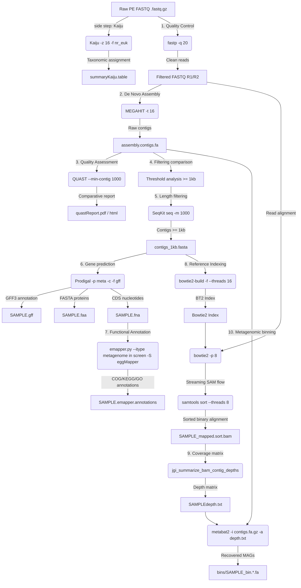

### 🧬 Antarctic Metagenomic Data Processing Log

> 🌐 **Idioma / Language:** [Versión en español](README.md)  
> **Project:** Antarctic Metagenomic Sample Analysis (2019)  
> **Stage 1:** Direct Taxonomic Assignment (`Kaiju`) *[Side Step]*  
> **Stage 2:** Quality Control, Cleaning, and Adapter Trimming (`fastp`)  
> **Stage 3:** *De Novo* Metagenomic Assembly (`MEGAHIT`)  
> **Stage 4:** Assembly Quality Assessment (`QUAST`)  
> **Stage 5:** Direct Filtering Comparative Analysis  
> **Stage 6:** Contig Filtering (`SeqKit`) and Gene Prediction (`Prodigal`)  
> **Stage 7:** Genome-Wide Functional Annotation (`EggNOG-mapper`)  
> **Stage 8:** Reference Index Construction, Read Alignment, and Sorting (`Bowtie2` and `Samtools`)  
> **Stage 9:** Metagenomic Binning and Coverage Matrix (`MetaBAT 2`)  
> **Date Updated:** October 25, 2026  

---

#### 📋 Table of Contents

- [0. Auxiliary Tools for Background Execution and Resource Monitoring (`screen`, `nohup`, and `/usr/bin/time`)](#0-auxiliary-tools-for-background-execution-and-resource-monitoring-screen-nohup-and-usrbintime)
  - [0.1. GNU Screen (`screen`)](#01-gnu-screen-screen)
  - [0.2. The `nohup` Command (*No Hang Up*)](#02-the-nohup-command-no-hang-up)
  - [0.3. Runtime and Resource Monitoring with GNU `time` (`/usr/bin/time`)](#03-runtime-and-resource-monitoring-with-gnu-time-usrbintime)
- [1. Raw Dataset Description](#1-raw-dataset-description)
- [2. Direct Taxonomic Classification from Raw Reads (`Kaiju`) [Side Step]](#2-direct-taxonomic-classification-from-raw-reads-kaiju-side-step)
  - [2.1. Taxonomic Abundance Summary (`kaiju2table`)](#21-taxonomic-abundance-summary-kaiju2table)
  - [2.2. Average Processing Time](#22-average-processing-time)
- [3. Quality Control and Preprocessing (`fastp`)](#3-quality-control-and-preprocessing-fastp)
  - [3.1. General HTML Report Interpretation Guide](#31-general-html-report-interpretation-guide)
  - [3.2. Average Processing Time](#32-average-processing-time)
- [4. *De Novo* Metagenomic Assembly (`MEGAHIT`)](#4-de-novo-metagenomic-assembly-megahit)
  - [4.1. Average Processing Time](#41-average-processing-time)
  - [4.2. Raw *De Novo* Assembly Statistics with MEGAHIT (Contigs ≥ 200 bp)](#42-raw-de-novo-assembly-statistics-with-megahit-contigs--200-bp)
- [5. Assembly Quality Assessment (`QUAST`)](#5-assembly-quality-assessment-quast)
  - [5.1. Real QUAST Report Metrics (Contigs ≥ 1000 bp)](#51-real-quast-report-metrics-contigs--1000-bp)
  - [5.2. Bioinformatic Statistics Glossary](#52-bioinformatic-statistics-glossary)
  - [5.3. Average Processing Time (`QUAST`)](#53-average-processing-time-quast)
- [6. Direct Filtering Comparative Analysis](#6-direct-filtering-comparative-analysis)
- [7. Contig Filtering (`SeqKit`) and Gene Prediction (`Prodigal`)](#7-contig-filtering-seqkit-and-gene-prediction-prodigal)
  - [7.1. Average Processing Time (`SeqKit` + `Prodigal`)](#71-average-processing-time-seqkit--prodigal)
- [8. Genome-Wide Functional Annotation (`EggNOG-mapper`)](#8-genome-wide-functional-annotation-eggnog-mapper)
  - [8.1. Processing Times (EggNOG-mapper)](#81-processing-times-eggnog-mapper)
- [9. Reference Index Construction, Read Alignment, and Sorting (`Bowtie2` and `Samtools`)](#9-reference-index-construction-read-alignment-and-sorting-bowtie2-and-samtools)
  - [9.1. Executed Commands and Parameter Breakdown](#91-executed-commands-and-parameter-breakdown)
  - [9.2. Processing Times (Index Building + Alignment)](#92-processing-times-index-building--alignment)
- [10. Metagenomic Binning and Coverage Matrix (`MetaBAT 2`)](#10-metagenomic-binning-and-coverage-matrix-metabat-2)
  - [10.1. Metagenomic Binning Results (Bins Formed)](#101-metagenomic-binning-results-bins-formed)
  - [10.2. Processing Times (Depth Matrix + Binning)](#102-processing-times-depth-matrix--binning)
- [11. Integrated Pipeline Flowchart](#11-integrated-pipeline-flowchart)
- [12. References](#12-references)

---

***ALL COMMANDS USED IN THIS LOG ASSUME EXECUTION FROM A ROOT WORKING DIRECTORY CONTAINING OUTPUT SUBDIRECTORIES AND FROM WHICH ALL TOOLS ARE INVOKED***

### 0. 🛠️ Auxiliary Tools for Background Execution and Resource Monitoring (`screen`, `nohup`, and `/usr/bin/time`)

In high-performance computing (HPC) or remote SSH server environments, long-running bioinformatic tasks require persistence and auditing mechanisms to reliably record execution runtimes without network interruptions.

#### 0.1. GNU Screen (`screen`)

`screen` is a terminal multiplexer that creates independent terminal sessions detached from the active shell.

###### Key Parameters Used for Screen:
* **`screen -S <session_name>`**: Creates a new terminal session with a custom identifier (e.g., `screen -S megahit_run`).
* **`screen -ls`**: Lists all active server sessions alongside their status (`Attached` or `Detached`).
* **`screen -r <name_or_id>`**: Reattaches a background session to the foreground.
* **`screen -d <name_or_id>`**: Detaches an active session remotely.

###### Important Keyboard Shortcuts (Inside a Session):
* **`Ctrl + A` followed by `D`**: Detaches the current session and returns to the main shell while commands remain running in the background.
* **`Ctrl + A` followed by `K`**: Kills the current session.
* **`exit`**: Gracefully terminates the session after completing tasks.

#### 0.2. The `nohup` Command (*No Hang Up*)

The `nohup` command (short for *No Hang Up*) is a UNIX/Linux utility designed to ignore the `SIGHUP` (*Signal Hang Up*) signal. This signal is automatically transmitted by the operating system to all child processes whenever the originating terminal window or SSH session is closed or disconnected. For each stage of the workflow, `nohup` was combined with a Bash subshell (`bash -c`), timestamp logging, I/O stream redirection, and the background operator (`&`).

#### 0.3. Runtime and Resource Monitoring with GNU `time` (`/usr/bin/time`)

To accurately audit the real elapsed wall clock time of each bioinformatic command across the pipeline, the GNU `time` system binary (`/usr/bin/time`) is combined with timestamp logging inside a `nohup` wrapper block.

###### Parameters Used for `/usr/bin/time`:
* **`-v`** (`--verbose`): Outputs a detailed performance report with full execution time metrics.
* **`-a`** (`--append`): Appends output to the log file instead of overwriting it.
* **`-o <file>`** (`--output`): Specifies the output file path for saving the timing report.

###### Monitoring Wrapper Block Structure:
```bash
nohup bash -c '
echo "Muestra: NOMBRE_MUESTRA" > directorioOut/reports/reporte_tiempo.txt
echo "Hora de inicio: $(date)" >> directorioOut/reports/reporte_tiempo.txt

/usr/bin/time -v -a -o directorioOut/reports/reporte_tiempo.txt \
  COMANDO_BIOINFORMÁTICO \
  > directorioOut/reports/salida_comando.log 2>&1

echo "Hora de finalización: $(date)" >> directorioOut/reports/reporte_tiempo.txt
' &

```

##### Interpretation of Metrics Delivered by the Runtime Report (`/usr/bin/time -v`)

The detailed output generated by `/usr/bin/time -v` in log files (`reporte_tiempo.txt`) provides the following system resource consumption and performance metrics:

* **Command being timed:** The exact command line and arguments executed during monitoring.
* **User time (seconds):** Total CPU time spent by the process in user mode (direct numerical computation by the application).
* **System time (seconds):** CPU time spent by the operating system kernel on behalf of the process (file I/O calls, memory allocation, etc.).
* **Percent of CPU this job got:** Percentage of CPU capacity allocated during execution (calculated as `(User + System) / Elapsed`). A value exceeding 100% indicates active multithreaded acceleration (e.g., 1400% corresponds to 14 parallel CPU cores).
* **Elapsed (wall clock) time:** Total wall-clock time elapsed from task initialization to completion (`h:mm:ss` or `m:ss`).
* **Maximum resident set size (kbytes):** Peak physical RAM consumed by the application throughout its lifecycle (*maximum resident set size / RSS*).
* **Major (requiring I/O) page faults:** Number of major page faults requiring direct disk reads to load data into physical memory.
* **Minor (reclaiming a frame) page faults:** Number of minor page faults resolved directly in RAM without physical storage access.
* **Voluntary / Involuntary context switches:** Context switches initiated voluntarily (waiting for I/O operations) and involuntarily (CPU preemptions by the system scheduler).
* **File system inputs / outputs:** Total file read and write operations performed on the server storage filesystem.
* **Exit status:** Application exit status code. A value of `0` confirms successful completion without runtime errors or crashes.

---

### 1. 📂 Raw Dataset Description

The input dataset consists of 5 pairs of compressed FASTQ files (`.fastq.gz`) obtained through paired-end (PE) sequencing of Antarctic environmental metagenomes (2019).

```text
metagenomas_antarida_2019/
├── C4_230_347_S89_L002_R1_001.fastq.gz   (17,020,773 KB ~ 17.02 GB)
├── C4_230_347_S89_L002_R2_001.fastq.gz   (17,922,220 KB ~ 17.92 GB)
├── D_242_335_S88_L002_R1_001.fastq.gz    ( 3,663,943 KB ~  3.66 GB)
├── D_242_335_S88_L002_R2_001.fastq.gz    ( 3,842,488 KB ~  3.84 GB)
├── E4_254_323_S87_L002_R1_001.fastq.gz   ( 7,921,805 KB ~  7.92 GB)
├── E4_254_323_S87_L002_R2_001.fastq.gz   ( 8,249,762 KB ~  8.25 GB)
├── EC_266_311_S86_L002_R1_001.fastq.gz  ( 7,876,211 KB ~  7.88 GB)
├── EC_266_311_S86_L002_R2_001.fastq.gz  ( 8,246,128 KB ~  8.25 GB)
├── H_278_299_S85_L002_R1_001.fastq.gz   ( 6,824,312 KB ~  6.82 GB)
└── H_278_299_S85_L002_R2_001.fastq.gz   ( 7,149,960 KB ~  7.15 GB)
```

* **Total Raw Data Volume:** **88,717,602 KB (~88.72 GB)**.

---

### 2. 🔀 Direct Taxonomic Classification from Raw Reads (`Kaiju`) [Side Step]

As a complementary and assembly-independent analysis, direct taxonomic classification of raw reads was performed using **Kaiju 1.10.1**. By translating DNA sequences across all 6 reading frames and aligning them against a protein reference database (`nr_euk` 2023-05-10), Kaiju identifies microbial community members.

The command executed for sample processing (**Note:** illustrated using one sample name, but all samples were processed identically):

```bash
nohup bash -c '
echo "Muestra: D_242" > ./kaijuOut/reports/D_242_reporte_kaiju.txt
echo "Hora de inicio: $(date)" >> ./kaijuOut/reports/D_242_reporte_kaiju.txt

/usr/bin/time -v -a -o ./kaijuOut/reports/D_242_reporte_kaiju.txt \
  ./kaiju/bin/kaiju \
  -t /media/hdd1/kaijudb/nodes.dmp \
  -f /media/hdd1/kaijudb/kaiju_db_nr_euk.fmi \
  -i ./metagenomas_antarida_2019/D_242_335_S88_L002_R1_001.fastq.gz \
  -j ./metagenomas_antarida_2019/D_242_335_S88_L002_R2_001.fastq.gz \
  -o ./kaijuOut/D_242-kaiju.out \
  -z 16 \
  > ./kaijuOut/reports/D_242_kaiju_run.log 2>&1

echo "Hora de finalización: $(date)" >> ./kaijuOut/reports/D_242_reporte_kaiju.txt
' &

```

##### Parameter Breakdown

| Parameter | Long Option | Bioinformatic Rationale |
| :--- | :--- | :--- |
| `-t` | `--taxonomy` | Path to the NCBI taxonomy nodes file (`nodes.dmp`). |
| `-f` | `--fmi` | Path to the FM-Index of the protein reference database (`kaiju_db_nr_euk.fmi`). |
| `-i` | `--in1` | Path to input FASTQ file for **Read 1 / Forward (R1)**. |
| `-j` | `--in2` | Path to input FASTQ file for **Read 2 / Reverse (R2)**. |
| `-o` | `--output` | Output file path containing per-read classifications (`.out`). |
| `-z 16` | `--threads` | Allocates **16 CPU threads** for accelerated multithreaded alignment. |

##### General Paired-End Sample Mapping

| Sample ID | Input Read 1 (-i) | Input Read 2 (-j) | Output File (-o) | Timing Report |
| :---: | :--- | :--- | :--- | :--- |
| **`C4_230`** | `C4_230_..._R1_001.fastq.gz` | `C4_230_..._R2_001.fastq.gz` | `./taxMetagenomes/C4_230-kaiju.out` | `C4_230_reporte_kaiju.txt` |
| **`D_242`** | `D_242_..._R1_001.fastq.gz` | `D_242_..._R2_001.fastq.gz` | `./taxMetagenomes/D_242-kaiju.out` | `D_242_reporte_kaiju.txt` |
| **`E4_254`** | `E4_254_..._R1_001.fastq.gz` | `E4_254_..._R2_001.fastq.gz` | `./taxMetagenomes/E4_254-kaiju.out` | `E4_254_reporte_kaiju.txt` |
| **`EC_266`** | `EC_266_..._R1_001.fastq.gz` | `EC_266_..._R2_001.fastq.gz` | `./taxMetagenomes/EC_266-kaiju.out` | `EC_266_reporte_kaiju.txt` |
| **`H_278`** | `H_278_..._R1_001.fastq.gz` | `H_278_..._R2_001.fastq.gz` | `./taxMetagenomes/H_278-kaiju.out` | `H_278_reporte_kaiju.txt` |

#### 2.1. Taxonomic Abundance Summary (`kaiju2table`)

To visualize all taxonomic assignments across samples, `kaiju2table` was executed to generate a summary matrix consolidating matches across all samples:

```bash
nohup bash -c '
./kaiju/bin/kaiju2table \
  -t /media/hdd1/kaijudb/nodes.dmp \
  -n /media/hdd1/kaijudb/names.dmp \
  -o ./kaijuOut/summaryKaiju.table \
  -r genus \
  -l superkingdom,phylum,class,order,family,genus \
  ./kaijuOut/*.out
' &

```

##### Parameter Breakdown

| Parameter | Long Option | Bioinformatic Rationale |
| :--- | :--- | :--- |
| `-t` | `--taxonomy` | Path to the NCBI taxonomy nodes file (`nodes.dmp`). |
| `-n` | `--names` | Path to the NCBI taxonomy names file (`names.dmp`). |
| `-o` | `--output` | Output file name for the summary abundance matrix (`summaryKaiju.table`). |
| `-r genus` | `--rank` | Target taxonomic rank at which read counts are aggregated (**Genus**). |
| `-l ...` | `--levels` | Comma-separated list of taxonomic ranks for output columns. |
| `*.out` | — | Input classification files generated by Kaiju for each sample. |

##### Output Files Obtained After Kaiju and `kaiju2table`

```text
kaijuOut/
├── C4_230-kaiju.out  │
├── D_242-kaiju.out   │
├── E4_254-kaiju.out  ├── summaryKaiju.table
├── EC_266-kaiju.out  │
└── H_278-kaiju.out   │
```

#### 2.2. Average Processing Time

* **Per Sample:**
  * **`D_242` (7.51 GB):** 3h 56m
  * **`H_278` (13.97 GB):** 7h 20m
  * **`EC_266` (16.12 GB):** 8h 27m
  * **`E4_254` (16.17 GB):** 8h 29m
  * **`C4_230` (34.94 GB):** 18h 19m
* **Full Batch (88.72 GB):** **46h 32m** total.

---

### 3. ⚙️ Quality Control and Preprocessing (`fastp`)

**`fastp 1.3.6`** was used for quality control, adapter trimming, and Phred quality filtering in a single pass over raw reads.

```bash
nohup bash -c '
echo "Muestra: C4_230" > ./fastpOut/reports/C4_230_reporte_fastp.txt
echo "Hora de inicio: $(date)" >> ./fastpOut/reports/C4_230_reporte_fastp.txt

/usr/bin/time -v -a -o ./fastpOut/reports/C4_230_reporte_fastp.txt \
  ./fastp \
  -i ./metagenomas_antarida_2019/C4_230_347_S89_L002_R1_001.fastq.gz \
  -I ./metagenomas_antarida_2019/C4_230_347_S89_L002_R2_001.fastq.gz \
  -o ./fastpOut/C4_230_R1.fastq.gz \
  -O ./fastpOut/C4_230_R2.fastq.gz \
  -q 20 \
  -j ./fastpOut/C4_230.json \
  -h ./fastpOut/C4_230.html \
  > ./fastpOut/reports/C4_230_fastp.log 2>&1

echo "Hora de finalización: $(date)" >> ./fastpOut/reports/C4_230_reporte_fastp.txt
' &

```

##### Parameter Breakdown

| Parameter | Long Option | Bioinformatic Rationale |
| :--- | :--- | :--- |
| `-i` / `-I` | `--in1` / `--in2` | Paired-end compressed input FASTQ files (`.fastq.gz`). |
| `-o` / `-O` | `--out1` / `--out2` | Cleaned paired-end output FASTQ files (`.fastq.gz`). |
| `-q 20` | `--qualified_quality_phred` | Minimum Phred quality score for qualified base (**Q20 = 99% accuracy**). |
| `-j` / `-h` | `--json` / `--html` | Output paths for quantitative metrics (JSON) and interactive charts (HTML). |

##### General Paired-End Sample Mapping

| Sample ID | Input R1 (-i) | Input R2 (-I) | Output R1 (-o) | Output R2 (-O) | JSON Report (-j) | HTML Report (-h) |
| :---: | :--- | :--- | :--- | :--- | :--- | :--- |
| **`C4_230`** | `C4_230_..._R1_001.fastq.gz` | `C4_230_..._R2_001.fastq.gz` | `C4_230_R1.fastq.gz` | `C4_230_R2.fastq.gz` | `C4_230.json` | `C4_230.html` |
| **`D_242`** | `D_242_..._R1_001.fastq.gz` | `D_242_..._R2_001.fastq.gz` | `D_242_R1.fastq.gz` | `D_242_R2.fastq.gz` | `D_242.json` | `D_242.html` |
| **`E4_254`** | `E4_254_..._R1_001.fastq.gz` | `E4_254_..._R2_001.fastq.gz` | `E4_254_R1.fastq.gz` | `E4_254_R2.fastq.gz` | `E4_254.json` | `E4_254.html` |
| **`EC_266`** | `EC_266_..._R1_001.fastq.gz` | `EC_266_..._R2_001.fastq.gz` | `EC_266_R1.fastq.gz` | `EC_266_R2.fastq.gz` | `EC_266.json` | `EC_266.html` |
| **`H_278`** | `H_278_..._R1_001.fastq.gz` | `H_278_..._R2_001.fastq.gz` | `H_278_R1.fastq.gz` | `H_278_R2.fastq.gz` | `H_278.json` | `H_278.html` |

##### Output Files Obtained After `fastp`

```text
fastpOut/
├── <Sample>_R1.fastq.gz   ├── <Sample>.json   ├── <Sample>.html
├── <Sample>_R2.fastq.gz
├── <Sample>_reporte_fastp.txt
└── ...
```

#### 3.1. General HTML Report Interpretation Guide

<details>
<summary><b>🔍 Click to expand the interpretation guide</b></summary>

This guide details the key metrics produced by `fastp`:

##### 3.1.1. Summary
* **Total reads:** Total sequenced fragments. Comparing before and after filtering evaluates read retention.
* **Total bases:** Raw nucleotide volume ($A, T, C, G$).
* **GC content (%GC):** Proportion of Guanine and Cytosine.
* **Duplication rate:** Percentage of identical reads.

##### 3.1.2. Filtering Result
* **Passed filter:** Reads passing quality thresholds.
* **Low quality reads:** Reads discarded due to low Phred scores.
* **Too many N reads:** Reads discarded due to excess uncalled bases ($N$).
* **Too short reads:** Reads failing length thresholds after adapter/quality trimming.
* **Adapter trimming:** Removal of synthetic adapter sequences.

##### 3.1.3. Phred Quality Scores
Phred scores ($Q$) measure error probability ($P$):
$$Q = -10 \log_{10}(P)$$

| Score | Base Accuracy | Error Probability |
| :---: | :---: | :---: |
| **Q20** | **99%** | 1 in 100 bases |
| **Q30** | **99.9%** | 1 in 1,000 bases |

##### 3.1.4. Insert Size
* **Insert size peak:** Estimated physical DNA fragment length between adapters.

##### 3.1.5. Quality Control Charts
* **Quality curves:** Mean Phred score per cycle.
* **Base content:** Proportion of $A, T, C, G$ per cycle.
</details>

#### 3.2. Average Processing Time

* **Per Sample:**
  * **`D_242` (7.51 GB):** 07m 41s
  * **`H_278` (13.97 GB):** 14m 15s
  * **`EC_266` (16.12 GB):** 16m 07s
  * **`E4_254` (16.17 GB):** 16m 29s
  * **`C4_230` (34.94 GB):** 35m 30s
* **Full Batch (88.72 GB):** **1h 30m 02s** total.

---

### 4. 🧩 *De Novo* Metagenomic Assembly (`MEGAHIT`)

*De novo* contig assembly using **`MEGAHIT v1.2.9`**, a memory-efficient metagenomic assembler using succinct de Bruijn graphs (SDBG).

```bash
nohup bash -c '
echo "Muestra: H_278" > ./megahitOut/reports/H_278_reporte_megahit.txt
echo "Hora de inicio: $(date)" >> ./megahitOut/reports/H_278_reporte_megahit.txt

/usr/bin/time -v -a -o ./megahitOut/reports/H_278_reporte_megahit.txt \
  ./MEGAHIT-1.2.9-Linux-x86_64-static/bin/megahit \
  -1 ./fastqOut/H_278_R1.fastq.gz \
  -2 ./fastqOut/H_278_R2.fastq.gz \
  -o ./megahitOut/H_278 \
  -t 16 \
  > ./megahitOut/reports/H_278_salida_megahit.log 2>&1

echo "Hora de finalización: $(date)" >> ./megahitOut/reports/H_278_reporte_megahit.txt
' &

```

##### Parameter Breakdown

| Parameter | Value | Bioinformatic Rationale |
| :--- | :--- | :--- |
| `-1` / `-2` | FastQ Files (R1 / R2) | Cleaned paired-end reads. |
| `-o` | `./megahitOut/<sample>/` | Output directory path. |
| `-t` | 16 | Allocates 16 CPU threads for parallel processing. |

##### General Batch Sample Mapping for MEGAHIT

| Sample | Input Read 1 (-1) | Input Read 2 (-2) | Output Directory (-o) | Timing Report |
| :---: | :--- | :--- | :--- | :--- |
| **`C4_230`** | `../fastq/C4_230_R1.fastq.gz` | `../fastq/C4_230_R2.fastq.gz` | `./megahitOut/C4_230/` | `reporte_megahit.txt` |
| **`D_242`** | `../fastq/D_242_R1.fastq.gz` | `../fastq/D_242_R2.fastq.gz` | `./megahitOut/D_242/` | `reporte_megahit.txt` |
| **`E4_254`** | `../fastq/E4_254_R1.fastq.gz` | `../fastq/E4_254_R2.fastq.gz` | `./megahitOut/E4_254/` | `reporte_megahit.txt` |
| **`EC_266`** | `../fastq/EC_266_R1.fastq.gz` | `../fastq/EC_266_R2.fastq.gz` | `./megahitOut/EC_266/` | `reporte_megahit.txt` |
| **`H_278`** | `../fastq/H_278_R1.fastq.gz` | `../fastq/H_278_R2.fastq.gz` | `./megahitOut/H_278/` | `reporte_megahit.txt` |

##### Output Structure and MEGAHIT Results

```text
megahitOut/H_278/
├── assembly_H_278.contigs.fa.gz  <-- 🌟 MAIN FILE: Final assembled contigs (FASTA)
├── reporte_megahit.txt        <-- Timing report (/usr/bin/time -v)
├── checkpoints.txt
├── options.json        <-- Parameter configuration list
├── log        <-- Assembly process log
└── intermediate_contigs/     <-- Intermediate contigs (k21 to k119)
```

#### 4.1. Average Processing Time

* **Per Sample:**
  * **`D_242` (7.51 GB):** 7h 10m 31s
  * **`H_278` (13.97 GB):** 14h 10m 36s
  * **`EC_266` (16.12 GB):** 9h 01m 37s
  * **`E4_254` (16.17 GB):** 18h 22m 14s
  * **`C4_230` (34.94 GB):** 23h 08m 43s
* **Full Batch (88.72 GB):** **71h 53m 41s** total.

#### 4.2. Raw *De Novo* Assembly Statistics with MEGAHIT (Contigs ≥ 200 bp)

Values extracted from execution logs produced by MEGAHIT:

| Sample | Total Contigs (≥ 200 bp) | Total Length (bp) | N50 (bp) | Largest Contig (bp) | Mean Length (bp) |
| :---: | :---: | :---: | :---: | :---: | :---: |
| **`C4_230`** | 4,350,356 | 3,483,909,817 | 1,023 | 421,916 | 800 |
| **`D_242`** | 1,317,483 | 1,158,328,128 | 1,214 | 226,212 | 879 |
| **`E4_254`** | 3,572,499 | 2,475,797,541 | 787 | 434,884 | 693 |
| **`EC_266`** | 1,533,500 | 1,118,929,119 | 902 | 225,584 | 729 |
| **`H_278`** | 2,494,409 | 2,168,322,057 | 1,146 | 451,911 | 869 |

---

### 5. 📊 Assembly Quality Assessment (`QUAST`)

Quality assessment with **`QUAST 5.3.0`** using `--min-contig 1000` and 16 threads (`-t 16`).

```bash
nohup bash -c '
echo "Evaluación comparativa QUAST" > ./quastOut/reports/reporte_quast.txt
echo "Hora de inicio: $(date)" >> ./quastOut/reports/reporte_quast.txt

/usr/bin/time -v -a -o ./quastOut/reports/reporte_quast.txt \
  ./quast/quast.py \
  ./megahitOut/C4_230/assembly_C4_230.contigs.fa \
  ./megahitOut/D_242/assembly_D_242.contigs.fa \
  ./megahitOut/E4_254/assembly_E4_254.contigs.fa \
  ./megahitOut/EC_266/assembly_EC_266.contigs.fa \
  ./megahitOut/H_278/assembly_H_278.contigs.fa \
  -o ./quastOut/ \
  -t 16 \
  --min-contig 1000 \
  --labels C4_230,D_242,E4_254,EC_266,H_278 \
  > ./quastOut/reports/quast_execution.log 2>&1

echo "Hora de finalización: $(date)" >> ./quastOut/reports/reporte_quast.txt
' &

```

##### Parameter Breakdown
* **`--min-contig 1000`**: Filters contigs < 1,000 bp.
* **`--labels`**: Custom labels for comparative reports.

##### QUAST Output Structure and Results

```text
quastOut/
├── report.html            <-- Interactive visual report
├── report.txt / .tsv      <-- Summary tables
├── reporte_quast.txt      <-- Timing report (/usr/bin/time -v)
└── basic_stats/           <-- N50, GC, and length distribution plots
```

#### 5.1. Real QUAST Report Metrics (Contigs ≥ 1000 bp)

Values extracted directly from `quastReport.pdf`:

| Metric | `C4_230` | `D_242` | `E4_254` | `EC_266` | `H_278` |
| :--- | :---: | :---: | :---: | :---: | :---: |
| **# contigs (≥ 0 bp)** | 4,350,356 | 1,317,483 | 3,572,499 | 1,533,500 | 2,494,409 |
| **# contigs (≥ 1,000 bp)** | **672,142** | **233,420** | **438,529** | **215,581** | **418,430** |
| **# contigs (≥ 50,000 bp)** | **1,124** | **407** | **396** | **75** | **879** |
| **Largest contig (bp)** | 421,916 | 226,212 | 434,884 | 225,584 | **451,911** |
| **Total length (≥ 1,000 bp)** | **1,766,567,241** | **641,681,108** | **1,030,586,967** | **523,112,992** | **1,167,876,196** |
| **N50 (bp)** | 3,108 | 3,376 | 2,580 | 2,758 | **3,509** |
| **L50** | 110,935 | 37,595 | 86,456 | 42,986 | **62,948** |
| **auN** | 11,468.8 | 11,444.2 | 8,246.1 | 6,547.7 | **15,148.1** |
| **GC (%)** | 50.31 | 59.72 | 51.70 | 49.72 | 56.41 |
| **# N's per 100 kbp** | **0.00** | **0.00** | **0.00** | **0.00** | **0.00** |

#### 5.2. Bioinformatic Statistics Glossary

##### Contig Count and Size Distribution
* **# contigs ($\ge 0	ext{ bp}$):** Absolute total number of assembled DNA contigs without minimum size thresholding.
* **# contigs ($\ge 1{,}000	ext{ bp}$):** Contigs with length $\ge 1,000	ext{ bp}$, discarding noise and short fragments.
* **# contigs ($\ge 50{,}000	ext{ bp}$):** Large contigs ($\ge 50	ext{ kb}$) indicating long-range continuity.
* **Largest contig (bp):** Length of the single longest contig.
* **Total length ($\ge 1{,}000	ext{ bp}$):** Cumulative nucleotide sum of contigs $\ge 1,000	ext{ bp}$.

##### Continuity Metrics
* **N50 (bp):** Contig length $k$ such that sum of contigs $\ge k$ covers at least 50% of the total assembly length.
* **L50:** Minimum number of contigs required to reach N50 length.
* **auN (Area under $N$-Curve):** Weighted average of $N_x$ across the full range ($x = 0\%$ to $100\%$).

##### Composition and Sequence Quality
* **GC (%):** Molar percentage of Guanine and Cytosine.
* **# N's per $100	ext{ kbp}$:** Average ambiguous bases ($N$) per $100	ext{ kb}$.

#### 5.3. Average Processing Time (`QUAST`)

* **Full Batch (5 samples):** **~15 to 25 minutes** total using 16 threads.

---

### 6. 🔄 Direct Filtering Comparative Analysis

| Sample ID | Source / Filter | Total Contigs | Total Length (bp) | N50 (bp) | Largest Contig (bp) | Secondary Metric |
| :---: | :--- | :---: | :---: | :---: | :---: | :---: |
| **`C4_230`** | **MEGAHIT** (≥ 200 bp)<br>**QUAST** (≥ 1,000 bp) | 4,350,356<br>**672,142** | 3,483,909,817 (~3.48 Gb)<br>**1,766,567,241 (~1.77 Gb)** | 1,023 bp<br>**3,108 bp** | 421,916 bp<br>**421,916 bp** | 800 bp (Mean)<br>**11,468.8 (auN)** |
| **`D_242`** | **MEGAHIT** (≥ 200 bp)<br>**QUAST** (≥ 1,000 bp) | 1,317,483<br>**233,420** | 1,158,328,128 (~1.16 Gb)<br>**641,681,108 (~0.64 Gb)** | 1,214 bp<br>**3,376 bp** | 226,212 bp<br>**226,212 bp** | 879 bp (Mean)<br>**11,444.2 (auN)** |
| **`E4_254`** | **MEGAHIT** (≥ 200 bp)<br>**QUAST** (≥ 1,000 bp) | 3,572,499<br>**438,529** | 2,475,797,541 (~2.48 Gb)<br>**1,030,586,967 (~1.03 Gb)** | 787 bp<br>**2,580 bp** | 434,884 bp<br>**434,884 bp** | 693 bp (Mean)<br>**8,246.1 (auN)** |
| **`EC_266`** | **MEGAHIT** (≥ 200 bp)<br>**QUAST** (≥ 1,000 bp) | 1,533,500<br>**215,581** | 1,118,929,119 (~1.12 Gb)<br>**523,112,992 (~0.52 Gb)** | 902 bp<br>**2,758 bp** | 225,584 bp<br>**225,584 bp** | 729 bp (Mean)<br>**6,547.7 (auN)** |
| **`H_278`** | **MEGAHIT** (≥ 200 bp)<br>**QUAST** (≥ 1,000 bp) | 2,494,409<br>**418,430** | 2,168,322,057 (~2.17 Gb)<br>**1,167,876,196 (~1.17 Gb)** | 1,146 bp<br>**3,509 bp** | 451,911 bp<br>**451,911 bp** | 869 bp (Mean)<br>**15,148.1 (auN)** |

Key observations from comparing pre-filtered and filtered statistics:
* Filtering removes **85.09% of total contigs** (reducing from 13.27M to 1.98M contigs), eliminating noisy short fragments (200-999 bp).
* Retains **49.30% of total nucleotide mass** (~5.13 Gb out of ~10.41 Gb assembled).
* N50 increases **more than 3-fold (x3.04)** across all samples after filtering.
* **`H_278`** maintains highest continuity with an N50 of **3,509 bp**, auN of **15,148.1**, and the longest contig at **451,911 bp (~452 kb)**.

---

### 7. 🧬 Contig Filtering (`SeqKit`) and Gene Prediction (`Prodigal`)

Contigs are filtered to **≥ 1,000 bp (1 kb)** using **`SeqKit 2.14.0`** and processed with **`Prodigal v2.6.3`** in metagenomic mode (`-p meta`) for protein-coding gene prediction.

```bash
#Recorte de secuencias con SeqKit
nohup bash -c '
echo "Muestra: EC_266" > ./seqkitOut/reports/EC_266_reporte_tiempo.txt
echo "Hora de inicio: $(date)" >> ./seqkitOut/reports/EC_266_reporte_tiempo.txt

/usr/bin/time -v -a -o ./seqkitOut/reports/EC_266_reporte_tiempo.txt \
  seqkit seq -m 1000 ./megahitOut/EC_266/assembly_EC_266.contigs.fa \
  > ./seqkitOut/EC_266contigs_1kb.fasta 2> ./seqkitOut/reports/EC_266_salida_comando.log

echo "Hora de finalización: $(date)" >> ./seqkitOut/reports/EC_266_reporte_tiempo.txt
' &

```

```bash
#Predicción de genes con Prodigal
nohup bash -c '
echo "Muestra: EC_266 (Prodigal)" > ./prodigalOut/prodEC_266/EC_266_reporte_prodigal.txt
echo "Hora de inicio: $(date)" >> ./prodigalOut/prodEC_266/EC_266_reporte_prodigal.txt

/usr/bin/time -v -a -o ./prodigalOut/prodEC_266/EC_266_reporte_prodigal.txt \
  prodigal \
  -i ./seqkitOut/EC_266contigs_1kb.fasta \
  -a ./prodigalOut/prodEC_266/EC_266.faa \
  -d ./prodigalOut/prodEC_266/EC_266.fna \
  -o ./prodigalOut/prodEC_266/EC_266.gff \
  -f gff \
  -c \
  -p meta \
  > ./prodigalOut/prodEC_266/EC_266prodigal_execution.log 2>&1

echo "Hora de finalización: $(date)" >> ./prodigalOut/prodEC_266/EC_266_reporte_prodigal.txt
' &

```

##### Parameter Breakdown for Prodigal

| Parameter | Long Option | Bioinformatic Rationale |
| :--- | :--- | :--- |
| `-i` | `--input` | Input FASTA file containing filtered contigs. |
| `-a` | `--amo` | Output FASTA file for **amino acid / protein translations** (`.faa`). |
| `-d` | `--nucleotide` | Output FASTA file for **CDS nucleotide sequences** (`.fna`). |
| `-o` | `--output` | Output annotation file in **GFF3** format (`.gff`). |
| `-f gff` | `--format gff` | Specifies standard **GFF3** output format. |
| `-c` | `--closed_ends` | Forces prediction of **complete genes** only (no truncated genes). |
| `-p meta` | `--procedure meta` | **Metagenomic mode** using pre-trained models. |

##### General Batch Mapping and Output Structure

| Sample ID | Input Contigs (-i) | GFF3 Annotation (-o) | Protein FASTA (-a) | CDS Nucleotides (-d) | Timing Report |
| :---: | :--- | :--- | :--- | :--- | :--- |
| **`C4_230`** | `C4_230contigs_1kb.fasta` | `./prodC4_230/C4_230.gff` | `./prodC4_230/C4_230.faa` | `./prodC4_230/C4_230.fna` | `C4_230_reporte_seqkit_prodigal.txt` |
| **`D_242`** | `D_242contigs_1kb.fasta` | `./prodD_242/D_242.gff` | `./prodD_242/D_242.faa` | `./prodD_242/D_242.fna` | `D_242_reporte_seqkit_prodigal.txt` |
| **`E4_254`** | `E4_254contigs_1kb.fasta` | `./prodE4_254/E4_254.gff` | `./prodE4_254/E4_254.faa` | `./prodE4_254/E4_254.fna` | `E4_254_reporte_seqkit_prodigal.txt` |
| **`EC_266`** | `EC_266contigs_1kb.fasta` | `./prodEC_266/EC_266.gff` | `./prodEC_266/EC_266.faa` | `./prodEC_266/EC_266.fna` | `EC_266_reporte_seqkit_prodigal.txt` |
| **`H_278`** | `H_278contigs_1kb.fasta` | `./prodH_278/H_278.gff` | `./prodH_278/H_278.faa` | `./prodH_278/H_278.fna` | `H_278_reporte_seqkit_prodigal.txt` |

```text
prodEC_266/
├── EC_266.gff                          <-- Structural annotation in GFF3 format
├── EC_266.faa                          <-- Amino acid sequences (proteins in FASTA format)
├── EC_266.fna                          <-- Coding nucleotide sequences (CDS in FASTA format)
└── EC_266_reporte_seqkit_prodigal.txt  <-- Timing report (/usr/bin/time -v)
```

#### 7.1. Average Processing Time (`SeqKit` + `Prodigal`)

| Sample ID | Filtering Time (`SeqKit`) | Gene Prediction Time (`Prodigal`) | Cumulative Stage Total |
| :---: | :---: | :---: | :---: |
| **`D_242`** | 1.28s | 30m 37s | **30m 38s** |
| **`H_278`** | 2.39s | 56m 57s | **57m 00s** |
| **`EC_266`** | 2.75s | 1h 05m 43s | **1h 05m 45s** |
| **`E4_254`** | 2.76s | 1h 05m 55s | **1h 05m 58s** |
| **`C4_230`** | 5.97s | 2h 22m 26s | **2h 22m 32s** |

* **Full Batch (88.72 GB):** **6h 01m 53s** total.

---

### 8. 🔬 Genome-Wide Functional Annotation (`EggNOG-mapper`)

Massive orthology-based functional annotation using **`EggNOG-mapper`** (`emapper.py`) inside a dedicated **GNU Screen** session (`screen -S eggMapper`).

```bash
# Create and enter the dedicated Screen session
screen -S eggMapper
cd  eggnog-mapper/

# Functional annotation execution with time tracking from the eggmapper installation directory

echo "Muestra: C4_230" > ../eggnogOut/reports/C4_230_reporte_eggnog.txt
echo "Hora de inicio: $(date)" >> ../eggnogOut/reports/C4_230_reporte_eggnog.txt

/usr/bin/time -v -a -o ../eggnogOut/reports/C4_230_reporte_eggnog.txt \
  emapper.py \
  -i ../eggnogOut/prodC4_230/C4_230.fna \
  --itype metagenome \
  -o C4_230 \
  --output_dir ../eggnogOut/eggYESprodC4_230 \
  --data_dir /media/hdd2/eggnog_data_v7 \
  --cpu 16 \
  > ../eggnogOut/reports/C4_230_eggnog_execution.log 2>&1

echo "Hora de finalización: $(date)" >> ../eggnogOut/reports/C4_230_reporte_eggnog.txt

# Detach from Screen session (keeps process running in background): Ctrl + A then D

```

##### Parameter Breakdown for EggNOG-mapper:

| Parameter | Bioinformatic Rationale |
| :--- | :--- |
| `screen -S` | Creates dedicated background session `eggMapper`. |
| `-i` | Input coding nucleotide sequences from Prodigal (`C4_230.fna`). |
| `--itype metagenome` | Specifies input data type as metagenomic (`metagenome`). |
| `-o` | Output file prefix for sample outputs. |
| `--output_dir` | Destination directory for EggNOG annotation output files. |
| `--data_dir` | Local path to EggNOG reference database (v7 / `eggnog_data_v7`). |
| `--cpu 16` | Allocates **16 CPU threads**. |

##### General Batch Mapping for EggNOG-mapper

| Sample | Input CDS (-i) | Output Prefix (-o) | Output Directory (--output_dir) | Timing Report |
| :---: | :--- | :--- | :--- | :--- |
| **`C4_230`** | `prodC4_230/C4_230.fna` | `C4_230` | `eggYESprodC4_230` | `C4_230_reporte_eggnog.txt` |
| **`D_242`** | `prodD_242/D_242.fna` | `D_242` | `eggYESprodD_242` | `D_242_reporte_eggnog.txt` |
| **`E4_254`** | `prodE4_254/E4_254.fna` | `E4_254` | `eggYESprodE4_254` | `E4_254_reporte_eggnog.txt` |
| **`EC_266`** | `prodEC_266/EC_266.fna` | `EC_266` | `eggYESprodEC_266` | `EC_266_reporte_eggnog.txt` |
| **`H_278`** | `prodH_278/H_278.fna` | `H_278` | `eggYESprodH_278` | `H_278_reporte_eggnog.txt` |

##### EggNOG Output Structure and Results

```text
eggYESprodH_278/
├── H_278.emapper.annotations      <-- 🌟 MAIN TABLE: Complete functional annotations (COG, KEGG, GO, EC, CAZy)
├── H_278.emapper.seed_orthologs   <-- Initial top ortholog hits and BitScore / E-value metrics
├── H_278.emapper.hits             <-- Raw protein search alignments (DIAMOND/MMseqs2)
└── H_278_reporte_eggnog.txt       <-- Timing report (/usr/bin/time -v)
```

#### 8.1. Processing Times (EggNOG-mapper)

* **Per Sample:**
  * **`D_242` (7.51 GB):** 09h 06m 37s
  * **`H_278` (13.97 GB):** 16h 56m 49s
  * **`EC_266` (16.12 GB):** 19h 33m 18s
  * **`E4_254` (16.17 GB):** 19h 36m 57s
  * **`C4_230` (34.94 GB):** 42h 23m 08s
* **Full Batch (88.72 GB):** **107h 36m 51s** total.

---

### 9. 🎯 Reference Index Construction, Read Alignment, and Sorting (`Bowtie2` and `Samtools`)

Assembled contigs ($\ge 1,000	ext{ bp}$) were indexed using **`Bowtie2`** (`bowtie2-build`). Cleaned reads were aligned against the index and piped to **`Samtools`** (`samtools sort`) to generate coordinate-sorted BAM files (`.sort.bam`) without writing intermediate SAM files to disk.

#### 9.1. Executed Commands and Parameter Breakdown

```bash
# Reference index construction (bowtie2-build)
nohup bash -c '
echo "Muestra: C4_230" > bowtieOut/C4_230Index/reports/C4_230_reporte_bowtiebuild.txt
echo "Hora de inicio: $(date)" >> bowtieOut/C4_230Index/reports/C4_230_reporte_bowtiebuild.txt

/usr/bin/time -v -a -o bowtieOut/C4_230Index/reports/C4_230_reporte_bowtiebuild.txt \
  bowtie2-build \
  -f \
  --verbose \
  --threads 16 \
  eggnogOut/C4_230contigs_1kb.fasta \
  bowtieOut/C4_230Index/C4_230 \
  > bowtieOut/C4_230Index/reports/C4_230_bowtiebuild_execution.log 2>&1

echo "Hora de finalización: $(date)" >> bowtieOut/C4_230Index/reports/C4_230_reporte_bowtiebuild.txt
' &

```

```bash
# Read alignment and streaming sort (bowtie2 + samtools sort)
nohup bash -c '
echo "Muestra: C4_230" > bowtieOut/C4_230Index/reports/C4_230_reporte_bowtie_align.txt
echo "Hora de inicio: $(date)" >> bowtieOut/C4_230Index/reports/C4_230_reporte_bowtie_align.txt

/usr/bin/time -v -a -o bowtieOut/C4_230Index/reports/C4_230_reporte_bowtie_align.txt \
  bash -c "bowtie2 -p 8 \
    -x bowtieOut/C4_230Index/C4_230 \
    -1 ./fastpOut/C4_230_R1.fastq.gz \
    -2 ./fastpOut/C4_230_R2.fastq.gz \
    2> bowtieOut/C4_230Index/reports/C4_230_estadisticas_mapeo.log \
    | samtools sort -o bowtieOut/C4_230Index/C4_230_mapped.sort.bam --threads 8 -" \
  > bowtieOut/C4_230Index/reports/C4_230_samtools_execution.log 2>&1

echo "Hora de finalización: $(date)" >> bowtieOut/C4_230Index/reports/C4_230_reporte_bowtie_align.txt
' &

```

##### Combined Parameter Breakdown:

| Parameter | Tool / Option | Bioinformatic Rationale |
| :--- | :--- | :--- |
| `-f` | `bowtie2-build` | Input sequence format as FASTA. |
| `--verbose` | `bowtie2-build` | Verbose logging for index building progress. |
| `--threads 16` | `bowtie2-build` | Allocates **16 CPU threads** for index construction. |
| `-p 8` / `-p 16` | `bowtie2` | CPU thread allocation for multithreaded read alignment. |
| `-x` | `bowtie2` | Path and prefix for reference index. |
| `-1` / `-2` | `bowtie2` | Paired-end input FASTQ files from `fastp`. |
| `2>` | Redirección I/O | Captures mapping rates and concordance metrics. |
| `\|` | Pipe | Streams SAM output directly into `samtools` without writing SAM to disk. |
| `samtools sort` | `samtools` | Sorts alignments by genomic coordinates from standard input (`-`). |
| `--threads 8` | `samtools` | Allocates **8 CPU threads** for alignment sorting. |
| `-o` | `samtools` | Output path for compressed coordinate-sorted binary file (`.sort.bam`). |

##### General Batch Mapping for Indexing and Alignment

| Sample | Reference Contigs (.fasta) | Input Reads (R1/R2) | Output Directory | Index Prefix | Final BAM File |
| :---: | :--- | :--- | :--- | :--- | :--- |
| **`C4_230`** | `C4_230contigs_1kb.fasta` | `./fastpOut/C4_230_R1/R2.fastq.gz` | `./bowtieOut/C4_230Index/` | `C4_230` | `C4_230_mapped.sort.bam` |
| **`D_242`** | `D_242contigs_1kb.fasta` | `./fastpOut/D_242_R1/R2.fastq.gz` | `./bowtieOut/D_242Index/` | `D_242` | `D_242_mapped.sort.bam` |
| **`E4_254`** | `E4_254contigs_1kb.fasta` | `./fastpOut/E4_254_R1/R2.fastq.gz` | `./bowtieOut/E4_254Index/` | `E4_254` | `E4_254_mapped.sort.bam` |
| **`EC_266`** | `EC_266contigs_1kb.fasta` | `./fastpOut/EC_266_R1/R2.fastq.gz` | `./bowtieOut/EC_266Index/` | `EC_266` | `EC_266_mapped.sort.bam` |
| **`H_278`** | `H_278contigs_1kb.fasta` | `./fastpOut/H_278_R1/R2.fastq.gz` | `./bowtieOut/H_278Index/` | `H_278` | `H_278_mapped.sort.bam` |

##### Output Structure and Results

```text
bowtieOut/C4_230Index/
├── C4_230.1.bt2 to .4.bt2             <-- Direct reference index files
├── C4_230.rev.1.bt2 and .rev.2.bt2     <-- Reverse strand index files
├── bowtiebuild.txt                   <-- Index building process log
├── reporte_bowtiebuild.txt           <-- Indexing timing report
├── C4_230_mapped.sort.bam            <-- 🌟 MAIN FILE: Coordinate-sorted binary alignment
├── C4_230_estadisticas_mapeo.log     <-- Mapping rate and concordance summary
└── C4_230_reporte_bowtie_align.txt   <-- Alignment timing report
```

#### 9.2. Processing Times (Index Building + Alignment)

| Sample ID | Input Reference (.fasta) | Index Building Time | Alignment + Sorting Time | Cumulative Stage Total |
| :---: | :--- | :---: | :---: | :---: |
| **`EC_266`** | `EC_266contigs_1kb.fasta` | 10m 08s | 2h 12m 03s | **2h 22m 11s** |
| **`D_242`** | `D_242contigs_1kb.fasta` | 15m 03s | 1h 12m 32s | **1h 27m 35s** |
| **`E4_254`** | `E4_254contigs_1kb.fasta` | 21m 24s | 1h 32m 54s | **1h 54m 18s** |
| **`H_278`** | `H_278contigs_1kb.fasta` | 24m 00s | 2h 12m 04s | **2h 36m 04s** |
| **`C4_230`** | `C4_230contigs_1kb.fasta` | 38m 06s | 9h 08m 09s | **9h 46m 15s** |

* **Full Batch:** **18h 06m** total.

---

### 10. 🦇 Metagenomic Binning and Coverage Matrix (`MetaBAT 2`)

To reconstruct individual genomes of uncultivated microorganisms (MAGs / *Metagenome-Assembled Genomes*), **`MetaBAT 2` (v2.12.1)** was executed to generate preliminary *bins*. First, per-contig coverage depth matrices were calculated using `jgi_summarize_bam_contig_depths` from coordinate-sorted BAM files (`.sort.bam`). Next, `metabat2` grouped contigs ($\ge 2,500	ext{ bp}$) combining coverage depth profiles and tetranucleotide frequency (TNF).

```bash
# Contig depth matrix generation
nohup bash -c '
echo "Muestra: C4_230" > ./metabatOut/C4_230/reports/C4_230_reporte_depth.txt
echo "Hora de inicio: $(date)" >> ./metabatOut/C4_230/reports/C4_230_reporte_depth.txt

/usr/bin/time -v -a -o ./metabatOut/C4_230/reports/C4_230_reporte_depth.txt \
  env OMP_NUM_THREADS=16 jgi_summarize_bam_contig_depths \
  --outputDepth ./metabatOut/C4_230/C4_230depth.txt \
  ./bowtieOut/C4_230Index/C4_230_mapped.sort.bam \
  > ./metabatOut/C4_230/reports/C4_230_jgi_depth_execution.log 2>&1

echo "Hora de finalización: $(date)" >> ./metabatOut/C4_230/reports/C4_230_reporte_depth.txt
' &

```

```bash
# Metagenomic binning with MetaBAT 2
nohup bash -c '
echo "Muestra: C4_230" > ./metabatOut/C4_230/reports/C4_230_reporte_metabat.txt
echo "Hora de inicio: $(date)" >> ./metabatOut/C4_230/reports/C4_230_reporte_metabat.txt

/usr/bin/time -v -a -o ./metabatOut/C4_230/reports/C4_230_reporte_metabat.txt \
  metabat2 \
  -i ./megahitOut/C4_230/assembly_C4_230.contigs.fa.gz \
  -a ./metabatOut/C4_230/C4_230depth.txt \
  -o ./metabatOut/C4_230/bins/C4_230_bin \
  -t 16 \
  > ./metabatOut/C4_230/reports/C4_230_metabat_execution.log 2>&1

echo "Hora de finalización: $(date)" >> ./metabatOut/C4_230/reports/C4_230_reporte_metabat.txt
' &

```

##### Combined Parameter Breakdown:

| Parameter | Tool / Option | Bioinformatic Rationale |
| :--- | :--- | :--- |
| `env OMP_NUM_THREADS=16` | `jgi_summarize...` | Specifies 16 OpenMP parallel threads for BAM depth calculation. |
| `--outputDepth` | `jgi_summarize...` | Structured output depth matrix with mean depth and variance per contig. |
| `-i` | `metabat2` | Input compressed FASTA file containing assembled metagenomic contigs. |
| `-a` | `metabat2` | Per-contig coverage depth matrix generated by `jgi_summarize_bam_contig_depths`. |
| `-o` | `metabat2` | Output directory and prefix for recovered genome FASTA files (`C4_230_bin`). |
| `-t 16` | `metabat2` | Allocates **16 CPU threads** for parallel graph clustering iterations. |

##### General Batch Mapping for MetaBAT 2

| Sample | Input BAM File | Depth Matrix (-a) | Bins Directory (-o) | Timing Report |
| :---: | :--- | :--- | :--- | :--- |
| **`C4_230`** | `./bowtieOut/C4_230Index/C4_230_mapped.sort.bam` | `./metabatOut/C4_230/C4_230depth.txt` | `./metabatOut/C4_230/bins/C4_230_bin` | `C4_230_reporte_metabat.txt` |
| **`D_242`** | `./bowtieOut/D_242Index/D_242_mapped.sort.bam` | `./metabatOut/D_242/D_242depth.txt` | `./metabatOut/D_242/bins/D_242_bin` | `D_242_reporte_metabat.txt` |
| **`E4_254`** | `./bowtieOut/E4_254Index/E4_254_mapped.sort.bam` | `./metabatOut/E4_254/E4_254depth.txt` | `./metabatOut/E4_254/bins/E4_254_bin` | `E4_254_reporte_metabat.txt` |
| **`EC_266`** | `./bowtieOut/EC_266Index/EC_266_mapped.sort.bam` | `./metabatOut/EC_266/EC_266depth.txt` | `./metabatOut/EC_266/bins/EC_266_bin` | `EC_266_reporte_metabat.txt` |
| **`H_278`** | `./bowtieOut/H_278Index/H_278_mapped.sort.bam` | `./metabatOut/H_278/H_278depth.txt` | `./metabatOut/H_278/bins/H_278_bin` | `H_278_reporte_metabat.txt` |

##### Output Structure and Results

```text
metabatOut/C4_230/
├── C4_230depth.txt                    <-- Computed coverage depth matrix
├── C4_230_reporte_depth.txt           <-- Timing report for jgi_summarize_bam_contig_depths
├── C4_230_reporte_metabat.txt         <-- Timing report for metabat2 clustering
└── bins/
    ├── C4_230_bin.1.fa                <-- 🌟 Individual bin FASTA file 1
    ├── C4_230_bin.2.fa                <-- 🌟 Individual bin FASTA file 2
    └── ...                            <-- Remaining bin FASTA files (up to bin 261)
```

#### 10.1. Metagenomic Binning Results (Bins Formed)

Reconstructed binning results obtained by **MetaBAT 2** under a minimum contig length threshold of 2,500 bp (`minContig 2500`):

| Sample ID | Well-Mapped Reads | Mapping Rate (%) | Bins Formed | Total Packaged Size (bp) | Equivalent Size |
| :---: | :---: | :---: | :---: | :---: | :---: |
| **`C4_230`** | 330,057,933 | 71.75% | **261 bins** | 783,194,055 | **~783.19 Mb (~0.78 Gb)** |
| **`E4_254`** | 120,949,874 | 57.49% | **212 bins** | 407,286,077 | **~407.29 Mb (~0.41 Gb)** |
| **`H_278`** | 109,995,103 | 59.76% | **178 bins** | 591,322,729 | **~591.32 Mb (~0.59 Gb)** |
| **`D_242`** | 63,913,026 | 64.66% | **104 bins** | 309,415,306 | **~309.42 Mb (~0.31 Gb)** |
| **`EC_266`** | 153,178,374 | 72.97% | **87 bins** | 229,118,885 | **~229.12 Mb (~0.23 Gb)** |
| **FULL BATCH** | **778,094,310** | **~66.89%** | **842 bins** | **2,320,337,052** | **~2,320.34 Mb (~2.32 Gb)** |

#### 10.2. Processing Times (Depth Matrix + Binning)

Execution runtimes audited via `/usr/bin/time -v` allocating 16 CPU threads:

| Sample ID | Depth Matrix (`jgi_summarize...`) | Binning (`metabat2`) | Cumulative Stage Total |
| :---: | :---: | :---: | :---: |
| **`D_242`** | 1m 52s | 17m 21s | **19m 13s** |
| **`EC_266`** | 3m 48s | 14m 16s | **18m 04s** |
| **`H_278`** | 3m 22s | 34m 54s | **38m 16s** |
| **`E4_254`** | 3m 53s | 31m 43s | **35m 36s** |
| **`C4_230`** | 8m 25s | 1h 00m 54s | **1h 09m 19s** |
| **FULL BATCH** | **21m 20s** | **2h 39m 08s** | **~3h 00m 28s (~3.0 hours)** |

---

### 11. 🔄 Integrated Pipeline Flowchart



---

### 12. 📚 References

* **fastp:** Chen, S. (2025). *fastp 1.0: An ultra-fast all-round tool for FASTQ data quality control and preprocessing*. **iMeta**, 4.5, e70078.
* **MEGAHIT:** Li, D., et al. (2015). *MEGAHIT: An ultra-fast single-node solution for large and complex metagenomics assembly via succinct de Bruijn graph*. **Bioinformatics**, 31(10), 1674–1676.
* **QUAST:** Gurevich, A., et al. (2013). *QUAST: quality assessment tool for genome assemblies*. **Bioinformatics**, 29(8), 1072–1075.
* **Kaiju:** Menzel, P., et al. (2016). *Fast and sensitive taxonomic classification for metagenomics with Kaiju*. **Nature Communications**, 7, 11257.
* **SeqKit:** Shen, W., et al. (2016). *SeqKit: A Cross-Platform and Ultrafast Toolkit for FASTA/Q File Manipulation*. **PLoS ONE**, 11(10), e0163962.
* **Prodigal:** Hyatt, D., et al. (2010). *Prodigal: prokaryotic gene prediction and genome annotation*. **BMC Bioinformatics**, 11, 199.
* **EggNOG-mapper:** Cantalapiedra, C. P., et al. (2021). *eggnog-mapper v2: functional annotation, orthology assignment, and domain prediction at the metagenomic scale*. **Molecular Biology and Evolution**, 38(12), 5825–5829.
* **Bowtie2:** Langmead, B., & Salzberg, S. L. (2012). *Fast gapped-read alignment with Bowtie 2*. **Nature Methods**, 9(4), 357–359.
* **Samtools:** Danecek, P., et al. (2021). *Twelve years of SAMtools and BCFtools*. **GigaScience**, 10(2), giab008.
* **MetaBAT 2:** Kang, D. D., et al. (2019). *MetaBAT 2: an adaptive binning algorithm for robust and efficient genome reconstruction from metagenomic assemblies*. **PeerJ**, 7, e7359.
