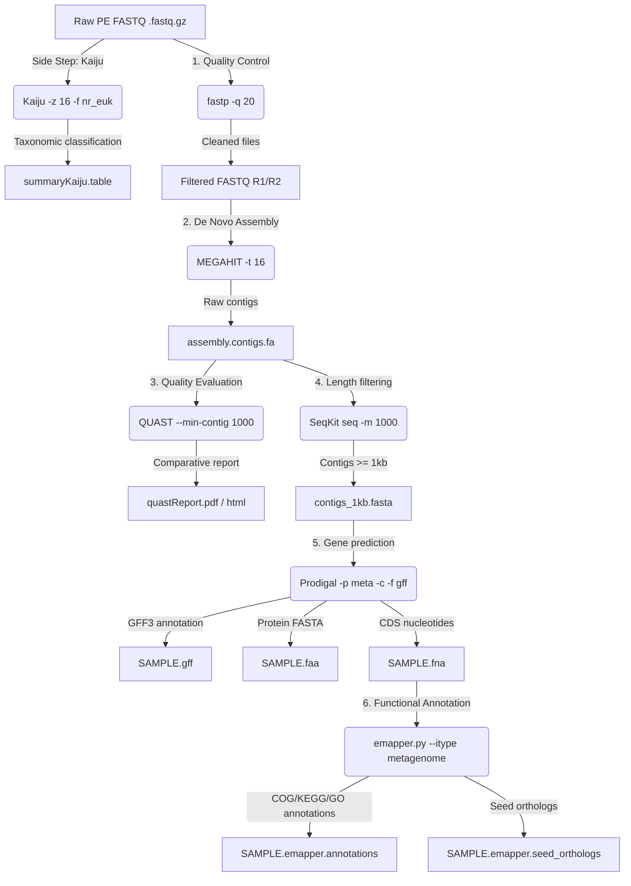

# 🧬 Antarctic Metagenomic Data Processing Log

> **Project:** Metagenomic Analysis of Antarctic Samples (2019)  
> **Stage 1:** Direct Taxonomic Classification (`Kaiju`) *[Side Step]*  
> **Stage 2:** Quality Control, Cleaning, and Adapter Trimming (`fastp`)  
> **Stage 3:** *De Novo* Metagenomic Assembly (`MEGAHIT`)  
> **Stage 4:** Assembly Quality Evaluation (`QUAST`)  
> **Stage 5:** Contig Filtering (`SeqKit`) and Gene Prediction (`Prodigal`)  
> **Stage 6:** Genome-Wide Functional Annotation (`EggNOG-mapper`)  
> **Date Updated:** October 2026  

---

## 📋 Table of Contents

- [0. Auxiliary Tools for Background Processes (`screen` and `nohup`)](#0-auxiliary-tools-for-background-processes-screen-and-nohup)
- [1. Raw Dataset Description](#1-raw-dataset-description)
- [2. Direct Taxonomic Classification from Raw Reads (`Kaiju`) [Side Step]](#2-direct-taxonomic-classification-from-raw-reads-kaiju-side-step)
  - [2.1. Sample Command and Parameter-by-Parameter Rationale](#21-sample-command-and-parameter-by-parameter-rationale)
  - [2.2. General Paired-Sample Mapping](#22-general-paired-sample-mapping)
  - [2.3. Summary of Taxonomic Abundances (`kaiju2table`)](#23-summary-of-taxonomic-abundances-kaiju2table)
  - [2.4. Average Processing Time](#24-average-processing-time)
- [3. Quality Control and Preprocessing (`fastp`)](#3-quality-control-and-preprocessing-fastp)
  - [3.1. Sample Command and Parameter-by-Parameter Rationale](#31-sample-command-and-parameter-by-parameter-rationale)
  - [3.2. General Paired-Sample Mapping](#32-general-paired-sample-mapping)
  - [3.3. Output Files Obtained After `fastp`](#33-output-files-obtained-after-fastp)
  - [3.4. HTML Report Interpretation Guide](#34-html-report-interpretation-guide)
  - [3.5. Average Processing Time](#35-average-processing-time)
- [4. *De Novo* Metagenomic Assembly (`MEGAHIT`)](#4-de-novo-metagenomic-assembly-megahit)
  - [4.1. Executed Command and Parameter Breakdown](#41-executed-command-and-parameter-breakdown)
  - [4.2. General Sample Batch Mapping for MEGAHIT](#42-general-sample-batch-mapping-for-megahit)
  - [4.3. Output Structure and MEGAHIT Results](#43-output-structure-and-megahit-results)
  - [4.4. Average Processing Time](#44-average-processing-time)
- [5. Assembly Quality Evaluation (`QUAST`)](#5-assembly-quality-evaluation-quast)
  - [5.1. Executed Command and Parameter Breakdown](#51-executed-command-and-parameter-breakdown)
  - [5.2. General Sample Batch Mapping for QUAST](#52-general-sample-batch-mapping-for-quast)
  - [5.3. Results Structure and QUAST Output Files](#53-results-structure-and-quast-output-files)
  - [5.4. Actual Results from QUAST Report (Contigs ≥ 1000 bp)](#54-actual-results-from-quast-report-contigs--1000-bp)
  - [5.5. Interpretation Guide for Bioinformatics Metrics](#55-interpretation-guide-for-bioinformatics-metrics)
  - [5.6. Average Processing Time](#56-average-processing-time)
- [6. Contig Filtering (`SeqKit`) and Gene Prediction (`Prodigal`)](#6-contig-filtering-seqkit-and-gene-prediction-prodigal)
  - [6.1. Minimum Length Filtering with `SeqKit`](#61-minimum-length-filtering-with-seqkit)
  - [6.2. CDS and Protein Prediction with `Prodigal`](#62-cds-and-protein-prediction-with-prodigal)
  - [6.3. General Batch Mapping and Output Structure](#63-general-batch-mapping-and-output-structure)
  - [6.4. Average Processing Time](#64-average-processing-time)
- [7. Genome-Wide Functional Annotation (`EggNOG-mapper`)](#7-genome-wide-functional-annotation-eggnog-mapper)
  - [7.1. Executed Command and Parameter Breakdown](#71-executed-command-and-parameter-breakdown)
  - [7.2. General Sample Batch Mapping for EggNOG-mapper](#72-general-sample-batch-mapping-for-eggnog-mapper)
  - [7.3. Results Structure and EggNOG Output Files](#73-results-structure-and-eggnog-output-files)
  - [7.4. Average Processing Time](#74-average-processing-time)
- [8. Batch Automation of the Complete Pipeline (Bash)](#8-batch-automation-of-the-complete-pipeline-bash)
- [9. Integrated Pipeline Flowchart](#9-integrated-pipeline-flowchart)
- [10. References](#10-references)

---

## 0. 🛠️ Auxiliary Tools for Background Processes (`screen` and `nohup`)

In high-performance computing (HPC) environments or remote servers accessed via SSH, long-running bioinformatics workflows (such as assembly or taxonomic classification) require persistence mechanisms to prevent execution failures caused by network drops or terminal closures.

### 0.1. GNU Screen (`screen`)

`screen` is a terminal multiplexer that creates sessions independent of the active shell process.

#### 🛠️ Breakdown of Commands and Main Options:
* **`screen -S <session_name>`**: Creates a new terminal session with a custom identifier (e.g., `screen -S megahit_run`).
* **`screen -ls`**: Lists all active sessions on the server alongside their status (`Attached` or `Detached`).
* **`screen -r <name_or_id>`**: Reattaches to a session running in the background.
* **`screen -d <name_or_id>`**: Detaches an active session remotely from another terminal.

#### ⌨️ Key Keyboard Shortcuts (Inside a Screen Session):
* **`Ctrl + A` followed by `D`**: Detaches the current session and returns to the main shell, leaving commands running in the background.
* **`Ctrl + A` followed by `K`**: Kills the current session.
* **`exit`**: Terminates the session cleanly after completing tasks.

---

### 0.2. The `nohup` Command (*No Hang Up*)

`nohup` redirects the `SIGHUP` signal (sent when an SSH session closes) so that processes continue running on the server.

#### 🛠️ Usage and Parameters:
```bash
nohup <BIOINFORMATICS_COMMAND> > output.log 2>&1 &
```
* **`nohup`**: Prevents process cancellation if the SSH connection is lost.
* **`> output.log 2>&1`**: Redirects standard output (`STDOUT`) and standard error (`STDERR`) to a log file (defaults to `./nohup.out`).
* **`&`**: Sends the command to the background, returning terminal control immediately.

---

## 1. 📂 Raw Dataset Description

The input dataset consists of 5 paired-end (PE) FASTQ file pairs (`.fastq.gz`) obtained from environmental Antarctic metagenomic sequencing (2019).

```text
metagenomas_antarida_2019/
├── C4_230_347_S89_L002_R1_001.fastq.gz   (17,020,773 KB ~ 17.02 GB)
├── C4_230_347_S89_L002_R2_001.fastq.gz   (17,922,220 KB ~ 17.92 GB)
├── D_242_335_S88_L002_R1_001.fastq.gz    ( 3,663,943 KB ~  3.66 GB)
├── D_242_335_S88_L002_R2_001.fastq.gz    ( 3,842,488 KB ~  3.84 GB)
├── E4_254_323_S87_L002_R1_001.fastq.gz   ( 7,921,805 KB ~  7.92 GB)
├── E4_254_323_S87_L002_R2_001.fastq.gz   ( 8,249,762 KB ~  8.25 GB)
├── EC_266_311_S86_L002_R1_001.fastq.gz  ( 7,876,211 KB ~  7.88 GB)
├── EC_266_311_S86_L002_R2_001.fastq.gz  ( 8,246,128 KB ~  8.25 GB)
├── H_278_299_S85_L002_R1_001.fastq.gz   ( 6,824,312 KB ~  6.82 GB)
└── H_278_299_S85_L002_R2_001.fastq.gz   ( 7,149,960 KB ~  7.15 GB)
```
* **Total Raw Volume:** **88,717,602 KB (~88.72 GB)**.

---

## 2. 🔀 Direct Taxonomic Classification from Raw Reads (`Kaiju`) [Side Step]

As a complementary analysis independent of assembly, direct taxonomic classification of the raw reads was performed using **Kaiju**. By translating DNA sequences into all 6 reading frames and aligning them against a reference protein database (`nr_euk`), Kaiju identifies microbial community members (including low-abundance or divergent organisms).

### 2.1. Sample Command and Parameter-by-Parameter Rationale

```bash
./kaiju/bin/kaiju   -t /media/hdd1/kaijudb/nodes.dmp   -f /media/hdd1/kaijudb/kaiju_db_nr_euk.fmi   -i ./metagenomas_antarida_2019/D_242_335_S88_L002_R1_001.fastq.gz   -j ./metagenomas_antarida_2019/D_242_335_S88_L002_R2_001.fastq.gz   -o ./taxMetagenomes/D_242-kaiju.out   -z 16
```

#### 🛠️ Parameter Breakdown:

| Parameter | Long Name | Description / Bioinformatics Rationale |
| :--- | :--- | :--- |
| `-t` | `--taxonomy` | Path to the NCBI taxonomy hierarchical node file (`nodes.dmp`). |
| `-f` | `--fmi` | Path to the reference protein FM-index (`kaiju_db_nr_euk.fmi`). Includes references for bacteria, archaea, viruses, fungi, and microeukaryotes. |
| `-i` | `--in1` | Path to the input FASTQ file for **Read 1 (R1)**. |
| `-j` | `--in2` | Path to the input FASTQ file for **Read 2 (R2)**. |
| `-o` | `--output` | Output classification file per read (`.out`). |
| `-z 16` | `--threads` | Assigns **16 CPU threads** to accelerate multithreaded alignment. |

---

### 2.2. General Paired-Sample Mapping

| Sample ID | Input File R1 (`-i`) | Input File R2 (`-j`) | Output File (`-o`) |
| :---: | :--- | :--- | :--- |
| **C4_230** | `.../C4_230_..._R1_001.fastq.gz` | `.../C4_230_..._R2_001.fastq.gz` | `./taxMetagenomes/C4_230-kaiju.out` |
| **D_242** | `.../D_242_..._R1_001.fastq.gz` | `.../D_242_..._R2_001.fastq.gz` | `./taxMetagenomes/D_242-kaiju.out` |
| **E4_254** | `.../E4_254_..._R1_001.fastq.gz` | `.../E4_254_..._R2_001.fastq.gz` | `./taxMetagenomes/E4_254-kaiju.out` |
| **EC_266** | `.../EC_266_..._R1_001.fastq.gz` | `.../EC_266_..._R2_001.fastq.gz` | `./taxMetagenomes/EC_266-kaiju.out` |
| **H_278** | `.../H_278_..._R1_001.fastq.gz` | `.../H_278_..._R2_001.fastq.gz` | `./taxMetagenomes/H_278-kaiju.out` |

---

### 2.3. Summary of Taxonomic Abundances (`kaiju2table`)

To summarize individual read classifications into a tabulated abundance matrix:

```bash
../kaiju/bin/kaiju2table   -t /media/hdd1/kaijudb/nodes.dmp   -n /media/hdd1/kaijudb/names.dmp   -o summaryKaiju.table   -r genus   -l superkingdom,phylum,class,order,family,genus   *.out
```

* **`-n names.dmp`**: Maps NCBI TaxIDs to scientific names.
* **`-r genus`**: Summarizes counts at the **Genus** rank.
* **`-l ...`**: Exports the full taxonomic hierarchy.
* **`summaryKaiju.table`**: Relative abundance and count matrix ready for downstream analysis in R/Python.

---

### 2.4. Average Processing Time (Kaiju)

* **Throughput per Sample:** ~20 to 60 minutes per sample depending on library size.
* **Estimated Total Time (5-Sample Batch):** **~3.5 to 5.5 hours** with 16 threads against `nr_euk`. `kaiju2table` takes **1 to 2 minutes**.

---

## 3. ⚙️ Quality Control and Preprocessing (`fastp`)

**`fastp`** (v1.0 / v0.23+) was used to perform quality control, adapter removal, and Phred quality filtering in a single pass.

### 3.1. Sample Command and Parameter-by-Parameter Rationale

```bash
../fastp   -i ../metagenomas_antarida_2019/C4_230_347_S89_L002_R1_001.fastq.gz   -I ../metagenomas_antarida_2019/C4_230_347_S89_L002_R2_001.fastq.gz   -o C_230_R1.fastq.gz   -O C_230_R2.fastq.gz   -q 20   -j C_230.json   -h C_230.html
```

#### 🛠️ Parameter Breakdown:

| Parameter | Long Name | Description / Bioinformatics Rationale |
| :--- | :--- | :--- |
| `-i` / `-I` | `--in1` / `--in2` | Compressed paired-end input FASTQ files (`.fastq.gz`). |
| `-o` / `-O` | `--out1` / `--out2` | Cleaned compressed output FASTQ files (`.fastq.gz`). |
| `-q 20` | `--qualified_quality_phred` | Minimum Phred quality for a qualified base (**Q20 = 99% accuracy**). |
| `-j` / `-h` | `--json` / `--html` | Quantitative metric reports (JSON) and interactive charts (HTML). |

---

### 3.2. General Paired-Sample Mapping

| Sample ID | Input R1 (`-i`) | Input R2 (`-I`) | Output R1 (`-o`) | Output R2 (`-O`) | JSON Report (`-j`) | HTML Report (`-h`) |
| :---: | :--- | :--- | :--- | :--- | :---: | :---: |
| **C4_230** | `.../C4_230_..._R1_001.fastq.gz` | `.../C4_230_..._R2_001.fastq.gz` | `C_230_R1.fastq.gz` | `C_230_R2.fastq.gz` | `C_230.json` | `C_230.html` |
| **D_242** | `.../D_242_..._R1_001.fastq.gz` | `.../D_242_..._R2_001.fastq.gz` | `D_242_R1.fastq.gz` | `D_242_R2.fastq.gz` | `D_242.json` | `D_242.html` |
| **E4_254** | `.../E4_254_..._R1_001.fastq.gz` | `.../E4_254_..._R2_001.fastq.gz` | `E4_254_R1.fastq.gz` | `E4_254_R2.fastq.gz` | `E4_254.json` | `E4_254.html` |
| **EC_266** | `.../EC_266_..._R1_001.fastq.gz` | `.../EC_266_..._R2_001.fastq.gz` | `EC_266_R1.fastq.gz` | `EC_266_R2.fastq.gz` | `EC_266.json` | `EC_266.html` |
| **H_278** | `.../H_278_..._R1_001.fastq.gz` | `.../H_278_..._R2_001.fastq.gz` | `H_278_R1.fastq.gz` | `H_278_R2.fastq.gz` | `H_278.json` | `H_278.html` |

---

### 3.3. Output Files Obtained After `fastp`

```text
clean_fastq/
├── C_230_R1.fastq.gz   ├── C_230.json   ├── C_230.html
├── C_230_R2.fastq.gz
├── D_242_R1.fastq.gz   ├── D_242.json   ├── D_242.html
├── D_242_R2.fastq.gz
├── E4_254_R1.fastq.gz  ├── E4_254.json  ├── E4_254.html
├── E4_254_R2.fastq.gz
├── EC_266_R1.fastq.gz  ├── EC_266.json  ├── EC_266.html
├── EC_266_R2.fastq.gz
├── H_278_R1.fastq.gz   ├── H_278.json   ├── H_278.html
└── H_278_R2.fastq.gz
```

---

### 3.4. HTML Report Interpretation Guide

<details>
<summary><b>🔍 Click to expand quality control report details</b></summary>

1. **Summary:** Total reads, Q20/Q30 percentages, and GC content before and after filtering.
2. **Quality Curves:** Per-cycle Phred quality curves for R1 and R2.
3. **Base Contents:** A, T, C, and G base proportions per position to detect sequence bias.
4. **Adapter Contents:** Percentage of identified and trimmed adapter sequences.
5. **Duplication Rate:** PCR duplication rate evaluation.

</details>

---

### 3.5. Average Processing Time (fastp)

* **Empirical Calibration:** Validated with a control sample of ~3.06 GB processed in 3 min 11 s (~1.04 min/GB compressed or ~0.96 GB/min).
* **Adjusted Per-Sample Throughput:**
  * **`D_242` (7.51 GB):** ~7.8 min (~8 min)
  * **`H_278` (13.97 GB):** ~14.5 min (~14–15 min)
  * **`EC_266` (16.12 GB):** ~16.8 min (~17 min)
  * **`E4_254` (16.17 GB):** ~16.8 min (~17 min)
  * **`C4_230` (34.94 GB):** ~36.4 min (~36–37 min)
* **Complete Batch (88.72 GB):** **~92.4 minutes (~1.5 hours)** in total.

---

## 4. 🧩 *De Novo* Metagenomic Assembly (`MEGAHIT`)

Genomic contig reconstruction using **MEGAHIT** (v1.2.9) based on succinct de Bruijn graphs (SDBG).

### 4.1. Executed Command and Parameter Breakdown

```bash
../MEGAHIT-1.2.9-Linux-x86_64-static/bin/megahit   -1 ../fastq/H_278_R1.fastq.gz   -2 ../fastq/H_278_R2.fastq.gz   -o ./H_278/   -t 16
```

#### 🛠️ Parameter Breakdown:
* **`-1` / `-2`**: Cleaned paired-end read inputs.
* **`-o ./H_278/`**: Sample-specific output directory.
* **`-t 16`**: Assigned 16 CPU threads.

---

### 4.2. General Sample Batch Mapping for MEGAHIT

| Sample | Input Read 1 (`-1`) | Input Read 2 (`-2`) | Output Directory (`-o`) |
| :---: | :--- | :--- | :---: |
| **C4_230** | `../fastq/C_230_R1.fastq.gz` | `../fastq/C_230_R2.fastq.gz` | `./MegahitOutputs/C4_230/` |
| **D_242** | `../fastq/D_242_R1.fastq.gz` | `../fastq/D_242_R2.fastq.gz` | `./MegahitOutputs/D_242/` |
| **E4_254** | `../fastq/E4_254_R1.fastq.gz` | `../fastq/E4_254_R2.fastq.gz` | `./MegahitOutputs/E4_254/` |
| **EC_266** | `../fastq/EC_266_R1.fastq.gz` | `../fastq/EC_266_R2.fastq.gz` | `./MegahitOutputs/EC_266/` |
| **H_278** | `../fastq/H_278_R1.fastq.gz` | `../fastq/H_278_R2.fastq.gz` | `./MegahitOutputs/H_278/` |

---

### 4.3. Output Structure and MEGAHIT Results

```text
MegahitOutputs/H_278/
├── assembly_H_278.contigs.fa  <-- 🌟 MAIN FILE: Final assembled contigs (FASTA)
├── checkpoints.txt
├── log
├── options.json
└── intermediate_contigs/     <-- Intermediate contigs (k21 to k119)
```

---

### 4.4. Average Processing Time (MEGAHIT)

* **Per Sample:** From ~6-10 hours (`D_242`) up to **~48 actual measured hours** (`C4_230`).
* **Complete Batch (88.72 GB):** **~105 to 132 hours (~4.3 to 5.5 continuous days)** using 16 CPU threads.

---

## 5. 📊 Assembly Quality Evaluation (`QUAST`)

Evaluation of continuity and fragmentation statistical metrics using **QUAST**.

### 5.1. Executed Command and Parameter Breakdown

```bash
quast.py   ../MegahitOutputs/C4_230/assembly_C4_230.contigs.fa   ../MegahitOutputs/D_242/assembly_D_242.contigs.fa   ../MegahitOutputs/E4_254/assembly_E4_254.contigs.fa   ../MegahitOutputs/EC_266/assembly_EC_266.contigs.fa   ../MegahitOutputs/H_278/assembly_H_278.contigs.fa   -o ./quast_results/   -t 16   --min-contig 1000   --labels C4_230,D_242,E4_254,EC_266,H_278
```

#### 🛠️ Parameter Breakdown:
* **`--min-contig 1000`**: Filters contigs < 1,000 bp for statistical calculations.
* **`--labels`**: Custom labels assigned to each assembly in comparative reports.

---

### 5.2. General Sample Batch Mapping for QUAST

| Sample | Input File (`.fa`) | QUAST Output Directory |
| :---: | :--- | :---: |
| **C4_230** | `../MegahitOutputs/C4_230/assembly_C4_230.contigs.fa` | `./quast_results/` |
| **D_242** | `../MegahitOutputs/D_242/assembly_D_242.contigs.fa` | `./quast_results/` |
| **E4_254** | `../MegahitOutputs/E4_254/assembly_E4_254.contigs.fa` | `./quast_results/` |
| **EC_266** | `../MegahitOutputs/EC_266/assembly_EC_266.contigs.fa` | `./quast_results/` |
| **H_278** | `../MegahitOutputs/H_278/assembly_H_278.contigs.fa` | `./quast_results/` |

---

### 5.3. Results Structure and QUAST Output Files

```text
quast_results/
├── report.html            <-- Interactive visual report
├── report.txt / .tsv      <-- Summary tables
├── icarus.html            <-- Interactive contig viewer
└── basic_stats/           <-- N50, GC, and length distribution histograms
```

---

### 5.4. Actual Results from QUAST Report (Contigs ≥ 1000 bp)

Consolidated values extracted directly from `quastReport.pdf`:

| Bioinformatics Metric | `C4_230` | `D_242` | `E4_254` | `EC_266` | `H_278` |
| :--- | :---: | :---: | :---: | :---: | :---: |
| **# contigs (>= 0 bp)** | 2,752,185 | 393,296 | 1,029,881 | 1,024,561 | 823,283 |
| **# contigs (>= 1000 bp)** | **464,888** | **78,924** | **180,683** | **172,551** | **150,056** |
| **# contigs (>= 50000 bp)** | **1,124** | **44** | **318** | **327** | **364** |
| **Largest contig (bp)** | 358,072 | 196,446 | 280,183 | 316,972 | **451,911** |
| **Total length (>= 1000 bp)** | **1,770,052,994** | **198,397,871** | **527,105,744** | **523,243,306** | **464,159,380** |
| **N50 (bp)** | 2,686 | 2,216 | 2,729 | 2,836 | **3,509** |
| **L50** | 171,960 | 25,662 | 51,916 | 49,977 | **33,962** |
| **auN** | 8,245.9 | 3,923.3 | 7,639.8 | 8,367.6 | **15,148.1** |
| **GC (%)** | 56.40 | 59.72 | 53.07 | 49.72 | 55.45 |
| **# N's per 100 kbp** | **0.00** | **0.00** | **0.00** | **0.00** | **0.00** |

---

### 5.5. Interpretation Guide for Bioinformatics Metrics

<details>
<summary><b>🔍 Click to expand diagnostic interpretation</b></summary>

* **N50 & auN (Continuity):** Sample **`H_278`** exhibits the highest continuity in the study (N50: 3,509 bp; auN: 15,148.1) and the longest contig (~452 kb).
* **Assembly Yield (`C4_230`):** Reconstructed **1.77 Gb** of genomic data in contigs ≥ 1 kb, reflecting the high sequencing depth of this library.
* **Accuracy:** Total absence of Ns (`0.00 N's per 100 kbp`).

</details>

---

### 5.6. Average Processing Time (QUAST)

* **5-Sample Batch:** **~15 to 25 minutes** total using 16 threads.

---

## 6. 🧬 Contig Filtering (`SeqKit`) and Gene Prediction (`Prodigal`)

### 6.1. Minimum Length Filtering with `SeqKit`

Prior to gene prediction and annotation, a minimum length filter of **1,000 bp (1 kb)** is applied to MEGAHIT contigs to retain sequences with sufficient genomic context.

```bash
seqkit seq -m 1000 assembly_EC_266.contigs.fa > EC_266contigs_1kb.fasta
```

#### 🛠️ Parameter Breakdown for SeqKit:
* **`seqkit seq`**: Subcommand for FASTA/Q sequence transformation and manipulation.
* **`-m 1000`** (`--min-len 1000`): Filters and retains only contigs with a length ≥ **1,000 base pairs**.
* **`> EC_266contigs_1kb.fasta`**: Output redirection to the filtered FASTA file.

---

### 6.2. CDS and Protein Prediction with `Prodigal`

To predict coding sequences (CDS) in the filtered contigs, **Prodigal** (*Prokaryotic Dynamic Programming Genefinding Algorithm*) was run in metagenomic mode.

```bash
prodigal   -i EC_266contigs_1kb.fasta   -a ./prodEC_266/EC_266.faa   -d ./prodEC_266/EC_266.fna   -o ./prodEC_266/EC_266.gff   -f gff   -c   -p meta
```

#### 🛠️ Parameter Breakdown for Prodigal:

| Parameter | Long Name | Description / Bioinformatics Rationale |
| :--- | :--- | :--- |
| `-i` | `--input` | Input FASTA file containing filtered contigs (`EC_266contigs_1kb.fasta`). |
| `-a` | `--amino` | Output FASTA file with **translated amino acid / protein sequences** (`EC_266.faa`). |
| `-d` | `--nucleotide` | Output FASTA file with **CDS nucleotide sequences** (`EC_266.fna`). |
| `-o` | `--output` | Structured output file containing gene coordinates and annotations (`EC_266.gff`). |
| `-f gff` | `--format gff` | Specifies the standard **GFF3** format (*General Feature Format*). |
| `-c` | `--closed_ends` | Forces prediction of **complete genes only** (prevents truncated genes at contig edges). |
| `-p meta` | `--procedure meta` | **Metagenomic mode**. Uses pre-trained models for unisolated organisms in microbial communities with variable GC content. |

---

### 6.3. General Batch Mapping and Output Structure

| Sample | Input Contigs (`-i`) | GFF3 Annotation (`-o`) | Protein FASTA (`-a`) | CDS Nucleotides (`-d`) |
| :---: | :--- | :--- | :--- | :--- |
| **C4_230** | `C4_230contigs_1kb.fasta` | `./prodC4_230/C4_230.gff` | `./prodC4_230/C4_230.faa` | `./prodC4_230/C4_230.fna` |
| **D_242** | `D_242contigs_1kb.fasta` | `./prodD_242/D_242.gff` | `./prodD_242/D_242.faa` | `./prodD_242/D_242.fna` |
| **E4_254** | `E4_254contigs_1kb.fasta` | `./prodE4_254/E4_254.gff` | `./prodE4_254/E4_254.faa` | `./prodE4_254/E4_254.fna` |
| **EC_266** | `EC_266contigs_1kb.fasta` | `./prodEC_266/EC_266.gff` | `./prodEC_266/EC_266.faa` | `./prodEC_266/EC_266.fna` |
| **H_278** | `H_278contigs_1kb.fasta` | `./prodH_278/H_278.gff` | `./prodH_278/H_278.faa` | `./prodH_278/H_278.fna` |

```text
prodEC_266/
├── EC_266.gff       <-- Structural annotation in GFF3 format
├── EC_266.faa       <-- Amino acid sequences (proteins in FASTA format)
└── EC_266.fna       <-- Coding nucleotide sequences (CDS in FASTA format)
```

---

### 6.4. Average Processing Time (SeqKit + Prodigal)

* **`SeqKit seq -m 1000`**: **~5 to 15 seconds** per FASTA sample.
* **`Prodigal -p meta`**: **~1 to 3 minutes** per sample.
* **Total Batch Time (5 Samples):** **~8 to 15 minutes**.

---

## 7. 🔬 Genome-Wide Functional Annotation (`EggNOG-mapper`)

Following the prediction of CDS nucleotide sequences (`.fna`) with Prodigal, **orthology-based functional annotation** was conducted using **EggNOG-mapper** (`emapper.py`). This tool transfers gene names, COG categories, Gene Ontology (GO) terms, KEGG metabolic pathways, CAZy enzyme families, and InterProScan domains via fast searches against the EggNOG database.

### 7.1. Executed Command and Parameter Breakdown

```bash
emapper.py   -i ../croppedSamplesEggNog/prodC4_230/C4_230.fna   --itype metagenome   -o C4_230   --output_dir ../croppedSamplesEggNog/eggYESprodC4_230   --data_dir /media/hdd2/eggnog_data_v7   --cpu 16
```

#### 🛠️ Parameter Breakdown for EggNOG-mapper:

| Parameter | Long Name | Description / Bioinformatics Rationale |
| :--- | :--- | :--- |
| `-i` | `--input` | Input file with predicted CDS nucleotide sequences from Prodigal (`C4_230.fna`). |
| `--itype metagenome` | `--input_type` | Specifies that the input data type corresponds to metagenomic nucleotide sequences (`metagenome`). |
| `-o` | `--output` | Output prefix for sample file naming (`C4_230`). |
| `--output_dir` | `--output_dir` | Destination directory for EggNOG annotation output files. |
| `--data_dir` | `--data_dir` | Path to the local EggNOG reference database directory (version 7 / `eggnog_data_v7`). |
| `--cpu 16` | `--cpu` | Number of parallel processing threads assigned (**16 CPU threads**). |

---

### 7.2. General Sample Batch Mapping for EggNOG-mapper

| Sample | Input CDS (`-i`) | Output Prefix (`-o`) | Output Directory (`--output_dir`) |
| :---: | :--- | :---: | :--- |
| **C4_230** | `.../prodC4_230/C4_230.fna` | `C4_230` | `.../eggYESprodC4_230` |
| **D_242** | `.../prodD_242/D_242.fna` | `D_242` | `.../eggYESprodD_242` |
| **E4_254** | `.../prodE4_254/E4_254.fna` | `E4_254` | `.../eggYESprodE4_254` |
| **EC_266** | `.../prodEC_266/EC_266.fna` | `EC_266` | `.../eggYESprodEC_266` |
| **H_278** | `.../prodH_278/H_278.fna` | `H_278` | `.../eggYESprodH_278` |

---

### 7.3. Results Structure and EggNOG Output Files

Inside each output directory (e.g., `eggYESprodH_278/`), EggNOG-mapper generates the following suite of results:

```text
eggYESprodH_278/
├── H_278.emapper.annotations      <-- 🌟 MAIN TABLE: Complete functional annotations (COG, KEGG, GO, EC, CAZy)
├── H_278.emapper.seed_orthologs   <-- Best initial seed ortholog alignments with BitScore / E-value
├── H_278.emapper.hits             <-- Raw protein search alignments (DIAMOND/MMseqs2)
├── H_278.emapper.genepred.fasta   <-- Predicted gene sequences from internal emapper workflow
└── H_278.emapper.genepred.gff     <-- Internal prediction GFF3 coordinates
```

#### 📄 Key File Description (`*.emapper.annotations`):
A tab-separated table (TSV) containing essential columns for metagenomic analysis:
1. **query**: Prodigal predicted gene/sequence ID.
2. **seed_ortholog**: Reference protein/ortholog with the top alignment.
3. **evalue & score**: Statistical significance metrics of the alignment.
4. **eggNOG_OGs**: Assigned Orthologous Groups (OGs) across taxonomic levels.
5. **max_annot_lvl**: Most specific taxonomic level of the assignment.
6. **COG_category**: Functional category of Cluster of Orthologous Groups (e.g., *Carbohydrate metabolism*, *DNA repair*).
7. **Description**: Textual description of the predicted protein function.
8. **Preferred_name**: Common gene symbol or name (e.g., *recA*, *dnaK*).
9. **GOs**: Gene Ontology terms (biological process, molecular function, cellular component).
10. **EC & KEGG_ko**: Enzyme Commission numbers (EC) and KEGG Orthology terms (KOs) for pathway reconstruction.

---

### 7.4. Average Processing Time (EggNOG-mapper)

* **Throughput per Sample:** ~15 to 45 minutes per sample based on CDS count in `.fna`.
* **Estimated Total Time (5-Sample Batch):** **~1.5 to 3.5 hours** using 16 threads with database `v7`.

---

## 8. 🤖 Batch Automation of the Complete Pipeline (Bash)

```bash
#!/usr/bin/env bash
# Complete Metagenomic Pipeline: fastp -> MEGAHIT -> QUAST -> SeqKit -> Prodigal -> EggNOG-mapper

THREADS=16
RAW_DIR="../metagenomas_antarida_2019"
CLEAN_DIR="./clean_fastq"
ASSEMBLY_DIR="./MegahitOutputs"
QUAST_DIR="./quast_results"
PROD_DIR="./prodigal_outputs"
EGGNOG_DIR="../croppedSamplesEggNog"
EGGNOG_DB="/media/hdd2/eggnog_data_v7"

mkdir -p "$CLEAN_DIR" "$ASSEMBLY_DIR" "$QUAST_DIR" "$PROD_DIR" "$EGGNOG_DIR"

for R1 in "${RAW_DIR}"/*_R1_001.fastq.gz; do
    R2="${R1/_R1_001.fastq.gz/_R2_001.fastq.gz}"
    SAMPLE=$(basename "$R1" | cut -d'_' -f1,2)

    echo "=== 1. QC with fastp: ${SAMPLE} ==="
    ../fastp -i "$R1" -I "$R2"       -o "${CLEAN_DIR}/${SAMPLE}_R1.fastq.gz"       -O "${CLEAN_DIR}/${SAMPLE}_R2.fastq.gz"       -q 20 -j "${CLEAN_DIR}/${SAMPLE}.json" -h "${CLEAN_DIR}/${SAMPLE}.html" -w 4

    echo "=== 2. Assembly with MEGAHIT: ${SAMPLE} ==="
    ../MEGAHIT-1.2.9-Linux-x86_64-static/bin/megahit       -1 "${CLEAN_DIR}/${SAMPLE}_R1.fastq.gz"       -2 "${CLEAN_DIR}/${SAMPLE}_R2.fastq.gz"       -o "${ASSEMBLY_DIR}/${SAMPLE}" -t "$THREADS"

    CONTIG_RAW="${ASSEMBLY_DIR}/${SAMPLE}/assembly_${SAMPLE}.contigs.fa"
    CONTIG_1KB="${ASSEMBLY_DIR}/${SAMPLE}/${SAMPLE}_contigs_1kb.fasta"

    echo "=== 3. Filtering >=1kb with SeqKit: ${SAMPLE} ==="
    seqkit seq -m 1000 "$CONTIG_RAW" > "$CONTIG_1KB"

    echo "=== 4. Gene Prediction with Prodigal: ${SAMPLE} ==="
    SAMPLE_PROD_DIR="${PROD_DIR}/prod_${SAMPLE}"
    mkdir -p "$SAMPLE_PROD_DIR"

    prodigal -i "$CONTIG_1KB"       -a "${SAMPLE_PROD_DIR}/${SAMPLE}.faa"       -d "${SAMPLE_PROD_DIR}/${SAMPLE}.fna"       -o "${SAMPLE_PROD_DIR}/${SAMPLE}.gff"       -f gff -c -p meta

    echo "=== 5. Functional Annotation with EggNOG-mapper: ${SAMPLE} ==="
    SAMPLE_EGG_DIR="${EGGNOG_DIR}/eggYESprod_${SAMPLE}"
    mkdir -p "$SAMPLE_EGG_DIR"

    emapper.py -i "${SAMPLE_PROD_DIR}/${SAMPLE}.fna"       --itype metagenome       -o "${SAMPLE}"       --output_dir "$SAMPLE_EGG_DIR"       --data_dir "$EGGNOG_DB"       --cpu "$THREADS"

    CONTIG_FILES+=("$CONTIG_RAW")
    LABELS+=("$SAMPLE")
done

echo "=== 6. Diagnostic Evaluation with QUAST ==="
JOINED_LABELS=$(IFS=,; echo "${LABELS[*]}")
quast.py "${CONTIG_FILES[@]}" -o "$QUAST_DIR" -t "$THREADS" --min-contig 1000 --labels "$JOINED_LABELS"

echo "🎉 Pipeline completed successfully."
```

---

## 9. 🔄 Integrated Pipeline Flowchart



---

## 10. 📚 References

- **fastp:** Chen, S. (2025). *fastp 1.0: An ultra-fast all-round tool for FASTQ data quality control and preprocessing*. **iMeta**, 4.5, e70078.
- **MEGAHIT:** Li, D., et al. (2015). *MEGAHIT: An ultra-fast single-node solution for large and complex metagenomics assembly via succinct de Bruijn graph*. **Bioinformatics**, 31(10), 1674–1676.
- **QUAST:** Gurevich, A., et al. (2013). *QUAST: quality assessment tool for genome assemblies*. **Bioinformatics**, 29(8), 1072–1075.
- **Kaiju:** Menzel, P., et al. (2016). *Fast and sensitive taxonomic classification for metagenomics with Kaiju*. **Nature Communications**, 7, 11257.
- **SeqKit:** Shen, W., et al. (2016). *SeqKit: A Cross-Platform and Ultrafast Toolkit for FASTA/Q File Manipulation*. **PLoS ONE**, 11(10), e0163962.
- **Prodigal:** Hyatt, D., et al. (2010). *Prodigal: prokaryotic gene prediction and genome annotation*. **BMC Bioinformatics**, 11, 199.
- **EggNOG-mapper:** Cantalapiedra, C. P., et al. (2021). *eggnog-mapper v2: functional annotation, orthology assignment, and domain prediction at the metagenomic scale*. **Molecular Biology and Evolution**, 38(12), 5825–5829.
